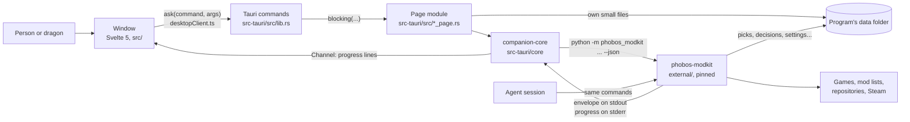

# How D'thorga Companion is built

**Status (23 Nov 2026): describes the code as of 0.69.2, written fresh from it** (the owner's docs rewrite, step 4). The
rules live in [`AGENTS.md`](../AGENTS.md); this page says how the code carries them out. When the two disagree, the rule wins
and this page is wrong: fix it in the change that finds it. Paths are from the repository's root; `path:line` points at the
line as of 0.69.2. **"How each part works" was moved here from the design record on 24 Nov 2026** (step 7), and is as each
piece was built, through 0.78.0.

**In one line:** a Svelte 5 window asks a Rust host; the host checks the request and runs the pinned phobos-modkit as a Python
process; the kit does the work and answers in one JSON shape. The window never decides, and never touches a file.

## Read this first (gotchas)

- **The window only asks.** Every request goes through `ask` (`src/lib/shell/desktopClient.ts:19`), called only from a
  `desktopClient.ts` file. Nothing else imports `@tauri-apps/*`. A check the window makes is for the person's sake; the host
  makes it again.
- **Every Tauri command is one line of delegation** in `src-tauri/src/lib.rs`: 129 of them, each wrapped in `blocking`
  (`lib.rs:54`) so work runs on a worker thread. The logic is in the page's own host module. Two commands
  (`save_picture`, `save_screen_note`) also unpack a raw body and a header there, because Tauri hands them the request.
- **The host runs the kit, never a game's tools by name.** A page finds its tool by the manifest's `surface` (`kit::offered`,
  `src-tauri/core/src/kit.rs:308`), so another game's kit command can serve the same page.
- **Every change is checked against the kit's manifest at the moment of the press**, not when the page loaded:
  `allowed_by_manifest` (`kit.rs:238`) for `writes` and `runs`, `allowed_on_press` (`kit.rs:260`) for `owner-press`,
  `reads_online` (`kit.rs:278`) before a report is passed its online flag. `owner-only` is never run.
- **The kit's exit code does not decide.** A tool may exit 1 with a finding and still print its report. Only a missing or
  unreadable envelope is a failure (`kit.rs:110`). A refusal is `data.ok: false` with `data.refusal` (`Outcome`, `kit.rs:211`).
- **Text from the window is always one argument**: `Args::given` writes `--option=value` (`src-tauri/core/src/args.rs:51`), so
  nothing typed can become an option. Values the host chose use `pair`.
- **Two writers share the program's data folder.** The host writes some files there itself; the kit writes others (picks,
  decisions, central settings, mod-list backups), finding the same folder with its own `paths.companion_data`
  (`external/phobos-modkit/python/phobos_modkit/paths.py:24`). The table under [Where state lives](#where-state-lives) says which.
- **On the owner's PC, the kit and games list come from the repository the program was built from** (`from_build_folder`,
  `src-tauri/core/src/lib.rs:56`): `external/phobos-modkit/python` and `.local/games.json`. An installed copy uses the Python and
  kit the installer brought, and `games.json` in its data folder. `PHOBOS_COMPANION_BUNDLED=1` makes a build behave as installed.
- **The browser tests have no host.** `tests/accessibility/host.ts`'s `mockHost` answers each command by name. A new command
  needs an answer there in every spec that reaches it, or the page shows a failure.
- **The program keeps a few things in memory for one run only**: which files a kit answer named (`viewable::remember`),
  which mods and Workshop items the last Publish reading named, the Explorer's held snapshot. A restart forgets them, on
  purpose: a press may act only on what this run was shown.

## The shape of it

**What each layer may do:**

| Layer | Holds | Never |
| --- | --- | --- |
| Window (`src/`) | What to show, in words from `locales/`, in the theme's colours | Decides what may run; reads a file |
| Tauri commands (`src-tauri/src/lib.rs`) | One line each: unpack, hand to a module on a worker thread | Logic |
| Page modules (`src-tauri/src/*.rs`) | What one page is allowed to ask, and its checks | Code another page also needs |
| `companion-core` (`src-tauri/core`) | Everything shared: games list, kit runner, checks, failures, prefs | Anything Tauri |
| The kit (`external/phobos-modkit`) | The actual work, and the manifest saying what each report does | Knows about the window |

`companion-core` holds no Tauri so a second front end could use it whole (owner, 19 Nov 2026; `docs/history/shared-code-audit.md`).

## Folder map

| Folder or file | What it is |
| --- | --- |
| `src/main.ts`, `src/App.svelte` | Starts the window; the App draws the page list, the page, the trail's dialogs |
| `src/app.css` | The styles every page shares: `h1`, `.lead`, `.how`, `.small`, pressed `.toggle` |
| `src/lib/<page>/` | One folder per page or shared part (38): see [Page anatomy](#page-anatomy) |
| `src/lib/shell/` | Shared window parts: `ask`, `BROWSER`, `Waiting`/`Pending`, `ProgressBar`, `Tabs`, `PageRail`, `dates.ts` |
| `src/lib/navigation/` | `PAGE_NAMES` (`place.ts`); the trail (`go`, `setFocus`, `here`, `openDialog`); `goto.ts` |
| `src/lib/shortcuts/` | Every shortcut (`actions.ts`), and `register` for a view's moves (`registry.ts`) |
| `src/lib/i18n/`, `locales/en-AU.json` | `t()` and every word the window shows (Fluent; about 2,300 keys) |
| `src/lib/theme/`, `themes/*.json` | The program's three themes and the window side of themes |
| `src/lib/guide/`, `guide/*.md` | The Guide: 77 entries (`page-`, `task-`, `term-`), read by `entries.ts` |
| `src/lib/charts/`, `atlas/`, `code/` | The one module each that imports ECharts, three.js and Shiki, on demand (Shiki in a worker, `highlight.worker.ts`, since 0.76.0) |
| `src-tauri/src/lib.rs` | The 129 Tauri commands, `blocking`, `hearing`, `data_folder`, and `run()` (setup, exit) |
| `src-tauri/src/*.rs` | 41 host modules: mostly `<page>_page.rs`, plus shared host parts (`viewable`, `pick`, `pictures`) |
| `src-tauri/src/tests/` | One Rust test file per host module, joined with `#[path = "tests/<module>.rs"]` |
| `src-tauri/core/src/` | `companion-core`'s 13 modules: `kit`, `serve`, `games`, `checks`, `args`, `failure`, `prefs`... |
| `src-tauri/capabilities/` | The window's Tauri permissions: `core:default` only |
| `src-tauri/tauri.conf.json` | Identifier `org.phobosdthorga.companion`, the content security policy |
| `tests/accessibility/` | 34 Playwright specs and `host.ts`, the stand-in host |
| `config/gate.json` | The gate's steps; `scripts/check-all.py` runs them |
| `config/decisions.json` | Questions agent sessions left for the owner |
| `scripts/` | `check-all.py`, `installer.mjs`, `with-target.mjs` (build output to `%LOCALAPPDATA%\phobos-modkit\target`) |
| `external/phobos-modkit` | The pinned kit: never edited here |

Counted on 23 Nov 2026 with tests included: about 470 Rust, TypeScript, Svelte and CSS files and 78,500 lines under `src/`,
`src-tauri/src`, `src-tauri/core/src` and `tests/`.

## Page anatomy

A page is a folder in the window and, usually, one module in the host.

| Part | Where | What it does |
| --- | --- | --- |
| The view | `src/lib/<page>/<Page>Page.svelte` and parts | Shows a reading; calls the client on a press; registers keys |
| The client | `src/lib/<page>/desktopClient.ts` | One function per command: `ask(command, args, ready)` |
| Presentation | `src/lib/<page>/presentation.ts` | Pure functions from a reading to what is shown; tested without a screen |
| Types | `src/lib/<page>/types.ts` | The shapes the host sends |
| The command | `src-tauri/src/lib.rs` | `#[tauri::command] async fn …` → `blocking(move \|\| page::fn(…))` |
| The host module | `src-tauri/src/<page>_page.rs` | Checks names, builds `Args`, checks the manifest, runs the kit |
| Host tests | `src-tauri/src/tests/<page>_page.rs` | Argument building, checks and refusals, with no kit run |
| Browser spec | `tests/accessibility/<page>.spec.ts` | The page drawn with `mockHost`, checked with axe and by keys |

A reading is a small union the view switches on: `{ state: "reading" }` (`Pending`), `"browser"` (`BROWSER`, outside the
desktop program), `"failed"` with the host's `Failure`, or `"ready"`/`"done"` with the answer (`src/lib/shell/types.ts:23`).

Not every page has a `_page.rs`. Home draws on `home.rs`, `pending.rs`, `open_work.rs`, `repo_status.rs`, `nightly.rs`,
`kit_pins.rs`, `safe_copies.rs` and `records_backup.rs`. The Atlas and the report viewer share `reports.rs`. The Guide has no
host part: `entries.ts` bundles `guide/*.md` into the window when it is built (`import.meta.glob`).

### Worked example: pressing Pick on the Picks page

The Picks page shows pictures and sounds the art tools offered; **Pick Try …** keeps the owner's pick.

1. **The press.** The button, or **Ctrl + Enter** (`picks.choose`, `src/lib/shortcuts/actions.ts:356`, registered by the page
   at `src/lib/picks/PicksPage.svelte:113`), calls `keep(pick, words)` (`PicksPage.svelte:82`). It sets `busy`, so a second
   press waits.
2. **The client.** `answerPick` (`src/lib/picks/desktopClient.ts:17`) calls
   `ask("answer_pick", { repository, id, pick, words }, …)`. `ask` (`src/lib/shell/desktopClient.ts:19`) puts the request on the
   activity strip, calls Tauri's `invoke`, and turns a thrown failure into `{ state: "failed", failure }`.
3. **The command.** `answer_pick` (`src-tauri/src/lib.rs:665`) is one line: `blocking(move || picks_page::answer(...))`.
4. **The host's checks** (`src-tauri/src/picks_page.rs:104`), in order:
   - the repository is a plain name (`checks::plain_name`) and on the owner's list, or this program's own repository;
   - the kit's manifest still calls `picks answer` `writes` (`kit::allowed_by_manifest`, `picks_page.rs:113`; the kit declares
     it at `external/phobos-modkit/python/phobos_modkit/picks.py:292`);
   - the pick's id and the try's id have the kit's shape, and the words are under 4,000 characters, made one line
     (`answer_arguments`, `picks_page.rs:63`); each goes as one `--id=…` argument (`Args::given`).
   Any failed check is `Failure::refused`, with the reason in words, and nothing runs.
5. **The kit runs.** `kit::run` (`src-tauri/core/src/kit.rs:112`) starts `python -m phobos_modkit picks answer --root <repo>
   --id=… --pick=… --json` from the kit's folder, with no console, no bytecode and UTF-8 throughout (`kit_command`, `kit.rs:119`).
6. **The write.** The kit's `answer` (`picks.py:177`) appends one JSON line to `picks/<repository>.jsonl` in the program's data
   folder (`picks.py:188`). Nothing in the repository changes: an agent session applies the pick later and settles it.
7. **The answer.** The host checks the envelope is format 1 and from `picks` (`parse_envelope`, `kit.rs:344`), reads `Outcome`
   and returns `PickResult { ok, refusal }`.
8. **The window.** A refusal or failure shows `picks-failed` with the reason. Success shows `picks-done`, reads the list again,
   and opens the next waiting pick.

The same press is tested three ways: `src-tauri/src/tests/picks_page.rs` (ids, words, arguments), `src/lib/picks/
presentation.test.ts` (ordering and stepping), and `tests/accessibility/picks.spec.ts`, where `mockHost` answers `answer_pick`.

## Running the kit

**Every kit call is a process.** About 0.16 s to start on the owner's PC, against 0.2 to 2.7 s for the work itself (measured
9 Nov 2026). There is no long-lived Python except the Explorer's.

| Way | Where | Used for |
| --- | --- | --- |
| `kit::run` | `kit.rs:112` | A quick answer with no progress (the Pick press above) |
| `kit::run_hearing` | `kit.rs:151` | Work that takes time: progress lines go to a listener while it runs |
| `kit::run_with_input` | `kit.rs:158` | A Workshop page's text on standard input, never as an argument (Publish, 0.69.0) |
| `serve::Served` | `src-tauri/core/src/serve.rs:70` | A kit command that stays running, one request a line (the Explorer) |

**Where the kit is** (`kit::locate`, `kit.rs:68`): `PHOBOS_COMPANION_KIT` and `PHOBOS_COMPANION_PYTHON` if set; else the build
repository's `external/phobos-modkit/python` with `python` on the PATH; else the installer's `runtime/kit` and its own
`runtime/python/python.exe`. About shows which (`KitStatus.source`).

**Progress.** The window makes a channel (`progressChannel`, `src/lib/shell/desktopClient.ts:48`) and sends it as `onProgress`.
The command wraps it with `hearing` (`lib.rs:66`). `run_hearing` sets `PHOBOS_MODKIT_PROGRESS=1`, reads standard error line by
line, and passes each line that opens `{"progress":` to the listener as `Progress { label, step, of, detail }`; anything else is
kept for a failure's detail. Standard output is read on its own thread, so neither pipe can stall the other. `ProgressBar.svelte`
draws it: filled when `of` is known, moving when not, always with words. The line format is phobos-modkit `docs/manifest.md`,
Progress.

**The Explorer's long-running kit** (`serve.rs`; `src-tauri/src/explorer_page.rs`):

1. `Served::start` (`serve.rs:96`) runs the game's `look-serve` (found by the `look-inside` surface, `runs`) with its input kept
   open. Its first line says whether it is ready.
2. Each question is one JSON line with an `id`; the line that repeats the `id` is its answer (`Served::ask`, `serve.rs:137`).
   `{"event": "released"}` means the kit let go by itself.
3. One snapshot is held at a time (`HELD`, `explorer_page.rs:248`). It is let go on **Let it go**, on leaving the page, at
   `LIMIT_SECONDS` (600, `explorer_page.rs:32`), and when the program exits (`RunEvent::Exit` in `lib.rs`).
4. Closing ends the whole process tree (`process::end_tree`, `src-tauri/core/src/process.rs:32`, Windows' `taskkill /T`), so a
   helper the kit started never outlives it.

**The one write without a press.** `records_backup::start` (`src-tauri/src/records_backup.rs:122`) starts a thread at setup that
looks every ten minutes; when the kit's `records status --every-hours 6` says a copy is due, it runs `records backup --automatic`,
under the same manifest check as the press.

## Where state lives

**The program's data folder** is Tauri's local app data for `org.phobosdthorga.companion`: on Windows
`%LOCALAPPDATA%\org.phobosdthorga.companion\`. The host finds it with `data_folder` (`lib.rs:109`); the kit with
`paths.companion_data`. Small choice files are written whole, through a `.tmp` file and a rename (`prefs::write_json`,
`src-tauri/core/src/prefs.rs:22`). Answer files are appended, one JSON line each, and the last line for a thing decides.

**One table for every place:** its rows down to `EBWebView/` are inside the data folder; the rows after it are elsewhere.

| File or folder | Written by | When | What guards it |
| --- | --- | --- | --- |
| `test-verdicts/<repo>.jsonl` | Host, `tests_page.rs` | **Pass**/**Fail** on a row | Repo of the game; each field checked |
| `test-key-decisions/<repo>.jsonl` | Host, `tests_page.rs` | "Make a row" / "No row needed" | As verdicts |
| `settings-seen/<repo>.jsonl` | Host, `settings_ledger.rs` | **Looked at** (Mods) | Repo of the game; 1 to 2,000 one-line ids |
| `screen-notes/<id>/` | Host, `screen_notes.rs` | The Something's off key | Written whole: `picture.png`, `note.json` |
| `screen-notes/<id>/resolved.json` | Kit, `screen-notes resolve` | A session deals with it | Not this program; never deleted |
| `shortcuts.json` | Host, `shortcuts.rs` | Save in the shortcuts dialog | Whole and checked; `prefs` |
| `features.json` | Core, `agents.rs` | Settings → Agents | One of the known choices; `prefs` |
| `online.json` | Core, `online.rs` | Settings → Going online | A kind from `KINDS` (`updates` since 0.85.0); `prefs` |
| `publishing.json` | Host, `publish_page.rs` | Settings → Publishing | `prefs` |
| `setup.json` | Host, `setup_page.rs` | Settings → Setup, I don't need it (0.87.0) | Keys of programs the tools list, sorted, each once; `prefs` |
| `chat.json` | Host, `chat_page.rs` | Settings → AI, Chat with an agent | On or off (starts off), an agent from `config/chat-agents.json`, and since 0.84.0 how its commands are handled (`refused`, `ask`, `automatic`; Ask when absent), sorted by `companion_core::commands` from `config/chat-commands.json` and run by `companion_core::terminals`; `prefs` |
| `ai.json` | Core, `ai.rs` | Settings → AI services: a service, a model, a length | A service from `config/ai-services.json`; a model of one line; `prefs` |
| `ai-usage.jsonl` | Core, `ai.rs` | Each answer to **Send** | Appended: time, service, model, tokens; never the text |
| The system's key store | Core, `ai_keys.rs` | **Keep this key**, **Forget this key** | Keys for AI services only, under "D'thorga Companion"; never in a file |
| `themes/<id>.json`, `chosen.json` | Core, `themes.rs` | Keep, Import, Remove, Use | Shape, ≤ 32 KB, contrast on every surface |
| `code-colours/<id>.json`, `chosen.json` | Core, `code_colours.rs` | **Bring in**, **Bring in a VS Code theme file…**, **Use these**, Remove | Read from the file chosen or a theme VS Code lists, and the files it builds on in its own folder, ≤ 512 KB each, at most four; kept as selectors, `#RRGGBB` colours and four style words; checked again when read back (0.77.0) |
| `opened-copies/` | Host, `changed_files.rs` | **Open with its own program** | A media kind the kit named, ≤ 64 MB |
| `report-drafts/report.md` | Host, `report_links.rs` | A report link to our repository | Overwritten each time |
| `games.json` (installed) | Core, `games.rs` | First steps; **Add** a game | Every field checked; `games.json.before-add` kept |
| `picks/<repo>.jsonl` | Kit, `picks answer` | **Pick**, **None of these** | Repo listed; ids; manifest `writes` |
| `decisions/<repo>.jsonl` | Kit, `decisions answer` | **Decide** | Manifest `writes` |
| `settings.json` (central) | Kit, `settings set` | Save, Use the default, a picker | A listed setting; manifest `writes` |
| `mod-list/<game>/` | Kit, `mod-list` | Each Mod list change; saved lists | Backup before each change; manifest `writes` |
| `history/` | The kit's tools as they work | Any tool run | Never written by this program |
| `claims.json` | Kit, `claims` | Agent sessions take or release | This program only reads it |
| `safe-copies/last-run-all.json` | Kit, the daily run | The scheduled task | Owner set the time |
| `EBWebView/` | WebView2 | Always | Its own cache; left out of records copies |
| `.local/games.json` (build) | Core, `games.rs` | First steps; **Add** a game | As installed; never committed |
| `Pictures\D'thorga Companion\` | Host, `pictures.rs` | **Save a picture** | Its own folder; a cleaned name |
| A folder the owner chose | Host or kit | Save dialogs: file, list, theme | Only where the owner chose |
| The records copy folder | Kit, `records backup` | **Back up now**; every 6 h | Manifest `writes`; never deletes a copy |
| Safe copy destinations | Kit, `safe-copies` | **Copy now**, **Restore**, **Let go** | Manifest `writes`; a yes first for two |
| A Windows scheduled task | Kit, `safe-copies schedule` | The daily run's time | Manifest `writes`; a time of day |
| The kit's cache | Kit | Watches, decompiles, archive | Manifest `runs` or `writes` |
| A game's `Mods` folder | Kit, `installs` | Mods page moves, **Encode** | Manifest; confirmed; refused while the game runs |
| A game's active mod list | Kit, `mod-list` | Mod list changes | Manifest; backup; refused while game or RimSort runs |
| A repository's Workshop page | Kit, `steam-publish` | **Save the page**, **Prepare** | Manifest; a catalogued repo |
| The Steam Workshop | Kit, `steam-publish`, `mod-list` | Upload, update, subscribe | `owner-press` or `writes`; a yes |

**In memory, for one run:** files a kit answer named (`viewable.rs:32`), the Publish page's last mods and items, the Mod list's
last listing, the Explorer's snapshot, each game's last log faults (`logs_page::remember`), its last changelogs
(`changes_page::remember`), each repository's last update check (`other_code_page::remember_check`), and the one question last
prepared for an AI service (`ai_help.rs`). A press is refused for anything this run was not shown.

## The security gates

Each change passes every gate below that applies to it, in the host, at the moment it runs.

- **The window cannot reach the system.** Its only Tauri permission is `core:default`
  (`src-tauri/capabilities/main-window.json`), and the content security policy in `tauri.conf.json` keeps it to its own files.
- **The manifest's effect, read at the press.** `kit::allowed_by_manifest`, `allowed_on_press`, `reads_online` and `offered`
  (`src-tauri/core/src/kit.rs:238` to `331`) refuse a report that has come to do more than the page expects.
- **`owner-only` is never run.** `allowed_by_manifest` passes only `writes` and `runs`; `allowed_on_press` only `owner-press`.
- **The report viewer only reads.** `runnable` (`src-tauri/src/reports.rs:63`) offers only `reads` reports.
- **Names are checked before the kit sees them**: `companion_core::checks`, `games::named_repository` and each page's own
  shapes stop paths outside a repository, odd names and long text.
- **Typed text is one argument** (`Args::given`, `src-tauri/core/src/args.rs:51`), never an option.
- **Only what this run named.** `viewable::remember`, Publish's `KNOWN_MODS` and `KNOWN_ITEMS`, the Mod list's last listing:
  a press on something the person was not shown is refused.
- **The online switches.** `online::is_on` (`src-tauri/core/src/online.rs:94`) is asked before every call of a kind, on a
  press or by itself. Calls the program makes by itself pass `--automatic`, so the kit keeps the hour's last keyless GitHub
  calls for a press.
- **One way to hand out an address**: `process::open_address` (`src-tauri/core/src/process.rs:19`). Callers build the address
  from what a tool named.
- **The owner's press and yes.** The window shows the confirm card; the host takes only what a reading named.
- **The Workshop uploads setting** (`publishing.json`, `uploads_on` in `publish_page.rs:70`) is read before `upload` and
  `update`.
- **A setup fetch** (0.87.0): the window sends a program's key only. `setup_page::fetch` reads `programs status` afresh and takes
  the command from it through `companion_core::setup::command_of` (the program is missing, the command starts one of `FETCHERS`,
  `winget` or `dotnet`, it is one line of plain words, and what it needs first is here), then runs it with
  `companion_core::terminals` (no shell, no input, its tree ended by Stop). A web page opens only at the `https://` address the kit
  names (`setup::address_of`).
- **An AI service's gate** (0.71.0): `companion_core::ai::allowed` before every call to one, a question or **Read the models**: a
  loopback service always; any other only while AI services is on and with a key. **Send** takes only the question
  `ai_help` built and showed, from what the page's last reading named. The model's only tools are the kit's three read-only ones
  (0.73.0), each call run by the kit's `mcp call` behind its own checks; for an online model each report waits, shown whole, for
  the person's yes (`ai_help::answer_call`) before it is sent.

**The manifest check, step by step:** read `manifest --json` fresh; find the command and the named report (an empty name is a
command's one unnamed report, as `cleanup` has); refuse unless its `effect` is one the press allows. `offered` adds the game and
the `surface`, so a page finds "the game's `look-inside` report", never a tool name, and is told in words when there is none.

**The online kinds** (`companion_core::online::KINDS`, `online.rs:37`), each kept on or off in `online.json`. Each starts on but
AI services, which starts off (`starts_on`):

| Kind | Contacts | Losing it | Used by |
| --- | --- | --- | --- |
| AI services | The AI service the person chose | Small | Logs, `ai_help.rs`: **Explain this fault**, on **Send**; Settings, **Read the models** |
| Gate lights | api.github.com | Severe | Home, `repo_status.rs`: the kit's `repos status` |
| Nightly watch | raw.githubusercontent.com | Severe | Home, `nightly.rs`: `feeds read --root`, each `companion-results` branch |
| Known problems | raw.githubusercontent.com | Severe | Mod list, `mod_list_page.rs`: `feeds read --from published` |
| Their reports | api.github.com | Small | Logs, `report_links.rs`: another author's issues, on a press |
| Workshop pages | api.steampowered.com | Small | Publish, `publish_page.rs`: **Read Steam back** (`pull --write`) |

### What each page's host checks

The mechanism behind each page's rule in `AGENTS.md`. Every change also passes the manifest check above.

- **Mods** (`installs_page.rs`): the repository is one of the game's and keeps `config/installs.json`; the move is `build`,
  `install`, `backup` or `restore`; every mod name is checked. Encoding finds the game's tool by the `textures` surface.
- **Mod list** (`mod_list_page.rs`, `mod_list_lists.rs`, `mod_list_steam.rs`): `mod-list fix --apply`, `undo --apply`, `sort`,
  `rules --apply`, `compare`, `load --apply`, `save`, `forget`, `export`, `subscribe --apply`, `unsubscribe --apply`. A mod or a
  list must be one the last `mod-list mods`, `lists` or check named in this run; at most 500 mods in one change; a place from 1;
  a Workshop number well formed. Known problems run `feeds read --root --from published`, best effort, then
  `mod-list check --known`, which reads only the kit's kept copies.
- **Publish** (`publish_page.rs`): upload and update pass `allowed_on_press`; public is `--update --visibility public
  --confirm-public`, sent only after the second yes. SteamCMD runs with `--new-console`. **Save the page** is `page --write` with
  the text on standard input (at most 64 KB, `run_with_input`); **Prepare** is `notes --write` then `prepare`. A repository must
  keep `config/workshop-publishing.json`; a mod or item must be one the last reading named (`KNOWN_MODS`, `KNOWN_ITEMS`).
- **Memory** (`memory_page.rs`): the tool by the `memory-watch` surface. The length is one offered, a label passes
  `checks::label`, a watch's name has the kit's shape, and a mark is one line under 200 characters, sent after `--`.
- **Explorer** (`explorer_page.rs`): `look-serve` by the `look-inside` surface. A request's kind is from a fixed list; a type name
  passes `checks::type_name`, an address `checks::memory_address`, a filter is one line under 80 characters, and every number is
  held to its range (`MAX_SKIP`, `MAX_TAKE`, `MAX_HOLDERS`, `MAX_SAMPLE`).
- **Changes and the code viewer** (`changes_page.rs`, `changed_files.rs`): the repository is one of the game's and the changelog
  a plain path inside it (`checks::changelog_path`). A file's bytes are handed over only for a binary file the kit's last answer
  for that repository and commit named, read with git, at most 64 MB. **Open with its own program** copies into
  `opened-copies/` and opens only a kind the kit named as media.
- **Pictures and sounds elsewhere** (`viewable.rs`): only a file a kit answer named in this run (each changed file in every copy
  of a mod, each preview, each picture and encoded texture of a pair), of a kind the window draws or plays, at most 64 MB.
- **Picks** (`picks_page.rs`): see the worked example. Only repositories that keep `config/picks.json` are asked.
- **Timeline** (`history_page.rs`): the repository is one of the game's, the changelog a plain path inside it, the commit or
  moment plain text of the right shape (`checks::commit_hash`, `checks::moment`).
- **Settings** (`settings_page.rs`, `pick.rs`): `settings set`, for a key and value that pass `checks::setting_key` and
  `setting_value`. Windows' picker (`pick.rs`) only answers with a path; saving it is the same press as typing it.
- **Add a game** (`companion_core::games::add`, `games_page.rs`): the id, the name, the Steam game, the data folder and every
  repository are checked again; the list as it was is kept in `games.json.before-add`; the new list is written beside and
  renamed over.
- **Their code** (`other_code_page.rs`): reports by the `other-code` and `updates` surfaces. A name goes after `--` and must have
  the shape of a type or member; a kept file is a plain `.dll` name; **Decompile** only for an assembly the kit's `holder` named
  in this run. **Keep the new builds** is `rimworld-archive snapshot`, found by the `updates` surface.
- **Clean up** (`cleanup_page.rs`): `cleanup` lists; deleting passes each chosen group as its own `--group` argument.
- **Code map and How it connects** (`connections_page.rs`): the game (`games::valid_id`, named with every question since
  0.83.0), the repository, a thing's id (`checks::node_id`: a language's prefix, or `data:` for a thing a game's data files
  declare), a commit, and a search of one line (`checks::search_pattern`).
- **Features for agent sessions** (`companion_core::agents`, `src/lib/agents/state.svelte.ts`): shown by the person's choice, or
  by default when a listed repository has `AGENTS.md`, `CLAUDE.md`, `.claude` or `config/decisions.json`, or screen notes or
  decisions are already kept.
- **Report links** (`report_links.rs`): the kit's `issue-links where` names each mod's repository; our new-issue text is kept
  first in `report-drafts/report.md`; listing their issues is `issue-links issues`, keyless, with Their reports on.
- **Records** (`records_backup.rs`): `records backup` into the folder the setting `recordsBackupPath` names.
- **Safe copies** (`safe_copies.rs`): `safe-copies run`, `verify`, `restore`, `let-go --apply` and `schedule`; set names and
  times of day are checked.
- **Tests** (`tests_page.rs`): a repository of the game that keeps a test list; the row, the verdict and the note checked,
  the note made one line.
- **Decisions** (`decisions_page.rs`): as Picks: a plain repository name on the list, ids checked, words made one line.
- **Game files** (`game_files_page.rs`): `game-files report` only reads; Show in folder only for a file inside a folder the last
  report named.

**Addresses** reach the system only through `open_address`: `steam://url/CommunityFilePage/<number>` for a number a reading
named, a Workshop search for the game's own app id, or a GitHub address for a repository the kit's `issue-links where` named.

## How each part works

**Moved here from the design record** (24 Nov 2026, the owner's docs rewrite, step 7), which now keeps only the requests, the
choices and the risks. Each table is the piece as it was built, with its version; where a later version changed it, the row says
so. What this page already says above (the kit runner, progress, the state table, the gates and each page's host checks) is not
repeated here.

### Home ("where was I?", 0.2.0)

| On the page | Where it comes from |
| --- | --- |
| Games, most recently worked on first | The newest commit across the game's repositories |
| The opening sentence and the last thing done | That newest commit |
| Left unfinished | `git status`: files changed but not committed, only when there are some |
| The latest work | The newest eight commits, across the game's repositories |
| Not released yet | Each changelog, the repository's own and one per mod in `mods/`: entries under Unreleased, and the newest version marked Draft |
| Open work | `docs/development/outstanding-work.md`, where a repository has one: tables with Item and Status columns, counting statuses that begin open, in progress, waits, waiting, blocked, proposed or done except |
| Couldn't be read | Any repository that is missing or has no history; the rest of the page still shows |

`PHOBOS_COMPANION_GAMES` names a games list other than `.local/games.json`. A test proves a git read leaves the index unchanged.
Dates read from a repository are drawn in the `observed` colour; "how long ago", worked out from them, in `comparison`.

### Reports and charts (0.3.0, 0.4.0)

| Part | How |
| --- | --- |
| Tables | Numbers sort as numbers, through the `values` the kit adds beside each table (kit 1.1.0); a column that isn't all numbers in one unit sorts as words. Columns take the width their words need and the table scrolls sideways. **Show more** asks the tool for five times as many rows, up to 5,000 |
| Charts | A chart block in a kit report (kit 1.5.0, `docs/manifest.md`): bars or a line, series and reference lines, each with a role, never a colour. `chartOptions.ts` turns it into ECharts options as plain data, tested without a browser. SVG, loaded only when a report has a chart; a failed load shows the numbers instead. ECharts costs one file of 562 kB (192 kB compressed) |
| Facts (0.24.0) | A report's `facts` (kit 1.48.0, label and value), drawn by `ReportView` as a strip of small cards above the opening lines |

### Atlas (0.6.0)

| Part | How |
| --- | --- |
| Data | `rimworld-save atlas` (kit 1.7.0): one globe block of tile positions, each tile's neighbours in order, one value per tile per layer, places, lines, tags and region labels; about 45 MB of JSON and 1.1 s for the owner's world once the save is indexed |
| Drawing | Every tile a flat-coloured fan of triangles; one texture holds every tile's colour, another the overlay, so a new view rewrites a texture, never the geometry. It draws only when something changes. 423 ms from data to picture in a software renderer |
| Picking | The point under the pointer on the sphere, then a walk from a nearby tile to whichever neighbour is nearer until none is; on tiles made this way that always ends at the nearest |
| Colours | Biomes and hills bring the kit's own colours (`atlas-palette.json`). Temperature and elevation are two hues meeting at a light grey at 0 °C and sea level; rainfall and swampiness one hue, light to dark; pollution the game's four bands. Water shows as having no value where a layer leaves it out. The same ramps serve light and dark |
| Labels | Your own colonies always; every place once a tile spans 5 pixels; region names at the size the game gives them. More important first, none on top of another |
| Moving | Buttons for north, south, east, west, closer, further, the whole planet and the tile in the middle; the arrow keys, + and - and Enter do the same. Drag and the wheel are shortcuts. Flights are instant when motion is reduced |
| The page's top (0.24.0) | The header holds the title and Read again on one line, and the globe's description as the lead (`globeCaption={false}`). The globe block is a container: at 960 px wide or more the tile panel and the key stand in a column beside the globe (300 to 380 px); narrower, they stack beneath it |

### Tests (0.7.0)

| Part | How |
| --- | --- |
| Reading | `test-pass report --all --json` (kit 1.9.0) for every repository of the game with `config/test-evidence.json`: the rows, the game's seen-in-play notes and the verdicts so far |
| Shelves | Seen working first (a note, no verdict), then waiting, your verdicts not yet in the list, and done; preset buttons with counts |
| Verdicts | Passed, Failed (with an optional note under 300 characters) and Take it back; one JSON line appended to `test-verdicts/<repository>.jsonl` |
| Into the test list | Not by this program: the kit's `test-pass apply --apply`, run by an agent session or the owner |
| Joined to code (0.19.0, L3) | A row's code comes from kit 1.36.0's `test-pass code`: every string in the code that is a mapped key, or starts with a mapped prefix, placed in the thing holding it; a type watches what its members note. Waiting rows are shown by version (a row names the versions it covers), for the products the test list's `versionNames` names |

### Installer (0.8.0, 0.36.0, 0.38.0)

| Part | How |
| --- | --- |
| The bundle | Tauri's NSIS target (`bundle.targets: ["nsis"]`), run by `npm run installer` with build output outside the repository; for the current user, no administrator. `productName` carries a curly apostrophe, since Tauri's NSIS script quotes the shortcut name with straight ones. The gate builds with `--no-bundle` |
| The runtime | `scripts/installer.mjs`: Python 3.14.10's portable build, pinned to python.org's SHA-256, unpacked with a `._pth` naming the kit beside it, and the kit's package copied from the submodule. All in the build folder, outside the repository |
| Into the installer | NSIS installer hooks copy it to `<install folder>\runtime` and remove it on uninstall. Not Tauri's resources: Tauri drops the drive letter from an absolute resource path, and a copy inside the repository would be synced |
| The compiled tools | `installer.mjs` runs the repository's own kit, `programs bundle --out <runtime>\tools`, with this PC's cargo and .NET 10 SDK; a failure stops the installer before anything is built. The installed kit's `native.bundled_dir` is `<install folder>\runtime\tools`, looked in first. The reader is framework-dependent (about 0.25 MB, needing the .NET 10 runtime) |
| The games list | `games::list_path_from`: the same order as `kit::locate`; on another PC, `games.json` in the person's own data folder. `games::start` begins an empty one |
| First steps | `FirstSteps.svelte`, on Home while no game is listed: the folder projects are kept in (or none), then Add a game from Steam |
| git | `git::available`, on Home's reading; a line above every page when it is missing |
| What else is needed | The kit's `programs status`, a read-only report with a question, so Reports lists it; About's "Which other programs do the tools use, and are they here?" opens it |

The window's content policy allows `blob:` pictures (0.36.0) and sounds (`media-src 'self' blob:`, 0.50.0).

### Mods (0.10.0, 0.11.0, 0.39.0)

| Part | How |
| --- | --- |
| Reading | `installs status --json` for every repository of the game with `config/installs.json`; again when the window regains focus (after 15 s) or on Read again. Read unredacted since 0.53.0, for the folders |
| Gains and losses | From the changelog each copy carries: an entry one has and the other lacks. Matched by text, so an Unreleased entry that later gets a version is neither |
| Moves | Install from the repository, Back up the installed copy, Go back to this. Each opens a confirmation in words on the card, with the keyboard moved to it |
| Safety | Going back and installing wait for the game to close (the button says so); nothing is deleted: the replaced install becomes a backup and the backup stays |
| Before you play | Built from both readings: needs a build, changes not installed, mods never installed (0.39.0), textures stale or never encoded, the game running; Ready to play when nothing is left. Each line carries the button that does it |
| Build | `installs build` (the repository's `deploy.py --build-only`); writes only inside the repository, so no question, and allowed while the game runs |
| Install everything that changed | Mods whose changelog, files or build differ, one `installs install` per repository with every mod named: one run, one restart |
| Side by side | Installed now (version, where it came from, entries lost) beside After installing (version, needs a build, entries gained, files, settings, rows to look out for); save notes above both |
| Textures | The kit command for this game whose status has the `textures` surface (`rimworld-textures` today), with the settings file a repository names |
| A mod never installed (0.39.0) | `presentation.newMods` and a `mods-pre-new` line in `preflight`, marked ● as worth knowing, not ◆ as left to do. Its button uses the same confirmation as Install everything that changed (`Asking` `all`, with `fresh`), worded for a first install. Both installs of several mods warn, naming them, when any has uncommitted changes |
| Settings list at once (0.27.0) | The last list read for a game is kept in the window's own storage (`ledgerMemory.ts`) and shown at once while the read checks it |

### Changes and the code viewer (0.12.0, 0.13.0)

| Part | How |
| --- | --- |
| Finding the code | The kit's `changes entry`: the oldest commit in which the entry's opening appears in its changelog (`git log -S`), then that commit's diff. Every entry has its commit from `git blame` by version, so one button stands for each run of entries one commit wrote |
| Order | Code, then data and definitions, then words, then other files; the viewer opens the code file with the most new lines, and the code before its tests |
| Views | What changed (both line numbers, a `+` or `−` mark), The code as it now stands (removed lines left out), How it connects, and from 0.78.0 The code as it was (old numbers only) |
| Rich text | `RichText.svelte` shows `**bold**` and `` `code` `` as such, never as markup |
| Rebuilds | The kit marks an assembly whose own sources are unchanged as only rebuilt, and names the sources when they did change: two states, Only rebuilt and Files differ |
| Code colours (0.76.0) | Shiki 4.6.0 with VS Code's grammars and its JavaScript engine (no WebAssembly), in `shikiCore.ts`; each grammar a file of its own, fetched on first use. `highlightCore.ts` asks a worker (`highlight.worker.ts`); where none starts, the window reads it itself. Plain text shows first. Measured: 217 lines of C# 127 ms; the first Svelte file 851 ms while its embedded grammars load |
| Which colour a piece takes | `scopeRoles.json`: VS Code's Dark+ selectors, each under the role whose colour Dark+ gives it. Shiki matches a piece's scopes against them through a theme of stand-in colours, one a role, read back as the role |
| Lines lit (0.78.0) | Kit 1.112.0's `at`: a thing's file and lines as declared at that commit. `linesOf` (tested without a screen): an unchanged or added line by its number as the code now stands; a removed line by where it was, the line before it. The viewer holds the chosen thing; the buttons over the lines, the buttons over the picture and recentring the picture (`onrecentre`) all set it. Lit lines carry an accent bar and bold accent numbers over the tints. `askChanged` keeps each commit's answer for the run |
| Names to follow (0.79.0) | The host's `connections` question `names` (a repository C# file, checked by `checks::repository_file`, and the commit) runs kit 1.111.0's `connections names`: MSBuild lists the file's project and every project it refers to without building, and the names reader (Roslyn) gives each name's kind, signature, documentation id and declaration, with the declaration's lines when it is this repository's. `askNames` keeps each file's answer for the run. `names.ts` (tested without a screen) marks each name in a line's coloured HTML (`wrapNames`, counting an entity as one character and closing a mark at a colour's edge), turns a documentation id into a connections id (`nodeIdOf`), and moves between names with the keys (`step`). `NameCard.svelte` shows the one pressed. Measured with the kit: phobos-rimworld `FieldKitchen.cs` 350 names, 0 errors, about 7 s; phobos-ostranauts `StoryPack.cs` 2,897 names, 0 errors, 4 s |
| Calls and rings (0.82.0) | The host's `connections` question `calls` (a commit, checked by `checks::commit_hash`, and the game asked about, checked by `games::valid_id`) runs kit 1.116.0's `connections calls --game`: the names reader reads the commit's C# files before and after it, and the kit compares each method's calls and finds the rings holding a changed method, reading the game's own methods a change hands on to from the game's install when the game's adapter can. `askCalls` keeps each commit's answer for the run. `calls.ts` (tested without a screen) chooses the methods for the thing in the middle (`methodsFor`), turns a method's calls into rows for Before, After or The change (`callRows`, with moved to and from), and draws a method's calls (`callsPicture`) and a ring round an ellipse (`ringPicture`), every arrowhead computed, so the drawing needs no ids. Since 0.83.1 both are sized from their text, measured by the component with the page's own font (a `Measure`; `estimate` in tests), and drawn at 1:1, never stretched to the viewer's width. `CommitCalls.svelte` sits under the picture in `CommitConnections.svelte`, for a commit that changed C# only. Measured with the kit: phobos-rimworld `5c122faf`, about 7 s |
| Updates (0.85.0) | `updates.rs` in the host: once a start, when the `updates` kind is on and `plugins.updater.pubkey` in `tauri.conf.json` is set, Tauri's updater (`tauri-plugin-updater`, used from the host only; the window has no permission to call it) reads `latest.json` from the latest published GitHub release, fetches a newer installer, checks its signature and keeps it in memory; `RunEvent::Exit` installs it without reopening, `updates_install` at once, reopening, after `before_exit`. The window polls `updates_status` while it works (`src/lib/updates`). `.github/workflows/release.yml` builds each `v*` tag with `npm run installer` and the key from the secrets, and `scripts/release-files.mjs` writes the draft's files (tested by `scripts/release-files.test.ts`) |
| System activity (0.86.0) | `companion_core::activity`: a thread of the host reads the whole computer once a second with `sysinfo` (CPU, memory, every disk's reading and writing, every network card's traffic but the loopback) and the Companion's family: its own process and every descendant, found by their parents, the list read every fifth second and the family each second (about 16 ms a reading on the owner's PC, half what reading every process took). The last 60 readings are kept; the window's `ActivityMeters.svelte` in the status bar asks for them each second while the window is in view (`activity`) and draws each measure's value and a sparkline (`src/lib/activity/presentation.ts`, tested without a screen). Network has no share: no program's part of it can be told |
| Setup (0.87.0) | `setup_page.rs` reads the kit's `programs status` (kit 1.118.0: each program's page, its fetch command for this system, what it needs first and whether everyday pages use it) and shows the rows of every game's and the listed games' programs (`companion_core::setup::rows`). **Fetch** runs the kit's command for one missing program on the person's press (above, "A setup fetch"); its output is kept, tidied (`setup::tidy`: a redrawn progress bar keeps its last drawing) and read by the window each second while it runs. When it ends, the host reads Windows' search path afresh from the registry (`setup::fresh_path`), so what was just installed is found without starting again. Home's line (`SetupNeeded.svelte`) reads once a run; git keeps its own line on every page |
| Jumps between data and code (0.83.0) | Every `connections` question carries `--game`, so kit 1.117.0 adds what the game's table (`games/<game>/data-names.json`, read by the kit's game-free `data_names`) says crosses between its data files and its code: translation keys and data objects as things of the graph, a `uses` connection from whatever holds a line that names one, and in `names` each rule's names. A name carries `rule` and `ruleWords`, `outside` when nothing in the repository has it, `their` for a class another author's code may hold, and, on a C# name read exactly, `also`: the data thing its declaration stands for (a DefOf field's Def). `names.ts` (tested without a screen): `asAlso` makes that thing a name of its own, and `sameDeclaration` rings two names of nothing here that one rule read alike. `NameCard.svelte` says the rule in words, shows the also-thing with its lines and its own How it connects, and keeps to half its pane (`50cqh`; the viewer's pane is a size container), scrolling within itself. A data file (`.json`) is asked for its names too; one no rule reads comes back empty. Measured with the kit on phobos-rimworld: about 9,400 names by 10 rules, the store with the game named read once in about 17 s, then about 1 s a question |

### Timeline and Settings (0.14.0)

| Part | How |
| --- | --- |
| Facts from git | The kit's `history timeline` reads every commit that touched a changelog, back to the first, once, and keeps the facts in its cache (about 4 s the first time for phobos-rimworld, under a second after) |
| Facts from this PC | The history log, one JSON line a fact, one file a game, in this program's own folder by default; the kit's installs, deploy and texture encoding write it as they work |
| The overview | One lane a product, one column a day anything happened; quiet days left out. Each cell is a 44 px button with the strongest mark of the day and a count |
| Day by day | Newest first, ten days at a time; each fact names its product, version and time, its version's summary, and its entries under their sections (up to eight). Mods installed, backed up or taken back together (one repository, one minute) are one row of buttons (0.15.1). The repository is named only for a game with several |
| As it stood | `history at`: the changelog at the fact's commit, or, for a fact from this PC, at its moment; each entry marked kept, reworded or taken out since, with the commit that wrote it then (0.15.0) |
| What was I running then? (0.19.0, L4) | Every mod's installed version at the end of a day, from the history log |
| Merges (S3) | An ended lane says "(merged into X)", and **Follow it into X** shows X's lane; the lane names' column is a fixed 160 px |
| Screenshots (0.32.0) | `game-files screenshots` (kit 1.59.0) lists the game's folder and Steam's without sizing the data folder (0.3 s for 330 pictures). `screenshot` hands one picture's bytes over raw, only for a file a list named in this run, under 64 MB. Small pictures are drawn in the window: decoded, shrunk to 360 pixels wide as a JPEG, kept for the run, two at a time, only once scrolled into view (`src/lib/gamefiles/shots.ts`). A `picture` dialog the App draws from the trail shows one whole |
| Settings | `settings list` names every repository on the owner's list, so a repository's own settings show; `settings set` writes only the central file. Since 0.66.0 each setting is one line that opens (kit 1.95.0 gives each a short `name`) |
| Pickers (0.29.0) | `pick.rs` (Tauri's dialog plugin, host only) opens at the setting's value or the nearest folder above it and answers with a path |

### How code connects and the Code map (0.17.0)

| Part | How |
| --- | --- |
| The facts | The kit's `connections` (1.33.0): C# exact from the built assemblies through the kit's assembly reader (calls, fields, inheritance, overrides, Harmony patches), placed in the source by its scanner; XML Defs, Lua and Python by their own rules; every connection marked exact or by name. .NET's own library is left out |
| The layouts | Around it (hubs by kind, up to 14 members fanned beyond each, the rest on a "more" node that opens the list), a flow of calls (columns from callers to callees, two steps each way), and a list |
| Drawing | SVG, from `layout.ts`. Each kind of connection has a theme colour and always its words and count; dashed lines are by name, dashed circles outside the repository, rings mark what the commit changed. Every node is a button with its words; zoom has buttons; drag and scroll are shortcuts |
| A thing's history (L2) | **Show its history**: the kit's `connections history` (1.34.0), git following its lines back; newest 25 commits |
| Patch badges (L5) | For the thing in the middle, each method it patches with the other active mods on it (kit 1.37.0's `rimworld-patches targets`) and what the newest update changed in it (the last 30 days), found by the `patch-targets` surface. A red dotted ring marks a method three or more other mods patch, or one the last update changed |
| Their code (0.26.0) | `kit::offered` finds the command by surface. Kit 1.49.0's `rimworld-code show` (public clones first, then `.local/decompiled`, then the kit's own decompiles; each line's own number kept), `holder` (the assembly and mod) and `decompile` (on a press, into the kit's cache). The panel stands above the Code map's results, under the focus key `their`; the first 400 lines are shown |
| Updates (0.26.0) | `rimworld-archive list` and `compare`, optionally `--show` one declaration, under `update`, `owner` and `member` |

### Keyboard shortcuts (0.18.0)

| Part | How |
| --- | --- |
| When a key acts | `registry.ts`: a view offers its moves while it is on screen; a press goes to the newest view offering it; never in a text box or in a part that takes keys itself (the globe), never when something else handled the press, and outside a dialog only while no dialog is open |
| Changing them | The Settings page's "Change keyboard shortcuts" dialog. A key another action has is refused in words; Tab, Enter, Space and Escape are kept |
| Keeping them | `shortcuts.json` holds only what differs from the defaults, so new defaults still arrive |
| Shared keys (0.55.0) | `TOGETHER` in `actions.ts` says which scopes work at once, and the shortcut check refuses a shared key only between those. `keyOf` names Shift before a letter |

### Cross-links (0.19.0)

| Part | How |
| --- | --- |
| Back and Forward (N1) | The trail keeps page, game and open dialog as one; the , and . keys and the mouse's side buttons walk it. A link to a dialog on another page arrives in two steps, so Back closes the dialog first. On the Code map each new thing in the middle is a step |
| Go to anything (N2) | The / key; the tools' existing searches asked together. Timeline facts are searched as versions written, released, installed or gone back to |
| Addresses (N3) | `dthorga://page/game?key=value`; the keys each page reads are in [cross-links.md](cross-links.md) |
| The log chain (L1) | The Logs page shows the kit's grouping (the 60 most serious kinds, kit 1.35.0's `--brief`); **Find in the code** searches every repository of the game for a stack step's method; **backups from before this** opens the Mods page at that mod's newest backup from before the change |
| Tool kit pins (S2) | Home's panel per game, from kit 1.38.0's `pins status` (the pin HEAD records, read against the kit's own changelog) |
| Home's links (S4) | A latest commit opens its code (the host sends each commit's hash); a mod not yet released opens Changes at its changelog (`product` in an address) |

### Make-up (0.20.0)

| Part | How |
| --- | --- |
| The facts | The kit's `makeup` (1.39.0: now, growth, churn, census): committed files only, products from changelog folders and each C# project's `<ModFolder>`, kinds by extension and folder |
| The pictures | ECharts treemap, stacked bars and stacked area through `OptionChart.svelte`, the one component that talks to ECharts. One fixed colour a kind, the reference categorical order validated on the chart surface (worst adjacent CVD ΔE 8.4, normal vision 19.3, every colour 3:1); heat is one blue ramp |

### Features for agent sessions (0.22.0, 0.37.0)

| Part | How |
| --- | --- |
| Screen notes | The picture is drawn before the dialog opens, so it shows the page, not the dialog. The host writes `picture.png` and `note.json` whole, into a folder made beside its place and then moved; the id is the owner's local time (`20261119-101500`), the time inside is UTC. Sessions read them with the kit's `screen-notes list` (1.41.0); Home shows open notes and the newest five dealt with |
| Claims board | The kit's `claims` (1.44.0): one file (`claimsPath`), changed under a lock file and written whole; a thing is its words, ignoring case and spacing. Home only reads it |
| Decisions | Each repository's `config/decisions.json`, read by kit 1.45.0's `decisions list` over every repository on the list and this program's own; the last answer line decides, so an answer can change until an agent acts on it. One card a question: radio buttons (the lean chosen first), Something else with words, Decide |
| Shown or hidden | `companion_core::agents::signs`; `features.json` holds `found` (the default), `on` or `off`; an unreadable file reads as the default. `src/lib/agents/state.svelte.ts` keeps them hidden until the host answers, then as last time at the next start, so nothing blinks |
| The Guide | `for: agents` marks an entry; it says so at its top with "Show them, in Settings" while they are hidden, and is listed last |
| Empty pages | `GuideLink.svelte`: Changes, Mods and Tests lead to "Make a repository ready for the Companion" |

### Records backup (0.22.0, 0.29.0)

| Part | How |
| --- | --- |
| What is copied | The kit's `records` (1.43.0): everything in this program's folder but WebView2's cache (`EBWebView`, about 79 MB of the owner's 80), so a new kind of record is included without a change; any record a setting keeps elsewhere too |
| Where | A new folder named for the local time, inside `recordsBackupPath`, written whole with a `backup.json`; a folder inside the records is refused |
| By itself | `records_backup::start` looks every 10 minutes (20 s after start); `records_automatic` is the last attempt this run, which the Settings panel asks each minute while on screen and Home's note shows when it failed |
| Home | A note when there is no copy, or the newest is at least seven days old |

### Game files (0.22.0, 0.28.0, 0.31.0)

| Part | How |
| --- | --- |
| The facts | The kit's `game-files report` (1.46.0): Steam's app manifest and Workshop records, the game's saves and screenshots folders and Steam's, sizes by folder |
| Places | Guessed by the game's name; the games list may name `data`, `saves` and `screenshots`, and `steam_app_id` (`games::places_of`) |
| The page | What changed (since the last launch, a day or a week), saves (ten a page), screenshots, space as bars. Show in folder reaches at most two levels down (a group of saves) |
| The launch before last (0.28.0) | `--since previous` while the game runs: Steam keeps only the latest launch, so the kit remembers each launch it sees (`game-files/launches-<id>.json` in its cache) |
| Add a game (0.31.0) | `game-files steam-games` (kit 1.58.0): each game with up to three `dataGuesses`, surest first. `games_page::listed_as` matches by Steam app ID, else by name. `games::unlisted_repositories`: folders under the list's root holding `.git` that no game names. `games::with_game` builds the new text with serde_json's `preserve_order`, so the list keeps its order (the owner's list round-trips byte for byte). The window then reads Home again |

### Since you last played and the update check (0.28.0, 0.35.0)

| Part | How |
| --- | --- |
| Which are ours to check | The archive's kept files (`rimworld-archive list`), matched by name to the updated items: the mods our code ties into, and the game's own file when the game updated |
| What changed in what we patch | `rimworld-patches targets --updates`, each change with `newestKept`; counted only when kept since the moment compared with and from an update since (`src/lib/mods/sinceLastPlayed.ts`) |
| Not kept yet | A tied update whose newest kept build is older than that moment; Keep the new builds runs `rimworld-archive snapshot`, then checks again |
| The check (0.35.0) | Kit 1.61.1's `rimworld-update-check`, found by its `update-check` surface; `other_code_page::update_check`, with `--since` the moment Since you last played compares with. What is ours: the repository's `config/update-check.json` and `config/temporary-patches.json`. `summariseCheck` decides what is shown; five updates before "and N smaller ones" |
| Shared reading (0.67.0) | `src/lib/mods/sinceReading.ts`, asked by the Mods page and the page list's scan alike |

### Memory (0.23.0)

| Part | How |
| --- | --- |
| Finding the watch | The `memory-watch` surface (kit 1.47.0) on `watch`, `watch-report`, `watch-status`, `watch-stop` and `watch-mark` (`memory_page.rs`) |
| Following it | The window reads `watch-status` (about 0.2 s) every 5 seconds while a watch runs. The request that started it lasts as long as the watch and carries its progress; it is kept outside the page (`watching.svelte.ts`), so changing page loses nothing. A watch started elsewhere is followed the same way, its bar counted from its own clock |
| Marks | B puts the keyboard in the mark box and takes the moment then, not when Enter is pressed. Five quick marks mark at once. The kit stores them beside the samples, and the report names them beside the jumps |
| Kept watches | The twenty newest, with their length, state and what they read; choosing one shows its whole report (`ReportView`). They join Go to anything |

### Tools beside the games, and loading (0.24.0)

| Part | How |
| --- | --- |
| Kind | An entry may carry `"kind": "tools"` (`GameKind` in `games.rs`, carried to the window on Home's answer). `GAME_ONLY_PAGES` (`src/lib/home/kinds.ts`: Atlas, Logs, Memory, Game files, Mods) show `NotForTools` instead of asking the host, and their buttons have a dashed edge |
| Loading | Every `ProgressBar` and `Placeholder` carries `data-picture-wait`, and so does the globe while it draws. Save a picture waits while any is on the page, looking every 250 ms, and takes the picture after two looks in a row find none. The Memory page's bar for a running watch passes `holdsPicture={false}` |
| Placeholders | Under each page's first reading: rows for the Code map, Reports, Settings and Tests; a `globe` shape for the Atlas |

### About (0.25.0)

| Part | How |
| --- | --- |
| The version in sight | The status bar's version button, from `package.json` at build time (`__COMPANION_VERSION__` in `vite.config.ts`) |
| Build facts | `src-tauri/build.rs` records the commit, the moment and the build output folder, and runs again whenever the repository moves to another commit |
| The page | `about_page.rs` reads the running version, the repository's `package.json` version, its changelog (each version's number, date and opening paragraph), commits since the build, the remote as a web address, the installer for the repository's version (found by its name's ending, so no product name is in code) and the notices' "In the program" table. Whatever cannot be read is left out, never a failure |
| Where it stands | Newer version waiting, up to date with commits not yet in a version, or up to date (`src/lib/about/presentation.ts`) |

### Clean up (0.27.0)

| Part | How |
| --- | --- |
| Listing | The kit's `cleanup` (1.50.0) for every repository with `config/cleanup.json` (else the first on the list, for the kit's own leftovers), items merged by path, groups summed, largest first |
| Home | `CleanupNote` from 5 GB, from the latest listing shared with the panel (`latest.svelte.ts`), read at most every half hour. `formatSize` gives GB from 1 GB |

### Themes (0.33.0, 0.76.0, 0.77.0)

| Part | How |
| --- | --- |
| The format | `themes/*.json`: schema 1, an id, a name, an optional author, twenty roles, and since 0.76.0 twelve code colours, all or none. Built-ins' ids start `org.phobosdthorga.companion.`, which a person's may not |
| The checks | `companion_core::themes::usable` (the host's, the authority) and `src/lib/theme/presentation.ts`'s `problems` (the window's, for the maker's live list), the same rules, each tested on every theme file |
| Kept | `themes/<id>.json` and `chosen.json`; a theme with the same id is a revision, the same colours under another id are refused |
| Drawn | `applyTheme` sets only the roles, only as `#RRGGBB`; the window remembers the colours in its own storage so the next start draws in them at once, and the host's answer confirms them |
| Open and Save | Windows' own dialogs, opened by the host (`pick::open_file`, `pick::save_file`) |
| Making one | `ThemeMaker.svelte`: starts from any theme; a colour box and a `#RRGGBB` box per role, in groups; a preview in the draft's colours; each failing pair listed; Keep and use waits until all pass |
| Code colours from VS Code (0.77.0) | `companion_core::code_colours::from_vscode`: comments and trailing commas taken out first, then `tokenColors` and `editor.foreground`; `#RGB` to `#RRGGBBAA` read as VS Code reads them, a see-through part drawn solid and said so; semantic colours left out. Files it builds on (`include`) followed from the same folder only, at most four, 512 KB each. `installed` lists the extension folders of VS Code, Insiders, VSCodium and Cursor, on Windows, Linux and macOS, with labels from each `package.nls.json`. A colour under 4.5:1 takes the theme's own code colour for its kind (the longest Dark+ selector its own starts with). The worker makes the set a Shiki theme of its own; each piece's colour is written into the HTML only when it is `#RRGGBB` |

### The Guide (0.34.0)

| Part | How |
| --- | --- |
| Entries | `guide/*.md`, one file each ([guide-entries.md](guide-entries.md)), built into the window with Vite's `import.meta.glob` |
| Reading | `src/lib/guide/entries.ts`: header lines, then paragraphs, steps, bullets, small headings, **bold**, `code` and links; nothing else is markup |
| The page | `GuidePage.svelte`: a search and the entries by kind on the left, the entry on the right with Take me there and See also. Each entry opened is a step of the trail. The search weighs title over search words over text |
| F1 | `guide.here`: the Guide at `page-<page>` |
| Go to anything | `fromGuide`: every entry, by title and search words |

### Explorer (0.41.0)

The tool is kit 1.65.1's heap reader, through `rimworld-perf look-serve`; [Running the kit](#running-the-kit) says how the program
holds it. Addresses are good within one snapshot only: a trail step back to an object from an earlier snapshot says it is gone and
offers the overview. Trail steps name an object by a token and the snapshot's number, never by its memory address.

### Safe copies (0.42.0 to 0.44.0)

| Part | How |
| --- | --- |
| The tools | The kit's `safe-copies status`, `run` and `verify` (1.66.0), through `src-tauri/src/safe_copies.rs` |
| Which repositories | Those of the game with `config/safe-copies.json`, and from 0.44.0 any repository on the list keeping `config/safe-copies/<game>.json` (each request naming the list with `--game`) |
| No second yes on Copy now | It never deletes or replaces at the source (from kit 1.68.0 it lets go only older copies beyond the number a set keeps), and puts an earlier copy aside before replacing it |

### Mod list (0.45.0 to 0.49.0)

| Part | How |
| --- | --- |
| The tools | The kit's `mod-list` (1.72.0 onwards: `check`, with `--online` when Ask Steam too is on; `fix`, `undo`; 1.73.0 `mods`, `--move`, `--enable`; 1.74.0 `sort`, `rules`; 1.76.0 `lists`, `compare`, `load`, `save`, `forget`, `export`; 1.77.0 `subscribe`, `unsubscribe`) |
| Games | RimWorld and Project Zomboid (kit adapters); any other game is told in words its list is not read yet |
| Home | A note when a game's list has problems or warnings, read without Steam at most every half hour. The check is kept in `modlist/latest.svelte.ts`, so Home's note and the page see the same answer |
| Editing | 40 rows a page; a switched-on mod goes just before the first that needs it, else last; Put it at takes the place number of the row pressed. The carry keys are the list's own (Up, Down, Page Up, Page Down, Home, End, Enter, Escape, Space) |
| Sort | Loops are broken by strength (yours, own, needs, community), the weakest rule set aside and named. The full re-sort puts the game's own first, then by name. The first 60 moves are shown |
| Shades | 14 % of a role over the raised surface, worked out from each theme; both theme checks hold words to them |
| Saved lists | A game start is RimWorld's log's `Started:` line (else the Logs folder's time); the copy is kept only when the list is unchanged more than two minutes after the game last wrote its log. 8 lists shown per source |
| Steam | Subscribe and Unsubscribe borrow the game's own Steam library; downloads waited for up to 15 minutes with bytes so far; each call up to 30 s; success read back from Steam's own item state; at most 500 items a press |

### Pictures and sounds (0.50.0, 0.53.0, 0.57.0)

| Part | How |
| --- | --- |
| The tools | Kit 1.78.0's `changes entry` names each binary file's `media` kind and its `sizeBefore` and `sizeAfter`; the kit never decodes anything. Kit 1.82.0: `installs` names each copy's folder; `changes commits` and `entry --commit` with no changelog; `mod-list mods` names each mod's `preview`; `rimworld-textures pairs` (surface `texture-pairs`) pairs pictures with encoded textures and says they are stored upside down |
| The host | `changed_files.rs` reads a side's bytes with git (`git cat-file`, no lock) from the commit or its parent, or for changes in no commit yet, the last commit and the file on disk. `viewable.rs` hands over any other file a kit answer named |
| Pictures | The window decodes PNG, JPEG, GIF, WebP, BMP, ICO, AVIF and SVG (through an image element, so an SVG's scripts never run); `dds.ts` decodes DDS: BC1 to BC5, BC7 and plain 8-bit kinds; BC6H and the rest are named, not drawn. At most 8,192 pixels a side |
| DDS checks | Bit-exact with Pillow 12.3 on random blocks of every kind (all eight BC7 modes), on 60 of Workers & Resources' DXT1 and DXT5 textures and on 10 of the owner's BC7 RimWorld textures. BC7's partition and anchor tables were derived from Pillow's decoder, not typed from memory; `dds.test.ts` holds known rows |
| Comparing | `pixels.ts`: two pixels both wholly see-through count as the same; pictures of different sizes are compared from their top-left corners. Changed pixels are drawn solid in the accent colour and the rest dimmed grey (30 %), with a box round them and a count in words. Tolerance (`TOLERANCES` in `viewing.ts`): Exact, 4, 16 or 64 levels |
| Fit (0.52.0) | `fitScale` in `viewing.ts`: no taller than half the window, enlarged by a whole number when small so pixels stay square, shrunk when large |
| Sounds | The browser decodes OGG, Opus, WAV, MP3, FLAC, M4A and AAC at 48 kHz; `sound.ts` measures BS.1770 integrated loudness (libebur128's K-weighting for any rate), sample peak, the band above 4 kHz, and the whine search (bands 4 to 20 kHz, a line fitted against log frequency, 12 dB; a band more than 80 dB under the loudest held at that floor). The whine alone is made with Web Audio: twice band-passed, shifted down to 1 kHz, low-passed, levelled to -20 LUFS with its peak under -6 dBFS. The spectrogram is linear in frequency, 90 dB range, marks at 4 and 15 kHz |
| One compare everywhere | `src/lib/media/MediaCompare.svelte` takes two named sides and shows them as the code viewer does (`source.ts`); `ChangedFile`, `ModFileCompare`, `TexturePairs`, `ModPreview`, the screenshot viewer and `RepositoryCommits` each build one |
| Remembered (0.57.0) | `viewSettings.svelte.ts`: view, zoom, ground, tolerance, side and marks, per place; kept between runs in the window's storage (`companion.viewSettings`), checked as read back (`viewSettingsKept.ts`). `MediaCompare` keeps the last pictures on screen while the next are read |
| Loose bits (0.57.0) | `src/lib/media/edges.ts`, ported from phobos-rimworld's `edge_check.py`: specks, loose strokes, joined fringe and haze. Erosion and dilation by a disk through an exact distance transform. Equal to the Python figures on 53 shipped textures; up to 1.7 s on the largest, so worked out only while the marks are on |

### Picks (0.55.0)

| Part | How |
| --- | --- |
| The tools | The kit's `picks` (1.83.0): `list` (surface `picks`), `answer`, and `offer` and `settle` for the art tools |
| The host | `picks_page.rs` asks only repositories that keep `config/picks.json`, unredacted, and remembers every file a pick names (`viewable.rs`); the worked example above follows a press |
| The window | `src/lib/picks/`: waiting ones first (`presentation.ts`); `PickView.svelte` with every try small and `MediaCompare` against the one in use or any other try; `PicksNote.svelte` on Home. Grounds: a picks file's own colours, after Checks, Dark and Light |

### Going online (0.61.0 to 0.65.0)

| Part | How |
| --- | --- |
| Gate lights | `repo_status.rs` runs the kit's `repos status` (1.89.0) for the game's repositories; `src/lib/online/GateLights.svelte` on Home, `OnlinePanel.svelte` in Settings (asks before switching off a severe one), `AboutOnline.svelte` on About |
| The nightly watch | phobos-rimworld's `.github/workflows/upstream-watch.yml` calls the kit's reusable `nightly-feed.yml` at a tag (`kit-ref`), which runs `rimworld-upstream pending --clone-into --feed` and commits to `companion-results` only when the answer changed. `nightly.rs` reads it with `feeds read --root`; the kit checks each file's size, hash and kind, and keeps the last good copy. `TheirCodeChanged.svelte` on Home. A next game needs its own `upstream` adapter and a caller workflow |

The design and the rest of the slices are in [online.md](online.md).

### The page list, tabs and scans (0.66.0, 0.67.0)

| Part | How |
| --- | --- |
| The page list | `src/lib/shell/PageRail.svelte`, in the groups Play, Code and Tools (0.22.0); each page's key from `keyFor` (`src/lib/shortcuts/state.svelte.ts`); 224 px wide |
| The game picker | `src/lib/home/GamePicker.svelte`; Home's `GamesPanel.svelte` lists every game with its date and **Look at this** |
| Tabs | `Tabs.svelte` draws any page's row; `tabs.ts` holds `PAGE_TABS` and the rules: the place's `tab` focus key, else the tab holding an older `panel`, else one a focus key names. `goTab` (`navigation.svelte.ts`) makes each change a trail step. Keys `tab.previous` (;), `tab.next` ('), `tab.1` to `tab.9` (Alt + 1 to 9) |
| Counts | `waiting.svelte.ts`: each a reading a page already makes (`readModList` then a `sortModList` preview, never applied; `readInstalls`, `readTextures` and `preflight`; `readSince` and `readPatches`; `readAbout`; decisions and picks while agent features show; the Tests page's "seen" shelf; settings to look at). A page's number is its parts added up (`waiting.ts`: `withPart`, `counted`); a part that could not be read adds nothing, so unknown shows nothing |
| When | For each game looked at, each Look again, a change of agent features, and the window's `focus` once the last scan is `SCAN_STALE_MS` old (five minutes). Each scan runs only where the game's page can serve (`pageServes`) |
| A mark, not a number | `waiting.marks`: About's diamond, its words the button's description |

### Publish (0.69.0)

| Part | How |
| --- | --- |
| The preview | `src/lib/publish/bbcode.ts` parses the kit's tags into a tree, drawn by Svelte as elements and text, never `{@html}` |
| Home | `PublishNote.svelte`: the kit's `pending` per repository, at most every half hour |

The host's checks are under [What each page's host checks](#what-each-pages-host-checks); the design is
[publishing.md](publishing.md).

## Tests and the gate

**The gate is `python scripts/check-all.py`**, a thin caller for phobos-modkit's gate reading `config/gate.json`. It prints only
what failed, and exits 0 only when everything passed. It takes about 5 to 8 minutes and uses port 4173.

| Stage | Step | What it runs |
| --- | --- | --- |
| Rules | shared rules | `phobos_modkit rules check`: `CLAUDE.md` imports and `AGENTS.md` names `every-session.md` |
| Web | web format | Prettier `--check .` (Markdown is left out by `.prettierignore`) |
| Web | web types | `svelte-check --fail-on-warnings` |
| Web | web tests | Vitest: 60 `*.test.ts` files under `src/` |
| Web | web build | `vite build` |
| Rust | rust format | `cargo fmt --all -- --check` |
| Rust | rust lints | `cargo clippy --locked --all-targets -- -D warnings` |
| Rust | rust tests | `cargo test --locked`: 40 host test files, 10 core test files |
| Window | window audit | Playwright: 34 specs in `tests/accessibility/`, Chromium, `vite preview` on 127.0.0.1:4173 |
| Window | desktop program | `tauri build --no-bundle` (no installer) |

**Tests that hold a rule:**

- `src/lib/i18n/catalogue.test.ts`: every key the code asks for is in `locales/en-AU.json`, no key is unused, none is twice.
- `src/lib/theme/contrast.test.ts`: each of the program's themes gives every role and meets the contrast rules.
- `src/lib/guide/entries.test.ts`: every page has an entry, links go to entries that exist, Take me there goes where a page can
  show, and every entry is reached from somewhere.
- `src/lib/shortcuts/shortcuts.test.ts`: keys that can work together differ; at most one of Shift, Ctrl, Alt.
- `src/lib/shell/presentation.test.ts`: the version in `package.json` and `src-tauri/Cargo.toml` match.
- `tests/accessibility/*.spec.ts`: each page drawn with `mockHost`, checked with axe and by keyboard; `useInstalledPolicy` puts
  the installed program's CSP on the page so a picture it would refuse fails here too.
- Rust host tests: each module's checks and argument building, with no kit run and no window.

**Not checked by a test:** that only `desktopClient.ts` files import `@tauri-apps/*` (it holds today), and that every command
stays one line.

## How to add a page

A checklist, in the order the work usually goes. Each item is something a test or the gate refuses, or a rule in `AGENTS.md`.

1. **The rule first.** If the page changes anything, its line in `AGENTS.md`'s "What the program may do": what it may change, on
   what press, and what guards it. Its design record section answers `rules/designs.md`'s questions.
2. **The kit.** The tool exists in phobos-modkit with a manifest entry (`effect`, and a `surface` if a game's tool serves it),
   speaks progress lines if it can take more than a moment, and is pinned here.
3. **The host module.** `src-tauri/src/<page>_page.rs`: check every name, build `Args` (window text through `given`), check the
   manifest for any change, run through `kit::run_hearing`, return `Outcome` or data. Shared parts go in `companion-core`.
   Tests in `src-tauri/src/tests/<page>_page.rs`.
4. **The commands.** In `src-tauri/src/lib.rs`: `mod <page>_page;`, one `#[tauri::command]` per request, one line each, an
   `on_progress: Channel<kit::Progress>` where work takes time, and each name in `generate_handler!`.
5. **The window folder.** `src/lib/<page>/`: `desktopClient.ts` (`ask`, `progressChannel`), `presentation.ts` with its tests,
   `types.ts`, and the `.svelte` view. Look in `src/lib/shell/` and `src/app.css` before writing a helper or a style.
6. **The page's name.** `PAGE_NAMES` (`src/lib/navigation/place.ts:5`), and `FOR_AGENTS_PAGES` if it is for agent sessions.
7. **The page list.** `PageRail.svelte`: its `page-<name>` words and its group; `waiting.svelte.ts` if it counts what waits.
8. **The App.** `src/App.svelte`: import the view, add its `page.<name>` shortcut to the page map, its branch, its
   `source-body-<name>` line.
9. **Tabs**, if it is too long for one scroll: its row in `PAGE_TABS` (`src/lib/shell/tabs.ts:27`), at most nine.
10. **Shortcuts.** `src/lib/shortcuts/actions.ts`: `page.<name>`, its moves in a scope of its own (added to `SCOPES` and
    `TOGETHER`), `forAgents` where it applies; the view calls `register`. A single key first where one is free.
11. **Words.** Every key in `locales/en-AU.json`: the page's, its shortcuts' (`shortcut-…`), its scope's, its tabs'.
12. **The Guide.** `guide/page-<name>.md` (`docs/guide-entries.md` gives the format), any How do I…? entry whose steps change,
    any new word as a `term-` entry; `for: agents` where it applies.
13. **Cross-links.** The focus keys it reads (and any `tab` values) in `docs/cross-links.md`; a new kind of thing joins
    `src/lib/navigation/goto.ts`.
14. **The browser spec.** `tests/accessibility/<page>.spec.ts` with `mockHost` answers for every command it reaches.
15. **More than one game.** Run the kit tool behind it on two games' repositories and say which in the changelog entry.
16. **The changelog.** One entry in `CHANGELOG.md`, in the same commit.

## Where to read more

- **The Guide** (`guide/`, F1 in the program): what each page does, for the person using it.
- **The design record** (`docs/design-record.md`): a decision log: what the owner asked for, what they chose, the agent's
  choices for them to revise, and the risks.
- **The kit's manifest and envelope** (`external/phobos-modkit/docs/manifest.md`): effects, surfaces, progress lines, blocks.
- **Cross-links** (`docs/cross-links.md`): the ids N1 to S5, the address form and every page's focus keys.
- **Going online** (`docs/online.md`), **Publishing** (`docs/publishing.md`), **Debugging** (`docs/debugging.md`): the designs
  behind the switches, the Publish page and the Explorer.
- **History** (`docs/history/`): finished plans and handoffs, such as the shared code audit (what moved into `companion-core`
  and `src/lib/shell/`, and why), the cross-links proposal and the Publish page's plan.
- **Release audit** (`docs/release-audit.md`): what stands between the program and another person.
