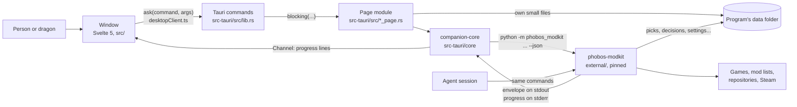

# How D'thorga Companion is built

**Status (23 Nov 2026): describes the code as of 0.69.2, written fresh from it** (the owner's docs rewrite, step 4). The
rules live in [`AGENTS.md`](../AGENTS.md); this page says how the code carries them out. When the two disagree, the rule wins
and this page is wrong: fix it in the change that finds it. Paths are from the repository's root; `path:line` points at the
line as of 0.69.2.

**In one line:** a Svelte 5 window asks a Rust host; the host checks the request and runs the pinned phobos-modkit as a Python
process; the kit does the work and answers in one JSON shape. The window never decides, and never touches a file.

## Read this first (gotchas)

- **The window only asks.** Every request goes through `ask` (`src/lib/shell/desktopClient.ts:19`), called only from a
  `desktopClient.ts` file. Nothing else imports `@tauri-apps/*`. A check the window makes is for the person's sake; the host
  makes it again.
- **Every Tauri command is one line of delegation** in `src-tauri/src/lib.rs`: 129 of them, each wrapped in `blocking`
  (`lib.rs:54`) so work runs on a worker thread. The logic is in the page's own host module. Two commands
  (`save_picture`, `save_screen_note`) also unpack a raw body and a header there, because Tauri hands them the request.
- **The host runs the kit, never a game's tools by name.** A page finds its tool by the manifest's `surface` (`kit::offered`,
  `src-tauri/core/src/kit.rs:308`), so another game's kit command can serve the same page.
- **Every change is checked against the kit's manifest at the moment of the press**, not when the page loaded:
  `allowed_by_manifest` (`kit.rs:238`) for `writes` and `runs`, `allowed_on_press` (`kit.rs:260`) for `owner-press`,
  `reads_online` (`kit.rs:278`) before a report is passed its online flag. `owner-only` is never run.
- **The kit's exit code does not decide.** A tool may exit 1 with a finding and still print its report. Only a missing or
  unreadable envelope is a failure (`kit.rs:110`). A refusal is `data.ok: false` with `data.refusal` (`Outcome`, `kit.rs:211`).
- **Text from the window is always one argument**: `Args::given` writes `--option=value` (`src-tauri/core/src/args.rs:51`), so
  nothing typed can become an option. Values the host chose use `pair`.
- **Two writers share the program's data folder.** The host writes some files there itself; the kit writes others (picks,
  decisions, central settings, mod-list backups), finding the same folder with its own `paths.companion_data`
  (`external/phobos-modkit/python/phobos_modkit/paths.py:24`). The table under [Where state lives](#where-state-lives) says which.
- **On the owner's PC, the kit and games list come from the repository the program was built from** (`from_build_folder`,
  `src-tauri/core/src/lib.rs:56`): `external/phobos-modkit/python` and `.local/games.json`. An installed copy uses the Python and
  kit the installer brought, and `games.json` in its data folder. `PHOBOS_COMPANION_BUNDLED=1` makes a build behave as installed.
- **The browser tests have no host.** `tests/accessibility/host.ts`'s `mockHost` answers each command by name. A new command
  needs an answer there in every spec that reaches it, or the page shows a failure.
- **The program keeps a few things in memory for one run only**: which files a kit answer named (`viewable::remember`),
  which mods and Workshop items the last Publish reading named, the Explorer's held snapshot. A restart forgets them, on
  purpose: a press may act only on what this run was shown.

## The shape of it

**What each layer may do:**

| Layer | Holds | Never |
| --- | --- | --- |
| Window (`src/`) | What to show, in words from `locales/`, in the theme's colours | Decides what may run; reads a file |
| Tauri commands (`src-tauri/src/lib.rs`) | One line each: unpack, hand to a module on a worker thread | Logic |
| Page modules (`src-tauri/src/*.rs`) | What one page is allowed to ask, and its checks | Code another page also needs |
| `companion-core` (`src-tauri/core`) | Everything shared: games list, kit runner, checks, failures, prefs | Anything Tauri |
| The kit (`external/phobos-modkit`) | The actual work, and the manifest saying what each report does | Knows about the window |

`companion-core` holds no Tauri so a second front end could use it whole (owner, 19 Nov 2026; `docs/shared-code-audit.md`).

## Folder map

| Folder or file | What it is |
| --- | --- |
| `src/main.ts`, `src/App.svelte` | Starts the window; the App draws the page list, the page, the trail's dialogs |
| `src/app.css` | The styles every page shares: `h1`, `.lead`, `.how`, `.small`, pressed `.toggle` |
| `src/lib/<page>/` | One folder per page or shared part (38): see [Page anatomy](#page-anatomy) |
| `src/lib/shell/` | Shared window parts: `ask`, `BROWSER`, `Waiting`/`Pending`, `ProgressBar`, `Tabs`, `PageRail`, `dates.ts` |
| `src/lib/navigation/` | `PAGE_NAMES` (`place.ts`); the trail (`go`, `setFocus`, `here`, `openDialog`); `goto.ts` |
| `src/lib/shortcuts/` | Every shortcut (`actions.ts`), and `register` for a view's moves (`registry.ts`) |
| `src/lib/i18n/`, `locales/en-AU.json` | `t()` and every word the window shows (Fluent; about 2,300 keys) |
| `src/lib/theme/`, `themes/*.json` | The program's three themes and the window side of themes |
| `src/lib/guide/`, `guide/*.md` | The Guide: 77 entries (`page-`, `task-`, `term-`), read by `entries.ts` |
| `src/lib/charts/`, `atlas/`, `code/` | The one module each that imports ECharts, three.js and Shiki, on demand (Shiki in a worker, `highlight.worker.ts`, since 0.76.0) |
| `src-tauri/src/lib.rs` | The 129 Tauri commands, `blocking`, `hearing`, `data_folder`, and `run()` (setup, exit) |
| `src-tauri/src/*.rs` | 41 host modules: mostly `<page>_page.rs`, plus shared host parts (`viewable`, `pick`, `pictures`) |
| `src-tauri/src/tests/` | One Rust test file per host module, joined with `#[path = "tests/<module>.rs"]` |
| `src-tauri/core/src/` | `companion-core`'s 13 modules: `kit`, `serve`, `games`, `checks`, `args`, `failure`, `prefs`... |
| `src-tauri/capabilities/` | The window's Tauri permissions: `core:default` only |
| `src-tauri/tauri.conf.json` | Identifier `org.phobosdthorga.companion`, the content security policy |
| `tests/accessibility/` | 34 Playwright specs and `host.ts`, the stand-in host |
| `config/gate.json` | The gate's steps; `scripts/check-all.py` runs them |
| `config/decisions.json` | Questions agent sessions left for the owner |
| `scripts/` | `check-all.py`, `installer.mjs`, `with-target.mjs` (build output to `%LOCALAPPDATA%\phobos-modkit\target`) |
| `external/phobos-modkit` | The pinned kit: never edited here |

Counted on 23 Nov 2026 with tests included: about 470 Rust, TypeScript, Svelte and CSS files and 78,500 lines under `src/`,
`src-tauri/src`, `src-tauri/core/src` and `tests/`.

## Page anatomy

A page is a folder in the window and, usually, one module in the host.

| Part | Where | What it does |
| --- | --- | --- |
| The view | `src/lib/<page>/<Page>Page.svelte` and parts | Shows a reading; calls the client on a press; registers keys |
| The client | `src/lib/<page>/desktopClient.ts` | One function per command: `ask(command, args, ready)` |
| Presentation | `src/lib/<page>/presentation.ts` | Pure functions from a reading to what is shown; tested without a screen |
| Types | `src/lib/<page>/types.ts` | The shapes the host sends |
| The command | `src-tauri/src/lib.rs` | `#[tauri::command] async fn …` → `blocking(move \|\| page::fn(…))` |
| The host module | `src-tauri/src/<page>_page.rs` | Checks names, builds `Args`, checks the manifest, runs the kit |
| Host tests | `src-tauri/src/tests/<page>_page.rs` | Argument building, checks and refusals, with no kit run |
| Browser spec | `tests/accessibility/<page>.spec.ts` | The page drawn with `mockHost`, checked with axe and by keys |

A reading is a small union the view switches on: `{ state: "reading" }` (`Pending`), `"browser"` (`BROWSER`, outside the
desktop program), `"failed"` with the host's `Failure`, or `"ready"`/`"done"` with the answer (`src/lib/shell/types.ts:23`).

Not every page has a `_page.rs`. Home draws on `home.rs`, `pending.rs`, `open_work.rs`, `repo_status.rs`, `nightly.rs`,
`kit_pins.rs`, `safe_copies.rs` and `records_backup.rs`. The Atlas and the report viewer share `reports.rs`. The Guide has no
host part: `entries.ts` bundles `guide/*.md` into the window when it is built (`import.meta.glob`).

### Worked example: pressing Pick on the Picks page

The Picks page shows pictures and sounds the art tools offered; **Pick Try …** keeps the owner's pick.

1. **The press.** The button, or **Ctrl + Enter** (`picks.choose`, `src/lib/shortcuts/actions.ts:356`, registered by the page
   at `src/lib/picks/PicksPage.svelte:113`), calls `keep(pick, words)` (`PicksPage.svelte:82`). It sets `busy`, so a second
   press waits.
2. **The client.** `answerPick` (`src/lib/picks/desktopClient.ts:17`) calls
   `ask("answer_pick", { repository, id, pick, words }, …)`. `ask` (`src/lib/shell/desktopClient.ts:19`) puts the request on the
   activity strip, calls Tauri's `invoke`, and turns a thrown failure into `{ state: "failed", failure }`.
3. **The command.** `answer_pick` (`src-tauri/src/lib.rs:665`) is one line: `blocking(move || picks_page::answer(...))`.
4. **The host's checks** (`src-tauri/src/picks_page.rs:104`), in order:
   - the repository is a plain name (`checks::plain_name`) and on the owner's list, or this program's own repository;
   - the kit's manifest still calls `picks answer` `writes` (`kit::allowed_by_manifest`, `picks_page.rs:113`; the kit declares
     it at `external/phobos-modkit/python/phobos_modkit/picks.py:292`);
   - the pick's id and the try's id have the kit's shape, and the words are under 4,000 characters, made one line
     (`answer_arguments`, `picks_page.rs:63`); each goes as one `--id=…` argument (`Args::given`).
   Any failed check is `Failure::refused`, with the reason in words, and nothing runs.
5. **The kit runs.** `kit::run` (`src-tauri/core/src/kit.rs:112`) starts `python -m phobos_modkit picks answer --root <repo>
   --id=… --pick=… --json` from the kit's folder, with no console, no bytecode and UTF-8 throughout (`kit_command`, `kit.rs:119`).
6. **The write.** The kit's `answer` (`picks.py:177`) appends one JSON line to `picks/<repository>.jsonl` in the program's data
   folder (`picks.py:188`). Nothing in the repository changes: an agent session applies the pick later and settles it.
7. **The answer.** The host checks the envelope is format 1 and from `picks` (`parse_envelope`, `kit.rs:344`), reads `Outcome`
   and returns `PickResult { ok, refusal }`.
8. **The window.** A refusal or failure shows `picks-failed` with the reason. Success shows `picks-done`, reads the list again,
   and opens the next waiting pick.

The same press is tested three ways: `src-tauri/src/tests/picks_page.rs` (ids, words, arguments), `src/lib/picks/
presentation.test.ts` (ordering and stepping), and `tests/accessibility/picks.spec.ts`, where `mockHost` answers `answer_pick`.

## Running the kit

**Every kit call is a process.** About 0.16 s to start on the owner's PC, against 0.2 to 2.7 s for the work itself (measured
9 Nov 2026). There is no long-lived Python except the Explorer's.

| Way | Where | Used for |
| --- | --- | --- |
| `kit::run` | `kit.rs:112` | A quick answer with no progress (the Pick press above) |
| `kit::run_hearing` | `kit.rs:151` | Work that takes time: progress lines go to a listener while it runs |
| `kit::run_with_input` | `kit.rs:158` | A Workshop page's text on standard input, never as an argument (Publish, 0.69.0) |
| `serve::Served` | `src-tauri/core/src/serve.rs:70` | A kit command that stays running, one request a line (the Explorer) |

**Where the kit is** (`kit::locate`, `kit.rs:68`): `PHOBOS_COMPANION_KIT` and `PHOBOS_COMPANION_PYTHON` if set; else the build
repository's `external/phobos-modkit/python` with `python` on the PATH; else the installer's `runtime/kit` and its own
`runtime/python/python.exe`. About shows which (`KitStatus.source`).

**Progress.** The window makes a channel (`progressChannel`, `src/lib/shell/desktopClient.ts:48`) and sends it as `onProgress`.
The command wraps it with `hearing` (`lib.rs:66`). `run_hearing` sets `PHOBOS_MODKIT_PROGRESS=1`, reads standard error line by
line, and passes each line that opens `{"progress":` to the listener as `Progress { label, step, of, detail }`; anything else is
kept for a failure's detail. Standard output is read on its own thread, so neither pipe can stall the other. `ProgressBar.svelte`
draws it: filled when `of` is known, moving when not, always with words. The line format is phobos-modkit `docs/manifest.md`,
Progress.

**The Explorer's long-running kit** (`serve.rs`; `src-tauri/src/explorer_page.rs`):

1. `Served::start` (`serve.rs:96`) runs the game's `look-serve` (found by the `look-inside` surface, `runs`) with its input kept
   open. Its first line says whether it is ready.
2. Each question is one JSON line with an `id`; the line that repeats the `id` is its answer (`Served::ask`, `serve.rs:137`).
   `{"event": "released"}` means the kit let go by itself.
3. One snapshot is held at a time (`HELD`, `explorer_page.rs:248`). It is let go on **Let it go**, on leaving the page, at
   `LIMIT_SECONDS` (600, `explorer_page.rs:32`), and when the program exits (`RunEvent::Exit` in `lib.rs`).
4. Closing ends the whole process tree (`process::end_tree`, `src-tauri/core/src/process.rs:32`, Windows' `taskkill /T`), so a
   helper the kit started never outlives it.

**The one write without a press.** `records_backup::start` (`src-tauri/src/records_backup.rs:122`) starts a thread at setup that
looks every ten minutes; when the kit's `records status --every-hours 6` says a copy is due, it runs `records backup --automatic`,
under the same manifest check as the press.

## Where state lives

**The program's data folder** is Tauri's local app data for `org.phobosdthorga.companion`: on Windows
`%LOCALAPPDATA%\org.phobosdthorga.companion\`. The host finds it with `data_folder` (`lib.rs:109`); the kit with
`paths.companion_data`. Small choice files are written whole, through a `.tmp` file and a rename (`prefs::write_json`,
`src-tauri/core/src/prefs.rs:22`). Answer files are appended, one JSON line each, and the last line for a thing decides.

**One table for every place:** its rows down to `EBWebView/` are inside the data folder; the rows after it are elsewhere.

| File or folder | Written by | When | What guards it |
| --- | --- | --- | --- |
| `test-verdicts/<repo>.jsonl` | Host, `tests_page.rs` | **Pass**/**Fail** on a row | Repo of the game; each field checked |
| `test-key-decisions/<repo>.jsonl` | Host, `tests_page.rs` | "Make a row" / "No row needed" | As verdicts |
| `settings-seen/<repo>.jsonl` | Host, `settings_ledger.rs` | **Looked at** (Mods) | Repo of the game; 1 to 2,000 one-line ids |
| `screen-notes/<id>/` | Host, `screen_notes.rs` | The Something's off key | Written whole: `picture.png`, `note.json` |
| `screen-notes/<id>/resolved.json` | Kit, `screen-notes resolve` | A session deals with it | Not this program; never deleted |
| `shortcuts.json` | Host, `shortcuts.rs` | Save in the shortcuts dialog | Whole and checked; `prefs` |
| `features.json` | Core, `agents.rs` | Settings → Agents | One of the known choices; `prefs` |
| `online.json` | Core, `online.rs` | Settings → Going online | A kind from `KINDS`; `prefs` |
| `publishing.json` | Host, `publish_page.rs` | Settings → Publishing | `prefs` |
| `chat.json` | Host, `chat_page.rs` | Settings → AI, Chat with an agent | On or off (starts off) and an agent from `config/chat-agents.json`; `prefs` |
| `ai.json` | Core, `ai.rs` | Settings → AI services: a service, a model, a length | A service from `config/ai-services.json`; a model of one line; `prefs` |
| `ai-usage.jsonl` | Core, `ai.rs` | Each answer to **Send** | Appended: time, service, model, tokens; never the text |
| The system's key store | Core, `ai_keys.rs` | **Keep this key**, **Forget this key** | Keys for AI services only, under "D'thorga Companion"; never in a file |
| `themes/<id>.json`, `chosen.json` | Core, `themes.rs` | Keep, Import, Remove, Use | Shape, ≤ 32 KB, contrast on every surface |
| `opened-copies/` | Host, `changed_files.rs` | **Open with its own program** | A media kind the kit named, ≤ 64 MB |
| `report-drafts/report.md` | Host, `report_links.rs` | A report link to our repository | Overwritten each time |
| `games.json` (installed) | Core, `games.rs` | First steps; **Add** a game | Every field checked; `games.json.before-add` kept |
| `picks/<repo>.jsonl` | Kit, `picks answer` | **Pick**, **None of these** | Repo listed; ids; manifest `writes` |
| `decisions/<repo>.jsonl` | Kit, `decisions answer` | **Decide** | Manifest `writes` |
| `settings.json` (central) | Kit, `settings set` | Save, Use the default, a picker | A listed setting; manifest `writes` |
| `mod-list/<game>/` | Kit, `mod-list` | Each Mod list change; saved lists | Backup before each change; manifest `writes` |
| `history/` | The kit's tools as they work | Any tool run | Never written by this program |
| `claims.json` | Kit, `claims` | Agent sessions take or release | This program only reads it |
| `safe-copies/last-run-all.json` | Kit, the daily run | The scheduled task | Owner set the time |
| `EBWebView/` | WebView2 | Always | Its own cache; left out of records copies |
| `.local/games.json` (build) | Core, `games.rs` | First steps; **Add** a game | As installed; never committed |
| `Pictures\D'thorga Companion\` | Host, `pictures.rs` | **Save a picture** | Its own folder; a cleaned name |
| A folder the owner chose | Host or kit | Save dialogs: file, list, theme | Only where the owner chose |
| The records copy folder | Kit, `records backup` | **Back up now**; every 6 h | Manifest `writes`; never deletes a copy |
| Safe copy destinations | Kit, `safe-copies` | **Copy now**, **Restore**, **Let go** | Manifest `writes`; a yes first for two |
| A Windows scheduled task | Kit, `safe-copies schedule` | The daily run's time | Manifest `writes`; a time of day |
| The kit's cache | Kit | Watches, decompiles, archive | Manifest `runs` or `writes` |
| A game's `Mods` folder | Kit, `installs` | Mods page moves, **Encode** | Manifest; confirmed; refused while the game runs |
| A game's active mod list | Kit, `mod-list` | Mod list changes | Manifest; backup; refused while game or RimSort runs |
| A repository's Workshop page | Kit, `steam-publish` | **Save the page**, **Prepare** | Manifest; a catalogued repo |
| The Steam Workshop | Kit, `steam-publish`, `mod-list` | Upload, update, subscribe | `owner-press` or `writes`; a yes |

**In memory, for one run:** files a kit answer named (`viewable.rs:32`), the Publish page's last mods and items, the Mod list's
last listing, the Explorer's snapshot, each game's last log faults (`logs_page::remember`), its last changelogs
(`changes_page::remember`), each repository's last update check (`other_code_page::remember_check`), and the one question last
prepared for an AI service (`ai_help.rs`). A press is refused for anything this run was not shown.

## The security gates

Each change passes every gate below that applies to it, in the host, at the moment it runs.

- **The window cannot reach the system.** Its only Tauri permission is `core:default`
  (`src-tauri/capabilities/main-window.json`), and the content security policy in `tauri.conf.json` keeps it to its own files.
- **The manifest's effect, read at the press.** `kit::allowed_by_manifest`, `allowed_on_press`, `reads_online` and `offered`
  (`src-tauri/core/src/kit.rs:238` to `331`) refuse a report that has come to do more than the page expects.
- **`owner-only` is never run.** `allowed_by_manifest` passes only `writes` and `runs`; `allowed_on_press` only `owner-press`.
- **The report viewer only reads.** `runnable` (`src-tauri/src/reports.rs:63`) offers only `reads` reports.
- **Names are checked before the kit sees them**: `companion_core::checks`, `games::named_repository` and each page's own
  shapes stop paths outside a repository, odd names and long text.
- **Typed text is one argument** (`Args::given`, `src-tauri/core/src/args.rs:51`), never an option.
- **Only what this run named.** `viewable::remember`, Publish's `KNOWN_MODS` and `KNOWN_ITEMS`, the Mod list's last listing:
  a press on something the person was not shown is refused.
- **The online switches.** `online::is_on` (`src-tauri/core/src/online.rs:94`) is asked before every call of a kind, on a
  press or by itself. Calls the program makes by itself pass `--automatic`, so the kit keeps the hour's last keyless GitHub
  calls for a press.
- **One way to hand out an address**: `process::open_address` (`src-tauri/core/src/process.rs:19`). Callers build the address
  from what a tool named.
- **The owner's press and yes.** The window shows the confirm card; the host takes only what a reading named.
- **The Workshop uploads setting** (`publishing.json`, `uploads_on` in `publish_page.rs:70`) is read before `upload` and
  `update`.
- **An AI service's gate** (0.71.0): `companion_core::ai::allowed` before every call to one, a question or **Read the models**: a
  loopback service always; any other only while AI services is on and with a key. **Send** takes only the question
  `ai_help` built and showed, from what the page's last reading named. The model's only tools are the kit's three read-only ones
  (0.73.0), each call run by the kit's `mcp call` behind its own checks; for an online model each report waits, shown whole, for
  the person's yes (`ai_help::answer_call`) before it is sent.

**The manifest check, step by step:** read `manifest --json` fresh; find the command and the named report (an empty name is a
command's one unnamed report, as `cleanup` has); refuse unless its `effect` is one the press allows. `offered` adds the game and
the `surface`, so a page finds "the game's `look-inside` report", never a tool name, and is told in words when there is none.

**The online kinds** (`companion_core::online::KINDS`, `online.rs:37`), each kept on or off in `online.json`. Each starts on but
AI services, which starts off (`starts_on`):

| Kind | Contacts | Losing it | Used by |
| --- | --- | --- | --- |
| AI services | The AI service the person chose | Small | Logs, `ai_help.rs`: **Explain this fault**, on **Send**; Settings, **Read the models** |
| Gate lights | api.github.com | Severe | Home, `repo_status.rs`: the kit's `repos status` |
| Nightly watch | raw.githubusercontent.com | Severe | Home, `nightly.rs`: `feeds read --root`, each `companion-results` branch |
| Known problems | raw.githubusercontent.com | Severe | Mod list, `mod_list_page.rs`: `feeds read --from published` |
| Their reports | api.github.com | Small | Logs, `report_links.rs`: another author's issues, on a press |
| Workshop pages | api.steampowered.com | Small | Publish, `publish_page.rs`: **Read Steam back** (`pull --write`) |

### What each page's host checks

The mechanism behind each page's rule in `AGENTS.md`. Every change also passes the manifest check above.

- **Mods** (`installs_page.rs`): the repository is one of the game's and keeps `config/installs.json`; the move is `build`,
  `install`, `backup` or `restore`; every mod name is checked. Encoding finds the game's tool by the `textures` surface.
- **Mod list** (`mod_list_page.rs`, `mod_list_lists.rs`, `mod_list_steam.rs`): `mod-list fix --apply`, `undo --apply`, `sort`,
  `rules --apply`, `compare`, `load --apply`, `save`, `forget`, `export`, `subscribe --apply`, `unsubscribe --apply`. A mod or a
  list must be one the last `mod-list mods`, `lists` or check named in this run; at most 500 mods in one change; a place from 1;
  a Workshop number well formed. Known problems run `feeds read --root --from published`, best effort, then
  `mod-list check --known`, which reads only the kit's kept copies.
- **Publish** (`publish_page.rs`): upload and update pass `allowed_on_press`; public is `--update --visibility public
  --confirm-public`, sent only after the second yes. SteamCMD runs with `--new-console`. **Save the page** is `page --write` with
  the text on standard input (at most 64 KB, `run_with_input`); **Prepare** is `notes --write` then `prepare`. A repository must
  keep `config/workshop-publishing.json`; a mod or item must be one the last reading named (`KNOWN_MODS`, `KNOWN_ITEMS`).
- **Memory** (`memory_page.rs`): the tool by the `memory-watch` surface. The length is one offered, a label passes
  `checks::label`, a watch's name has the kit's shape, and a mark is one line under 200 characters, sent after `--`.
- **Explorer** (`explorer_page.rs`): `look-serve` by the `look-inside` surface. A request's kind is from a fixed list; a type name
  passes `checks::type_name`, an address `checks::memory_address`, a filter is one line under 80 characters, and every number is
  held to its range (`MAX_SKIP`, `MAX_TAKE`, `MAX_HOLDERS`, `MAX_SAMPLE`).
- **Changes and the code viewer** (`changes_page.rs`, `changed_files.rs`): the repository is one of the game's and the changelog
  a plain path inside it (`checks::changelog_path`). A file's bytes are handed over only for a binary file the kit's last answer
  for that repository and commit named, read with git, at most 64 MB. **Open with its own program** copies into
  `opened-copies/` and opens only a kind the kit named as media.
- **Pictures and sounds elsewhere** (`viewable.rs`): only a file a kit answer named in this run (each changed file in every copy
  of a mod, each preview, each picture and encoded texture of a pair), of a kind the window draws or plays, at most 64 MB.
- **Picks** (`picks_page.rs`): see the worked example. Only repositories that keep `config/picks.json` are asked.
- **Timeline** (`history_page.rs`): the repository is one of the game's, the changelog a plain path inside it, the commit or
  moment plain text of the right shape (`checks::commit_hash`, `checks::moment`).
- **Settings** (`settings_page.rs`, `pick.rs`): `settings set`, for a key and value that pass `checks::setting_key` and
  `setting_value`. Windows' picker (`pick.rs`) only answers with a path; saving it is the same press as typing it.
- **Add a game** (`companion_core::games::add`, `games_page.rs`): the id, the name, the Steam game, the data folder and every
  repository are checked again; the list as it was is kept in `games.json.before-add`; the new list is written beside and
  renamed over.
- **Their code** (`other_code_page.rs`): reports by the `other-code` and `updates` surfaces. A name goes after `--` and must have
  the shape of a type or member; a kept file is a plain `.dll` name; **Decompile** only for an assembly the kit's `holder` named
  in this run. **Keep the new builds** is `rimworld-archive snapshot`, found by the `updates` surface.
- **Clean up** (`cleanup_page.rs`): `cleanup` lists; deleting passes each chosen group as its own `--group` argument.
- **Code map and How it connects** (`connections_page.rs`): the repository, a thing's id (`checks::node_id`), a commit, and a
  search of one line (`checks::search_pattern`).
- **Features for agent sessions** (`companion_core::agents`, `src/lib/agents/state.svelte.ts`): shown by the person's choice, or
  by default when a listed repository has `AGENTS.md`, `CLAUDE.md`, `.claude` or `config/decisions.json`, or screen notes or
  decisions are already kept.
- **Report links** (`report_links.rs`): the kit's `issue-links where` names each mod's repository; our new-issue text is kept
  first in `report-drafts/report.md`; listing their issues is `issue-links issues`, keyless, with Their reports on.
- **Records** (`records_backup.rs`): `records backup` into the folder the setting `recordsBackupPath` names.
- **Safe copies** (`safe_copies.rs`): `safe-copies run`, `verify`, `restore`, `let-go --apply` and `schedule`; set names and
  times of day are checked.
- **Tests** (`tests_page.rs`): a repository of the game that keeps a test list; the row, the verdict and the note checked,
  the note made one line.
- **Decisions** (`decisions_page.rs`): as Picks: a plain repository name on the list, ids checked, words made one line.
- **Game files** (`game_files_page.rs`): `game-files report` only reads; Show in folder only for a file inside a folder the last
  report named.

**Addresses** reach the system only through `open_address`: `steam://url/CommunityFilePage/<number>` for a number a reading
named, a Workshop search for the game's own app id, or a GitHub address for a repository the kit's `issue-links where` named.

## Tests and the gate

**The gate is `python scripts/check-all.py`**, a thin caller for phobos-modkit's gate reading `config/gate.json`. It prints only
what failed, and exits 0 only when everything passed. It takes about 5 to 8 minutes and uses port 4173.

| Stage | Step | What it runs |
| --- | --- | --- |
| Rules | shared rules | `phobos_modkit rules check`: `CLAUDE.md` imports and `AGENTS.md` names `every-session.md` |
| Web | web format | Prettier `--check .` (Markdown is left out by `.prettierignore`) |
| Web | web types | `svelte-check --fail-on-warnings` |
| Web | web tests | Vitest: 60 `*.test.ts` files under `src/` |
| Web | web build | `vite build` |
| Rust | rust format | `cargo fmt --all -- --check` |
| Rust | rust lints | `cargo clippy --locked --all-targets -- -D warnings` |
| Rust | rust tests | `cargo test --locked`: 40 host test files, 10 core test files |
| Window | window audit | Playwright: 34 specs in `tests/accessibility/`, Chromium, `vite preview` on 127.0.0.1:4173 |
| Window | desktop program | `tauri build --no-bundle` (no installer) |

**Tests that hold a rule:**

- `src/lib/i18n/catalogue.test.ts`: every key the code asks for is in `locales/en-AU.json`, no key is unused, none is twice.
- `src/lib/theme/contrast.test.ts`: each of the program's themes gives every role and meets the contrast rules.
- `src/lib/guide/entries.test.ts`: every page has an entry, links go to entries that exist, Take me there goes where a page can
  show, and every entry is reached from somewhere.
- `src/lib/shortcuts/shortcuts.test.ts`: keys that can work together differ; at most one of Shift, Ctrl, Alt.
- `src/lib/shell/presentation.test.ts`: the version in `package.json` and `src-tauri/Cargo.toml` match.
- `tests/accessibility/*.spec.ts`: each page drawn with `mockHost`, checked with axe and by keyboard; `useInstalledPolicy` puts
  the installed program's CSP on the page so a picture it would refuse fails here too.
- Rust host tests: each module's checks and argument building, with no kit run and no window.

**Not checked by a test:** that only `desktopClient.ts` files import `@tauri-apps/*` (it holds today), and that every command
stays one line.

## How to add a page

A checklist, in the order the work usually goes. Each item is something a test or the gate refuses, or a rule in `AGENTS.md`.

1. **The rule first.** If the page changes anything, its line in `AGENTS.md`'s "What the program may do": what it may change, on
   what press, and what guards it. Its design record section answers `rules/designs.md`'s questions.
2. **The kit.** The tool exists in phobos-modkit with a manifest entry (`effect`, and a `surface` if a game's tool serves it),
   speaks progress lines if it can take more than a moment, and is pinned here.
3. **The host module.** `src-tauri/src/<page>_page.rs`: check every name, build `Args` (window text through `given`), check the
   manifest for any change, run through `kit::run_hearing`, return `Outcome` or data. Shared parts go in `companion-core`.
   Tests in `src-tauri/src/tests/<page>_page.rs`.
4. **The commands.** In `src-tauri/src/lib.rs`: `mod <page>_page;`, one `#[tauri::command]` per request, one line each, an
   `on_progress: Channel<kit::Progress>` where work takes time, and each name in `generate_handler!`.
5. **The window folder.** `src/lib/<page>/`: `desktopClient.ts` (`ask`, `progressChannel`), `presentation.ts` with its tests,
   `types.ts`, and the `.svelte` view. Look in `src/lib/shell/` and `src/app.css` before writing a helper or a style.
6. **The page's name.** `PAGE_NAMES` (`src/lib/navigation/place.ts:5`), and `FOR_AGENTS_PAGES` if it is for agent sessions.
7. **The page list.** `PageRail.svelte`: its `page-<name>` words and its group; `waiting.svelte.ts` if it counts what waits.
8. **The App.** `src/App.svelte`: import the view, add its `page.<name>` shortcut to the page map, its branch, its
   `source-body-<name>` line.
9. **Tabs**, if it is too long for one scroll: its row in `PAGE_TABS` (`src/lib/shell/tabs.ts:27`), at most nine.
10. **Shortcuts.** `src/lib/shortcuts/actions.ts`: `page.<name>`, its moves in a scope of its own (added to `SCOPES` and
    `TOGETHER`), `forAgents` where it applies; the view calls `register`. A single key first where one is free.
11. **Words.** Every key in `locales/en-AU.json`: the page's, its shortcuts' (`shortcut-…`), its scope's, its tabs'.
12. **The Guide.** `guide/page-<name>.md` (`docs/guide-entries.md` gives the format), any How do I…? entry whose steps change,
    any new word as a `term-` entry; `for: agents` where it applies.
13. **Cross-links.** The focus keys it reads (and any `tab` values) in `docs/cross-links.md`; a new kind of thing joins
    `src/lib/navigation/goto.ts`.
14. **The browser spec.** `tests/accessibility/<page>.spec.ts` with `mockHost` answers for every command it reaches.
15. **More than one game.** Run the kit tool behind it on two games' repositories and say which in the changelog entry.
16. **The changelog.** One entry in `CHANGELOG.md`, in the same commit.

## Where to read more

- **The Guide** (`guide/`, F1 in the program): what each page does, for the person using it.
- **The design record** (`docs/design-record.md`): why each piece was built, the owner's choices, and the questions it answered.
- **The kit's manifest and envelope** (`external/phobos-modkit/docs/manifest.md`): effects, surfaces, progress lines, blocks.
- **Cross-links** (`docs/cross-links.md`): the trail, addresses and every page's focus keys.
- **Going online** (`docs/online.md`), **Publishing** (`docs/publishing.md`), **Debugging** (`docs/debugging.md`): the designs
  behind the switches, the Publish page and the Explorer.
- **Shared code** (`docs/shared-code-audit.md`): what moved into `companion-core` and `src/lib/shell/`, and why.
- **Release audit** (`docs/release-audit.md`): what stands between the program and another person.
