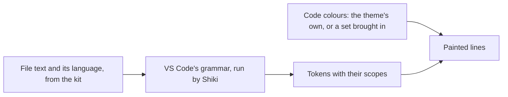
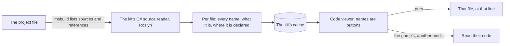
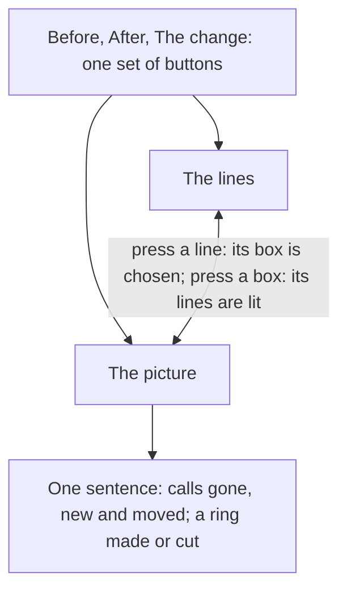

# Reading code closer: colours, names to follow, and a change as a picture (design, 24 Nov 2026)

**Status (24 Nov 2026):** the owner said go for steps 1 to 4 ("proceed with Steps #1 through #4, step-wise if necessary"), and
asked to be told clearly before step 7, for which they will give the resources it needs. **Step 1 is built** (0.76.0; as built in
`design-record.md`, "Code in VS Code's colours"), **step 2 is built** (0.77.0; "Code colours from VS Code" there), **step 3 is
built** (0.78.0; "Lines and pictures lit together" there), and **step 4 is built** (0.79.0, on phobos-modkit 1.111.0's
`connections names`; "Names to follow in C#" there). The owner then said "proceed with steps 5 and 6": **step 5 is built**
(0.81.0, on kit 1.115.0; "Names found by name in Lua, Python and XML" there), and **step 6 is built** (0.82.0, on kit 1.116.0's
`connections calls`; "Calls gone and added, and the ring finder" there). **Step 7 waits for the owner's word and the resources
they will give.** When a step is built, its design moves into `design-record.md` and `later.md`
keeps one line pointing there.

**The owner's request** (24 Nov 2026): "What can we do to improve the syntax highlighting, etc. of Companion? I want to bring it
more inline with that of VS Code, if at all possible. Maybe even have the possibility of clicking on variables, etc. and you are
taken directly to their source"; and, as "a speculative idea": "when you are viewing code changes in Companion, is there a way to
translate to, 'How it Connects', in a visually appealing manner?"

**Owner's choices (24 Nov 2026, by question card, after pressing through the mock-up):**

- **Colours: switch to VS Code's own grammars, plus bring in a VS Code theme** for the code colours.
- **Following a name: Microsoft's Roslyn for C#, by name for the other languages.**
- **The change picture: all four parts** offered: lines and boxes lit together, calls gone and calls added, a ring finder, and
  jumps between XML and C#.
- **Next: this record**, then each step on their word.

**The mock-up** (a working page on one real class, private to the owner):
[Reading Code Closer](https://claude.ai/artifact/MuJVaR5HbLM3Cey965aU2f). It is not the Companion's code.

## Read this first (gotchas)

- **Three layers, each a step further.** A grammar gives colours. A reader that understands the language gives what each name is and
  where it is declared. The same reader, run on both sides of a change, gives the calls the change removed and added.
- **A grammar only guesses what a name is.** In the sample class it coloured 5 of 52 names wrongly (it took two of our classes for
  variables). Following a name needs the second layer; it cannot be done from colours.
- **The C# reader only reads.** It reads source text and the metadata of the assemblies a project refers to. It never loads or runs
  an assembly, and it runs no analyser or generator a project names.
- **Exact for C#, by name for the rest**, and every by-name answer says so in words, as the Code map already does.
- **A ring is not always a fault.** The ring finder says "a ring", shows it, and leaves the judgement to the person.
- **Everything here only reads**, except keeping a brought-in set of code colours in the program's own folder.
- **Nothing here is tested in the Companion's window.** The figures below come from proofs run outside it.

## What was measured (observed, 24 Nov 2026)

Run on phobos-rimworld's `src/PhobosFramework.Vehicles/SetOut/FieldKitchen.cs` (217 lines) at commit `5c122faf` and the commit
before it, on the owner's computer, which is fast: treat the times as a best case.

| What | Result |
| --- | --- |
| highlight.js 11.11.1, as the Companion uses it | 11 kinds of token, shown in 5 colours; 9 ms |
| Shiki 4.6.0 (MIT), VS Code's C# grammar, Dark+ colours, **its JavaScript engine, no WebAssembly** | 69 kinds of token, 11 colours; 176 ms. Run in Node, not in the Companion's window |
| `dotnet msbuild -getItem:ReferencePath -getItem:Compile -t:ResolveAssemblyReferences -p:BuildProjectReferences=false` | The project's 355 source files and 240 references, as JSON, in 0.5 s, without building |
| Roslyn 5.0.0 (MIT, `Microsoft.CodeAnalysis.CSharp.Workspaces`), those files and references in an `AdhocWorkspace` | Read and bound with **0 errors**; 2.9 s for the whole run from a cold start |
| `Classifier.GetClassifiedSpansAsync` and `GetSymbolInfo` over one class | 52 of 52 names in code traced: ours to a file and line, the game's and Vehicle Framework's to an assembly and an exact name; 0.1 s |
| The same class from the file's older text (one document swapped) | The calls before and after, exactly: 8 before, 8 after, 2 gone, 2 new, 6 moved from one method to another; 0.04 s |
| The kit's code reader on the game's own `RecipeWorker.AvailableReport` | It asks `AvailableOnNow`, the call that closed the ring behind the crashes of 23 Nov 2026 |

**Not measured:** Shiki inside the Companion's window; a whole repository of many projects; a commit that changes many files or the
project's own file list; reading the game's whole assembly for rings.

## The four questions

| Question | Colours | Names to follow | A change as a picture |
| --- | --- | --- | --- |
| What does it let the person do? | Read code in the colours they know from their editor, their own theme included | Press any name and land on its declaration: ours, the game's or another mod's; see every other use of it lit | See which calls a change took away and added, and move between its lines and its picture as one view |
| What does it stop them doing? | Reading names, calls and variables as one undivided colour | Searching by hand for where a thing is declared, or opening an editor to find out | Reading a change as lines alone and missing what it did to the shape: a ring made, a ring cut |
| How does it change the way they work? | Code in the Companion reads like code in the editor, so moving between the two costs nothing | A changelog entry leads to its code, and the code leads on to whatever it names, with Back to return | "What did this change do?" is answered by a picture and a sentence before the lines are read |
| What outside it notices? | Themes (a new part, checked), Settings → Appearance, the Guide, `THIRD_PARTY_NOTICES.md` | The trail (each jump is a step), addresses, Go to anything, Read their code, the kit's cache | The Code map (the same nodes), a thing's history, the Guide. A new ring is said in the picture's words only |

## Colours

| Part | How | Whose choice |
| --- | --- | --- |
| The reader | Shiki replaces highlight.js in the one module that colours code (`src/lib/code/highlightCore.ts`), with its JavaScript engine, a grammar fetched the first time a file of its language is opened, as now. It covers every language on today's list, and Svelte with a grammar of its own (today it is read as XML) | Owner: switch |
| Off the main thread | Colouring runs in a worker made from the program's own files, since it is about twenty times slower than today's; the plain text shows first and the colours follow, as now | Agent |
| Code colours in a theme | A theme gains a part for code: twelve roles (keyword, flow word, type, function, variable, constant, string, number, comment, tag, punctuation, plain), each `#RRGGBB`, checked at 4.5:1 on the surface code is drawn on. One table in the colouring module says which grammar scopes take which role. House D'thorga ships with VS Code's default dark colours; the other two built-in themes get their own | Owner: VS Code's colours. Agent: the twelve roles and the table |
| Bring in a VS Code theme | Settings → Appearance: **Bring in a VS Code theme's code colours**. The host opens the file, takes only its token colour rules (a scope, a colour, bold or italic), and keeps them as a set of code colours in the program's own folder. "Code colours" is then a choice: the theme's own, or a set brought in | Owner: bring in a theme. Agent: the rest |
| What a brought-in file may be | Data only: at most 256 KB; comments allowed, as VS Code allows them; a file that includes another file is refused in words; every colour checked for shape. Workbench colours and everything else in the file are ignored | Agent, after the rule for what others bring |
| A colour that cannot be read | Decision `code-colours-contrast` (the agent leans to replacing it with the theme's own and saying how many were replaced) | For the owner |

**Why this now answers the old objection.** highlight.js was chosen on 19 Nov 2026 over a larger highlighter because it needed no
WebAssembly and no theme files of its own. Shiki's JavaScript engine needs no WebAssembly (observed), and the colours still come
from the theme in use, by role: the grammar is the only thing borrowed.

**In the same style, not yet chosen** (agent's proposals, each small): marks on the changed words inside a changed line; the
enclosing class and method pinned at the top of the code while scrolling; indent guides.

## Names to follow

| Part | How | Whose choice |
| --- | --- | --- |
| The reader | A C# program in phobos-modkit's `dotnet/`, beside the assembly reader, using Roslyn. It asks MSBuild what a project's sources and references are (0.5 s, no build), reads them, and writes for each file every name's line, column, kind (Roslyn's own words: class name, method name, parameter name, local name and so on) and declaration: a file and line of ours, or an assembly and an exact name. **This is the kit's second package exception, after ClrMD**, on the owner's choice here; it is recorded in the kit's `AGENTS.md` and `THIRD_PARTY_NOTICES.md` in the change that builds it | Owner: Roslyn. Agent: the shape |
| The kit's command | A game-free command (working name `code-names`): one file's names for the code as it now stands or at a commit, and "where is this declared". Answers are kept in the kit's cache, by the content of the files they came from, with a progress line while a project is first read | Agent |
| In the code viewer | Over the grammar's colours, each name takes the colour of what it really is, and becomes a button. Pressing one lights its other uses and shows a card: what it is, its full signature, where it is declared. **Enter** (and F12, as in VS Code) goes there; the jump is a step of the trail, so Back returns | Agent |
| Keys | Inside the code the arrow keys move between names; the code is a part that takes keys itself, as the globe does. Every name is also reachable by pointer | Agent |
| A name that is not ours | The game's or another mod's opens in **Read their code** at that member. A name from .NET itself shows its card and offers no jump | Agent |
| From a name to its picture | The card offers **How it connects**, which opens the Code map on the same thing | Agent |
| Other languages | Lua, Python and XML Defs go by name through the kit's existing `connections find`: one match goes straight there; several show a short list, each marked "by name" | Owner: by name elsewhere |
| Parameters, locals, fields and properties | VS Code gives all four one blue. Decision `code-kinds-apart` (the agent leans to keeping VS Code's way) | For the owner |

**At a commit.** The code viewer shows code as a commit left it. The reader takes those files' text from git and the references as
they are today, and says so in its answer. A commit that changed which files a project has is the unmeasured case.

**Without the .NET SDK.** A person whose computer cannot build the reader gets names by name only, and is told so in words on the
page. The kit's assembly reader already needs the SDK, so this adds nothing new to the release audit; the reader's first build
fetches its package from nuget.org once, which is to be treated as the heap reader's ClrMD fetch is.

### Jumps between a game's data files and its code

**The owner chose this from the picture card.** It is an idea beyond what VS Code does, and it is untested.

- **From XML to C#:** a Def's `thingClass`, `compClass`, `workerClass` or a `Class="…"` attribute opens that C# type.
- **From C# to XML:** a translation key in code opens its English line; a Def named in code opens the Def as patched.
- **From XML to XML:** a defName used in another Def opens that Def.

**Generic first.** The core rule is "a piece of text in a data file that names a thing the code map knows". Which elements and
calls count is a table in the game's adapter, never in the core: RimWorld's lists the elements above. **A next game needs only its
own table** (Ostranauts: its JSON data and C#; Project Zomboid: its scripts and Lua). **Before it is built, count the false matches
on two games' repositories**; a rule that matches wrongly more than rarely is left out.

## A change as a picture

Today the code viewer has three separate views: What changed, The code as it now stands, and How it connects. This joins the first
and the third.

| Part | How | Whose choice |
| --- | --- | --- |
| Lines and boxes lit together | Pressing a box lights the lines of that method in the change; pressing a line chooses its box. The kit's `connections changed` already gives each changed thing its file and lines, so **this part needs no kit change** | Owner |
| One set of buttons | Before, After and The change drive the lines and the picture at once: Before shows the old lines and the old calls, After the new, The change both, marked | Agent, from the mock-up |
| Calls gone and calls added | For each changed thing, the kit gives its calls before and after the commit, from the C# reader run on both texts. The picture draws a call gone, a call new and a call kept, each with its word and its own line style, never by colour alone | Owner |
| Moved | When a set of calls leaves one changed method and arrives whole at another, the picture says "moved", not "gone" and "new" | Agent's rule |
| A ring finder | A ring is a loop of calls. The picture says in words when a change **makes** a ring or **cuts** one, and marks its arrows. Rings that were there before and after are not raised | Owner: the finder. Agent: only rings a change makes or cuts |
| Rings through the game | A ring can pass through the game's code, as the one of 23 Nov 2026 did: our override asked its base, and the base asked our override back. To see such a ring the finder reads, with the kit's assembly reader, only the outside methods a changed method overrides or hands on to, never the game's whole assembly | Agent's proposal; its cost is unmeasured |
| Where the picture sits | Decision `code-change-layout` (the agent leans to the picture above the lines: side by side, the picture needed about 700 px and was cut off in the mock-up) | For the owner |
| Motion | Boxes and arrows arrive with a short fade; none with reduced motion | Agent |
| Other languages | The lighting works wherever the kit places a changed thing. Calls gone and added, and rings, are exact for C# and by name elsewhere, drawn dashed as by-name connections are today | Agent |

**What the ring finder would and would not have done.** On the class behind the crashes of 23 Nov 2026 it finds the ring, from the
calls alone (the mock-up does this in the page). It would have said so on the commit that first wrote that class, provided the
finder read the game's base method. It would not have known the ring had no way out: that was for a person to see.

## Order of work

Agent's proposal. Each step is a version of its own and waits for the owner's word; steps 1 to 3 need no kit change.

| Step | What | Where |
| --- | --- | --- |
| 1 | Shiki in the code viewer, colouring in a worker; code colours as a part of every theme | Companion |
| 2 | Bring in a VS Code theme's code colours | Companion |
| 3 | Lines and boxes lit together, with one set of Before, After and The change buttons | Companion |
| 4 | The C# source reader and its command; names as buttons in the code viewer, for C# | phobos-modkit, then Companion |
| 5 | Names by name for Lua, Python and XML | Companion |
| 6 | Calls gone and added, moved, and the ring finder | phobos-modkit, then Companion |
| 7 | Jumps between data files and code, after the count of false matches | phobos-modkit (adapter tables), then Companion |

**Each step is checked on two games' repositories before it is called done** (this repository's rule): the colours on every
language the list has; the C# reader on phobos-rimworld and phobos-ostranauts.

## What changes elsewhere when a step is built

- `AGENTS.md`, "Code is coloured by one module": it names highlight.js, and gains the worker and the code roles (step 1).
- The theme format, every theme file, both checks and the maker, in one change, as a new role requires (step 1).
- `THIRD_PARTY_NOTICES.md`: Shiki in, highlight.js out (step 1); Roslyn in phobos-modkit's (step 4).
- The Guide: the code viewer's entry, the appearance entry, a new "How do I follow a name?" answer, and the words "ring" and
  "code colours".
- `docs/cross-links.md`: the focus keys for a chosen name and a chosen thing in a change, and a name's address.
- Shortcuts: C, N and H stay; the joined view takes B, A and C only if the owner settles `code-change-layout` that way, since C
  is taken (What changed).

## Agent choices, for the owner to revise

Every row marked "Agent" above. The three that most change what is seen are on the Decisions page: `code-colours-contrast`,
`code-kinds-apart` and `code-change-layout`.
