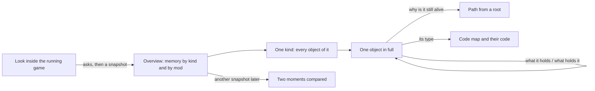

# Debugging the running game: design (20 Nov 2026)

**Status (20 Nov 2026):** designed; **a throwaway probe proved layer 1 on the owner's running RimWorld** (below); nothing is built
in the Companion or the kit. Layer 1 waits for the owner's word to build. When a layer is built, its design moves into
`design-record.md` and `later.md` keeps one line pointing there.

**The owner asked for "debug(ging) tools into Companion that you can attach to the games (supported) and with our tools, visual
code analysis, etc. see things like relationships between things, and so much more! While looking at variables in memory"**
(20 Nov 2026). **Owner's choices (20 Nov 2026, by question card):**

- **Look inside first**: a read-only snapshot of the running game to browse, before anything else.
- **Our own debugger window, speaking the Debug Adapter Protocol**, for breakpoints and stepping (layer 3), not a hand-off to an
  editor.
- **An in-game part behind its own setting, off by default** (layer 2), talking to the Companion on this PC only.
- **A test attach once the probe was ready**: run the same day, with a colony loaded, after the owner saved.

## Read this first (gotchas)

- **It only reads.** Layers 1 and 2 never write into the game. Changing values in a running game is left out, for the same reason
  the Save explorer leaves out save editing: it is risky, and a wrong write can corrupt a colony.
- **Every attach asks first, every time**, and asks the person to save, as perf recordings and the memory watch already do.
- **A snapshot pauses the game for about half a second** (431 and 449 ms on the owner's game with a colony loaded). The game then
  runs on while the snapshot is read.
- **A held snapshot costs memory as the game runs on.** Windows keeps the snapshot by copying each page the game changes
  afterwards, so the longer it is held, the more memory it takes. It is released when the page closes, after a time limit, or on
  **Let it go** (the limit is a decision below). Not yet measured.
- **Breakpoints freeze the whole game** (layer 3). The window says so in large words while it is stopped, with **Continue** beside.
- **RimWorld 1.7 runs on Ludeon's own build of .NET** (Waylith, `10.0.15-waylithclr.dev`; Ludeon,
  [announcing the Waylith engine, 12 Oct 2026](https://ludeon.com/blog/2026/10/announcing-the-waylith-engine-and-update-1-7/)).
  Its memory-reading library (`mscordaccore.dll`) is not signed by Microsoft, so the reader must be told to accept it, **and accepts
  only the one beside the game's own `coreclr.dll`**, in the game's install folder.
- **Pawn names, colony details and anything the game holds are on screen**, and in any picture the page saves.

## The probe (20 Nov 2026, agent-run, the owner's yes)

A 120-line C# program (`HeapProbe`, kept outside every repository at `K:\phobos-modkit\spikes\heapprobe-2026-11-20`, with its
output) using **ClrMD** (Microsoft.Diagnostics.Runtime 4.2.751201, MIT, Microsoft's library for reading .NET memory). It takes a
Windows process snapshot (`PssCaptureSnapshot`), loads the game's own memory-reading library, walks the heap and opens one object.

| What | Result |
| --- | --- |
| Self-test on a stand-in program (stock .NET 10.0.15) | 6 ms pause; 11,157 objects in 0.1 s; a test object's string, int and float read exactly |
| First attach to RimWorld | Snapshot in 449 ms; **refused**: ClrMD checks Microsoft's signature on the memory-reading library, and Waylith's has none |
| Second attach, the check switched off for the game's own file only | Snapshot in **431 ms**; library loaded in 8 ms; **28,350,237 objects in 12.0 s, every one with its type**; 34,812 types, 510 modules, 60 threads |
| One `Verse.Pawn` opened | All 121 fields: numbers, true/false, links to other objects (its kind, faction, name, every tracker, its 25 comps) |

**What this settles:** layer 1 works on RimWorld 1.7, with no cap on the number of objects (dotnet-gcdump stops near ten million on
the owner's game; see the Memory page). **What it does not settle:** structs (a position, a rotation) were shown only as "(Struct)"
by the probe and need reading field by field; generic lists and dictionaries need opening by their inner arrays; how much memory a
held snapshot costs over minutes; whether Waylith's injected fields (its `FieldInjection` setting) read correctly on every type.

### What the first look showed (leads, not conclusions)

These are the probe's top kinds by memory, on the owner's colony. Each is a question the finished page would answer with **what
holds it**; none was chased.

| Kind | Memory | Lead |
| --- | --- | --- |
| Free space between objects | 714.8 MB | The heap's gaps; matches the kit's memory watch, which already subtracts them |
| XML: elements, text, attribute lists, names | **at least 380 MB** (8.8 million objects) | Defs' XML is normally let go after loading; something still holds a parsed document |
| `MouseoverSounds+MouseoverRegionCall[]` | 128 MB in two arrays | Unusually large for two arrays |
| Character Editor's preset sets, a `KTrie` search tree | 34 MB and 63 MB | Two mods' caches |
| Vanilla Expanded Framework's `PipeSystem.CachedIngredient` | 22 MB, 722,371 objects | Many small objects |

## The four questions

| Question | Answer |
| --- | --- |
| What does it let the person do? | Look inside their running game without stopping it: what is in memory by kind and by mod, any object with every value it holds, what it holds, **what holds it and why it is still alive**, and two moments compared. Later (layer 2) values by their in-game names and charted over time; later still (layer 3) stop the game at a line of a mod's code and look around |
| What does it stop them doing? | Guessing from code alone, or from a partial heap snapshot, why memory grows or a value is wrong. Attaching by accident: every attach asks first. Changing the game: nothing is written |
| How does it change the way they work? | A question about the running game that needed a debugger, a dump of many gigabytes or an agent reading decompiled code becomes a few presses, and lands on the same Code map, patches and history the Companion already links |
| What outside the program notices? | **The game pauses for about half a second at each snapshot**, and stops at a breakpoint (layer 3). The layer 2 part is one setting in D'thorga Framework, off by default. Nothing else |

## Three layers

| Layer | What the person does | How | Pauses the game? |
| --- | --- | --- | --- |
| **1. Look inside** (first, owner's choice) | Takes a snapshot and browses it | A C# reader in the kit using ClrMD, reading a Windows snapshot | About half a second, at the snapshot |
| **2. Live view** | Values by their in-game names, our caches beside the truth, Harmony patches as applied, a value charted over time | A part of D'thorga Framework, **behind its own setting, off by default** (owner's choice), answering the Companion through a local pipe | No |
| **3. Debugger** | Breakpoints in a mod's code, stepping, locals, the call stack, in the Companion's own code viewer | **The Debug Adapter Protocol** (owner's choice), driving **netcoredbg** (Samsung, MIT) for .NET games | **Yes, at a breakpoint** |

### Layer 1: what the page shows

| Part | What it shows |
| --- | --- |
| **Look inside the running game** | A button, with the pause and "save first" in its question; a bar while the heap is read (12 s on the owner's game) |
| **Overview** | Memory by kind and **by mod** (a type's assembly file names its mod's folder), free space, object counts; the biggest first |
| **One kind** | Its objects, paged; a search by a value (a pawn's name, a thing's kind) |
| **One object in full** | Every field and its value, structs opened, lists and dictionaries opened a page at a time, each link a press away. **The same view the Save explorer's "one thing in full" uses**, so a save and the running game look alike |
| **What holds it** and **why is it still alive** | The objects that point to it, and one path from a root (a static field, a thread, a handle) down to it: the answer to a memory leak |
| **Its type** | A press to the Code map and to "Read their code" (`rimworld-code show`), with patch badges |
| **Two moments compared** | Counts and memory by kind and by mod between two snapshots, beside the Memory page's watch |

What a game's tools add, RimWorld first: friendly groups (Maps, Pawns by name, Things by kind, the game's and mods' components),
a thing's label from its kind, and the mod behind each kind, all through the kit's game adapter.

### Layer 1: how it is built

| Part | How |
| --- | --- |
| The reader | **phobos-modkit first, then the pin.** A C# reader under the kit's `dotnet/`, built outside the repository like the metadata reader, using ClrMD (to add to the kit's `THIRD_PARTY_NOTICES.md`). A game-free core command takes a process and a trusted runtime folder; the RimWorld adapter names the process (`RimWorld.exe`), the install folder whose memory-reading library it trusts, and the friendly groups. It answers in the kit's JSON envelope and speaks progress lines |
| Holding the snapshot | The reader stays running while the page is open, holding the snapshot, and answers one request at a time; **released** on Let it go, when the page closes, or after the time limit. The overview is kept in the kit's cache so it can be compared later; objects are not |
| What holds it | Found on request by walking the heap once (about 12 s), with a bar; a second walk is not needed while the snapshot is held |
| The host | `AGENTS.md`'s "What the program may do" gains a line in the change that builds it: an attach only on a press and a confirmation, only to the process the game adapter names, only reading |
| Moving | Every press goes through the trail; focus keys `snapshot`, `kind` and `object`, listed in `cross-links.md` when built |
| The Guide | A page entry, "Find out what is using my game's memory" and "Find why something is still in memory", in the same change |

### Layer 2: the live view (designed in outline)

- **A part of D'thorga Framework**, its own section in Framework's settings, **off by default** (owner's choice). It opens a named
  pipe that only this PC can reach, and answers read-only requests on the game's main thread in small slices (a budget per frame),
  so the game never waits on the Companion.
- **What it answers that a snapshot cannot:** the selected thing and its in-game label; Harmony's own list of applied patches and
  their owners (the truth, where the kit's list is read from files); each of our caches beside a fresh recompute; a value watched
  over ticks and charted; seen-in-play notes as they happen.
- **Risk (the shared rules' grade, agent's proposal):** low. It reads only, nothing the player owns can be lost, and only a program
  on the same PC can ask. It still starts off, by the owner's choice.

### Layer 3: the debugger (designed in outline)

- **The Companion speaks the Debug Adapter Protocol** (owner's choice): one debugger window for every game that has an adapter.
  For RimWorld that is **netcoredbg** (Samsung, MIT, can be bundled). Microsoft's own debugger, vsdbg, is licensed for use only
  inside Microsoft's editors, so it is not used.
- **Unproven**: whether netcoredbg attaches to Waylith's runtime. The game ships the debugging library it needs (`mscordbi.dll`),
  but its version reads 42.42.42.42424, which the attach helper may refuse. **A second probe settles this before layer 3 is
  designed further**, with the owner's yes, as before.
- **Our mods would need a debug build to show locals**: the deploy script gains a debug install with symbol files (`.pdb`), never
  shipped to the Workshop.
- **Harmony moves code**: a patched game method runs as a generated copy, so a breakpoint on the original may never be hit. The
  window says so when a breakpoint is set on a patched method.
- **Risk:** a stopped game can be closed by Windows if it stays stopped (a "not responding" box). The window warns after a
  minute stopped.

## Games

| Game | Look inside (layer 1) | Live view (layer 2) | Debugger (layer 3) | Checked |
| --- | --- | --- | --- | --- |
| **RimWorld 1.7** (Waylith's .NET 10) | **Proven by the probe**, 20 Nov 2026 | D'thorga Framework | netcoredbg, unproven | The probe |
| **Ostranauts** (Unity's Mono, BepInEx) | Hard from outside: Mono has no memory-reading library like .NET's | Phobos Framework (Ostranauts), beside Phobos Scope | Needs a debug-enabled Mono; later | Agent's knowledge |
| **Project Zomboid** (Java, with Lua) | A Java heap dump reads Java's objects; its Lua tables are hard | A Lua mod writing files (its Lua cannot open sockets) | Java through a launch option (JDWP); Lua through the game's own debug mode | Agent's knowledge |
| **Farming Simulator 25** (Lua) | No | A Lua mod writing files | GIANTS Studio (Giants' own debugger): the Companion can only point to it | Agent's knowledge |
| **Kenshi, Workers & Resources** (C++) | Only with known memory layouts (KenshiLib for Kenshi): large work | A KenshiLib plugin | Native debuggers; a guide only | Agent's knowledge |

**A game that cannot do something is told so in words**, never shown a blank page (`AGENTS.md`). **Check on two games before
calling it done** applies per layer: layer 1 on RimWorld and on any other .NET game the owner then plays (a Unity game on .NET is
not among them today), so layer 1 is RimWorld-only at first and says so for every other game.

## For other people

This is a modder's tool. It sits with the agent features (`docs/release-audit.md`, B1): **hidden unless switched on**, and the
Guide's entry says what it does before anyone presses it. ClrMD and netcoredbg are MIT, so both can be bundled.

## Agent choices, owner to revise

The page's place and key; one explorer for saves and the running game (below); the snapshot's time limit; the words "Look inside",
"What holds it" and "Why is it still in memory"; layer 2's risk grade. The first two are on the Decisions page.

## Not decided yet

- The page's place and key, and whether it shares the Save explorer's page (Decisions page).
- How long a snapshot may be held (Decisions page), once its memory cost is measured.
- Layer 3's design beyond its outline, until the second probe.
