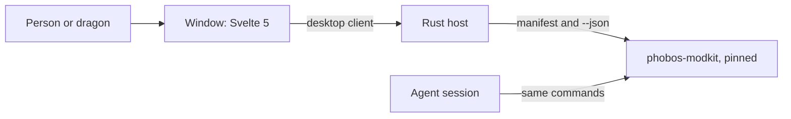

# D'thorga Companion: design record (9 Nov 2026)

**Steps 1 to 4 of this record are built: the window, its theme, its checks and the "where was I?" home page; so are the report
viewer's first stage, charts, the colony mood report and the atlas (10 Nov 2026). The owner approved the mock-up on 9 Nov 2026 ("I like the
purple vibe"); nothing built has been judged on screen yet.** The research behind it, with sources, is phobos-rimworld's
[research record](https://github.com/phobos-dthorga/phobos-rimworld/blob/main/docs/development/tools-desktop-research.md). The
home page mock-up the owner is judging is private to the owner; this record describes what it shows.

## Read this first

**D'thorga Companion is one desktop program for every game the owner mods.** It asks what you want to know and answers on
screen. Agent sessions keep the command line. Both run the same tools, so both get the same answers.

**Owner's decisions (9 Nov 2026):**

1. A program over every use of the tools, now and in the future, for humans and dragons first.
2. Primarily Rust, with SQLite if a database is needed.
3. Republic Observatory's layout and feel, with a House D'thorga identity.
4. A new sibling repository; phobos-modkit stays the engine.
5. One program for every game, so moving between games does not lose the thread.
6. The name: D'thorga Companion, plain so players can find it.
7. The order: this record and a mock-up, the two kit changes, this repository; then the home page, the report viewer, saves
   and logs, and the planet globe.

**Agent choices, for the owner to revise:** Tauri 2 with Svelte 5 over a Rust host; the Python tools run as processes; the
colours below; the first version only reads.

## What each behaviour does to the person

| Behaviour | What it lets them do | What it stops them doing | How it changes the way they work |
| --- | --- | --- | --- |
| The window (built) | See that the program and the tools are working, or be told plainly what is wrong and what to do | Nothing | Nothing yet: it is the frame everything else goes in |
| "Where was I?" home page (built) | Come back to a game after months and see when they last worked on it, what they did, what was left uncommitted, what isn't released and what's still open | Nothing; it only reads | Changing games stops costing the thread |
| Report viewer (step 5) | Read any tool's report, chosen from a list, with no typing | Run anything the manifest marks as writing, running or owner-only | Long quoted commands are no longer needed |
| Newest save and log (step 6) | See them appear by themselves as they play | Nothing | The page stays current without asking |
| Tests page (built 17 Nov 2026) | See which in-game tests the game has seen working, and pass or fail each with one press, in the moment | Mistake a note for a pass: only their own verdict passes a row | Passes seen in play reach the test list instead of being forgotten |
| Installer (built 17 Nov 2026) | Open the program from the Start menu or the desktop, like any other | Nothing | No more hunting for the exe in a build folder |
| Atlas (step 7, built 10 Nov 2026) | See the whole world as the game draws it, in six views with pollution over any of them, find any place and read any tile | Nothing; it only reads | "Why is that place polluted?" and "where should we settle?" become a glance |

## How it is built

**The window presents, the host decides.** Svelte components show what they are given. Only `desktopClient.ts` files may
talk to the host. The host owns running tools, and later the watcher, the databases and the refusals.

**One boundary to the tools.** The host runs `python -m phobos_modkit <command> --json` and reads one shape, the envelope
(phobos-modkit `docs/manifest.md`). A process per question is cheap: 0.16 s to start on the owner's PC, against 0.2 to 2.7 s
for the query itself (measured 9 Nov 2026, best case for other PCs).

**The manifest decides what the program may run.** Each report says what it does: `reads`, `reads-online`, `writes`, `runs`
or `owner-only`. The first version runs only the first two, and `owner-only` never.

**The core never names a game**, the rule phobos-modkit keeps too. A game's name reaches the core only through the
manifest's `game` field and the owner's own list of games.

## The window

Five bands, from Republic Observatory's `docs/dashboard-and-interface.md`:

| Band | Holds |
| --- | --- |
| Command bar | The crest and name, the pages |
| Observation bar | What you are looking at, and whether anything can change |
| Navigator | Your games |
| Canvas | The answer first, then the detail |
| Inspector | Where it came from, and how the tools are |

A status bar closes the window.

**For unreliable fine motor control:** controls are at least 44 px, nothing needs a drag, nothing appears only on hover, and
every control is reachable from the keyboard. **For reading:** the answer comes first, body text is 16 px and the floor is
12 px, and text scales with the operating system.

**When something fails, say four things in order:** what happened, what stayed safe, what to do, then the technical detail
folded away (Observatory's `docs/accessibility-guidance-and-notifications.md`).

**Fonts are the system's** (Georgia for headings, Segoe UI for text), as Observatory's are, so nothing is downloaded or
bundled. The mock-up uses web fonts that look much the same.

## The House D'thorga theme (agent's proposal, owner to judge)

The owner's Dragonself is the palette, in `themes/house-dthorga.json`:

| Role | Colour | From | Means |
| --- | --- | --- | --- |
| `accent` | Amber `#F2A93B` | The eyes | The brand, focus, what needs attention |
| `comparison` | Purple `#B79CFF` | The crest | Worked out from what was read |
| `observed` | Teal `#4FD1C5` | The tail | Read from a file or a save |
| `risk` | Red `#FF8A7A` | The body | Something went wrong |
| `success` | Green `#8BD17C` | The crest's streaks | It worked |
| `canvas` | Near-black `#0E0B10` | | The ground |

A test holds every colour to Observatory's contrast rules: 4.5:1 for text, 1.5:1 for dividers. **Colour never carries a
meaning alone.**

## "Where was I?" (built 9 Nov 2026)

**Each game is a list of repositories** in `.local/games.json`, never committed because it holds paths. `config/games.example.json`
shows the shape; `PHOBOS_COMPANION_GAMES` names another file. Nothing about any game is built in: the list is the only place a game
is named.

| On the page | Where it comes from |
| --- | --- |
| Games, most recently worked on first | The newest commit across the game's repositories |
| The opening sentence and the last thing done | That newest commit |
| Left unfinished | `git status`: files changed but not committed, only when there are some |
| The latest work | The newest eight commits, across the game's repositories |
| Not released yet | Each changelog, the repository's own and one per mod in `mods/`: entries under Unreleased, and the newest version marked Draft |
| Open work | `docs/development/outstanding-work.md`, where a repository has one: tables with Item and Status columns, counting statuses that begin open, in progress, waits, waiting, blocked, proposed or done except |
| Couldn't be read | Any repository that is missing or has no history; the rest of the page still shows |

**Git is read without changing anything:** `--no-optional-locks` takes no index lock, and `core.fsmonitor=false` starts no background
watcher, which is what leaked daemons on the owner's PC in November 2026. A test proves a read leaves the index unchanged.

**Why a JSON file and not SQLite** (agent choice, owner to revise): the list is short, is written by hand or by an agent, and in
`.local/` it is backed up with the repository. SQLite still arrives with the first thing that needs it, such as pins and history.

**Dates:** teal for a date read from a repository, purple for "how long ago", which is worked out from it, as the legend says.

**Left out of the mock-up:** Reports in the command bar, and Copy as command, until the report viewer gives them something to do.

## The report viewer, first stage (built 9 Nov 2026)

**The Reports page lists, for the chosen game, every report the kit marks `reads`, gives a plain question and needs nothing typed:
19 for RimWorld when built, 20 with the mood report.** The questions live with the tools, in each adapter's manifest, so the program still names no game. A game appears
here when its list `id` matches the manifest's `game`.

**The host decides.** The window asks to run a report by name. The host reads the manifest again, refuses anything it wouldn't offer,
and builds the arguments itself, so nothing typed or sent from the window reaches a command line.

**Tables:** numbers sort as numbers, through the `values` the kit adds beside each table (1.1.0). A column that isn't all numbers in
one unit sorts as words. Columns take the width their words need and the table scrolls sideways, after a real pawn list showed words
broken mid-letter. **Show more** asks the tool for five times as many rows, up to 5,000.

| Behaviour | What it lets them do | What it stops them doing | How it changes the way they work |
| --- | --- | --- | --- |
| Reports by question | Ask 19 questions of their game with a click | Run anything that writes, goes online or needs typing | No more long quoted commands for these |
| Sorting and Show more | Reorder a table and see all of it | Nothing | "Raise --top" and scanning for the biggest number are gone |
| Copy as command | Hand a session exactly what they're looking at | Nothing | Sessions and the program stay in step |

**The real path was checked with a report from the owner's own game**, through Rust and through the page, in a throwaway check that left
nothing behind. Clicking through the packaged window is the owner's.

## Charts (built 10 Nov 2026)

**Owner's request (10 Nov 2026): "pretty graphs and the like", learning from our other repositories.** Republic Observatory and
OnAir WyrmGrid both draw with Apache ECharts 6.1.0 behind one component fed a small declarative spec (Observatory's ADR-0003,
WyrmGrid's ADR-0004). Companion does the same, so the three programs share one way of drawing.

**The tools decide what to draw; the window decides how.** A chart is a block in a kit report (phobos-modkit 1.5.0,
`docs/manifest.md`): bars or a line, series and reference lines, each with a role (`risk`, `success` and so on) and never a colour.
`chartOptions.ts` turns it into ECharts options as plain data, tested without a browser; `CompanionChart.svelte` is the only
component that draws, and `echartsCore.ts` the only module that imports ECharts.

**What we changed from the sibling programs** (agent choices, owner to revise):

| Theirs | Ours | Why |
| --- | --- | --- |
| Tooltips on hover only (WyrmGrid has no other path) | Each bar's value written at its end, and **Show the numbers** for a sortable table | Nothing may need hover or a steady hand |
| Legend and line labels drawn by ECharts | A key in the page's own text under the chart, dashed swatches for lines | ECharts measured our font wrongly and the labels overlapped; page text is read aloud too |
| Axis text at 10 px | 13 px | The window's floor is 12 px |
| WyrmGrid ignores reduced motion | Motion stops when Windows asks for less | Observatory's rule, adopted |
| Canvas, loaded with the page | SVG, loaded only when a report has a chart; a failed load shows the numbers instead | Crisp at any display scale; a report without charts costs nothing |

**Does ECharts earn its place?** (the five tests in AGENTS.md, after WyrmGrid's ADR-0004): a real need now (four charts in the mood
report); less upkeep than our own, since two sibling programs already maintain the same code; one place to replace it from
(`echartsCore.ts`); tests on the option builder and in the browser; and when it fails the table shows. It costs one file of 562 kB
(192 kB compressed), read from this PC only when needed.

| Behaviour | What it lets them do | What it stops them doing | How it changes the way they work |
| --- | --- | --- | --- |
| Charts | See the shape of an answer at a glance: who is lowest, what costs most | Nothing | Long tables stop being the first thing to read |
| Show the numbers | Read and sort every figure behind a chart | Nothing | A chart never hides a number |

## Colony mood (built 10 Nov 2026)

**Owner's request (10 Nov 2026), from a play session showing "Extreme break risk x29":** "That might be actually worthwhile
integrating into our Companion, to see where you are lacking mood-wise." They handle mood mostly "with extreme amounts of drugs and
their addictions". The proposal came as a handoff from a phobos-rimworld session ([handoff-2026-11-10-mood-report.md](handoff-2026-11-10-mood-report.md));
this section is what was built from it.

**Gotcha: a save holds only half of a colonist's mood.** The game saves remembered events (a death, a meal off the floor, a party)
and works out situational thoughts (bedrooms, pain, cold, beliefs, a drug's high) while it runs. So the report counts remembered
events exactly, by the game's own rules, and gives the rest as one figure: mood minus the remembered events.

**Built: the save route, in phobos-modkit** (`rimworld-save mood`, 1.5.0). It needs no mod running and reads any save.

| Section | What it shows |
| --- | --- |
| Opening lines | How many are below each break threshold; what remembered events cost in all and the costliest; what everything else costs |
| Who is closest to breaking | A chart of every pawn's mood coloured by risk, against the thresholds; a table with each pawn's own threshold (traits move it), remembered events, everything else and lowest need |
| What hurts the most, what helps the most | Remembered events by what they cost or add everyone together, with charts |
| Needs running low | Each need's average, lowest first, with a chart and a line at 30% (our choice) |
| Addictions and drug needs | Each addiction, how many have it, how many are low and how many are empty |
| What this report cannot see | Said plainly in every report |

**Found while building, and fixed:** the game leaves a need's level out of the save when it is 0. Read as unknown, five colonists at
0% mood showed as fine; they were the worst off.

| Behaviour | What it lets them do | What it stops them doing | How it changes the way they play |
| --- | --- | --- | --- |
| Colony mood | See in one place which few problems cost the colony the most mood, instead of opening forty Needs tabs | Nothing: it only reads | Fixing the top two or three causes before reaching for drugs (the owner's own words prompted it) |

**The owner's answers (10 Nov 2026), all yes, built the same day:**

- **The snapshot route.** D'thorga Framework 0.64.0 writes the colony mood file at each save (phobos-rimworld's
  [design record](https://github.com/phobos-dthorga/phobos-rimworld/blob/main/docs/development/mood-snapshot.md)); phobos-modkit
  1.6.0 reads it when its tick count and world seed match the save, so every thought is named as the game counted it, bedrooms,
  cold and beliefs included, with each pawn's own thresholds. Without a matching file the report works from the save as before and
  says so. Not yet tested in game.
- **Suggested fixes, labelled as advice.** "Where to start" comes first: the costliest causes the player can act on, each with a
  suggestion; low needs and one pawn's thoughts carry advice too. The suggestions are written by us (agent-authored, held for the
  owner's review) in the kit's `mood-advice.json`, keyed by Def name, and every one says it is advice. A cause only time removes,
  such as a death, stays out of "Where to start".
- **Colonists, slaves and prisoners** together, each labelled; the tool's `--who` narrows it, and the window will offer that once
  reports take inputs.

## The atlas (built 10 Nov 2026)

**The owner chose a hex globe drawn with three.js over MapLibre (10 Nov 2026)**, once the owner's world turned out to have
590,492 tiles: MapLibre could only have drawn the land as a flat picture, soft up close and missing at the poles. WyrmGrid
uses three.js too, for its weather. **The owner asked for every layer in the first version**: biomes, settlements and tile
details; pollution; climate and terrain views; roads and rivers.

**The planet sits as the game's does.** The game builds its world from the same icosahedron our kit rebuilds and never rotates
it (read from the 1.7 code, 10 Nov 2026), so the in-game reading step 7 was waiting for is not needed; on the owner's world ice
sheet averages 75.5 degrees from the equator and rainforest 4.4. Reading the game's code for this also found that the kit kept
each tile's neighbours in its own order, not the game's, so roads and rivers would have been put on the wrong neighbours.
phobos-modkit 1.7.0 fixes it: the owner's 17,900 river pieces now join into 233 river systems.

| Part | How |
| --- | --- |
| Data | `rimworld-save atlas` (kit 1.7.0): one globe block of tile positions, each tile's neighbours in order, one value per tile per layer, places, lines, tags and region labels; about 45 MB of JSON and 1.1 s for the owner's world once the save is indexed |
| Drawing | Every tile a flat-coloured fan of triangles; one texture holds every tile's colour, another the overlay, so a new view rewrites a texture, never the geometry. It draws only when something changes. 423 ms from data to picture in a software renderer |
| Picking | The point under the pointer on the sphere, then a walk from a nearby tile to whichever neighbour is nearer until none is; on tiles made this way that always ends at the nearest |
| Colours | Biomes and hills bring the kit's own colours (agent-authored, `atlas-palette.json`). Temperature and elevation are two hues meeting at a light grey at 0 °C and sea level; rainfall and swampiness one hue, light to dark; pollution the game's four bands. Water shows as having no value where a layer leaves it out. The same ramps serve light and dark: the globe is a filled object, not marks on the page |
| Labels | Your own colonies always; every place once a tile spans 5 pixels; region names at the size the game gives them. More important first, none on top of another |
| Moving | Buttons for north, south, east, west, closer, further, the whole planet and the tile in the middle; the arrow keys, + and - and Enter do the same. Drag and the wheel are shortcuts. Flights are instant when motion is reduced |

**Agent choices, owner to revise:** the ramps and their stops; line colours (river blue, road tan); the purple glow from the theme's
comparison colour; amber for the picked tile; the label thresholds.

## The Tests page (built 17 Nov 2026)

**The owner asked for it (17 Nov 2026):** passes they saw in play rarely reached the test list, and the checklist should live
here rather than in the game ("Companion only", over an in-game window or both). **The owner's rules:** a note from the game is
evidence, never a pass ("seen working, awaiting your word"), and the owner has the final say on every row.

| Part | How |
| --- | --- |
| Reading | `test-pass report --all --json` (phobos-modkit 1.9.0) for every repository of the game with `config/test-evidence.json`: the rows, the game's seen-in-play notes and the verdicts so far |
| Shelves | Seen working first (a note, no verdict), then waiting, your verdicts not yet in the list, and done; preset buttons with counts |
| Verdicts | Passed, Failed (with an optional note) and Take it back; one JSON line appended to `test-verdicts/<repository>.jsonl` in this program's local data folder, checked by the host first (a row number, a known verdict, a note under 300 characters, a repository with a test list) |
| Into the test list | Not by this program: `python scripts/test-pass.py apply --apply` in the repository, run by an agent session or the owner, writes verdicts in |

**The one write.** The first version only read. Recording a verdict is the first thing this program writes, and only in its own
data folder: never a game, a save or a repository. Pressing Passed or Failed is the confirmation; Take it back undoes it. Agent
choice, for the owner to revise: no extra "are you sure?" step, since it costs a precise second press and changes nothing outside
this program.

## The installer (built 17 Nov 2026)

The owner had trouble finding the program each time and asked for an NSIS setup (17 Nov 2026). Tauri builds one itself
(`bundle.targets: ["nsis"]`); `npm run installer` runs it with build output outside the repository, as every build here does.

| Choice | What it is | Who chose |
| --- | --- | --- |
| NSIS | Tauri's own Windows installer: Start menu and desktop shortcuts, an uninstaller, updates over the top | Owner |
| For the current user | Installs under the user's local application data, no administrator prompt | Agent |
| Curly apostrophe in `productName` | Tauri's NSIS script quotes the shortcut name with straight apostrophes, so "D'thorga" broke it (`IsShortcutTarget`, 17 Nov 2026). The window title keeps the straight one | Agent |
| Not in the gate | The gate still builds with `--no-bundle`; the installer is built on request | Agent |

The installed program still finds the kit and `.local/games.json` by the folder it was built from (see Limits), so it is for the
PC that built it. The data folder is named by the identifier, which is unchanged, so test verdicts carry over.

## The Mods page (built 18 Nov 2026)

**The owner asked for it (18 Nov 2026):** a part "dedicated to the updating, reversing changes, making backups, etc. all with regard
to our mods", starting with seeing the changelogs "track and update to what I'm either benefitting from or losing as certain changes
are made". The design behind it is phobos-rimworld's
[mod installs record](https://github.com/phobos-dthorga/phobos-rimworld/blob/main/docs/development/mod-installs.md); the tool is
phobos-modkit 1.20.0's `installs` (its `docs/installs.md`).

| Question | Answer |
| --- | --- |
| What does it let the owner do? | See, mod by mod, what installing from the repository or going back to any backup would give or take away, by changelog entry, with save notes first; then make that move with one confirmed press |
| What does it stop them doing? | Going back or installing while the game runs; making a move without being asked first; losing the install a move replaces |
| How does it change the way they work? | Updating no longer needs a session to run deploy; a bad update can be undone from here without knowing where backups live |

| Part | How |
| --- | --- |
| Reading | `installs status --json` for every repository of the game with `config/installs.json`; again when the window regains focus (after 15 s) or on Read again |
| Gains and losses | From the changelog each copy carries: an entry one has and the other lacks. Matched by text, so an Unreleased entry that later gets a version is neither |
| Moves | Install from the repository, Back up the installed copy, Go back to this. Each opens a confirmation in words on the card, with the keyboard moved to it; the host checks the repository, the move (against the kit's manifest) and the names, then the kit checks again |
| Safety | Going back and installing wait for the game to close (the button says so); nothing is deleted: the replaced install becomes a backup and the backup stays |

**Round two (built 18 Nov 2026, 0.11.0).** The owner asked, after seeing the page, for a way to compile as needed, a refresh
after it, before and after shown ahead of a compile, and to know whether textures need encoding before a launch ("it's always a wild
guess currently"). **Owner's picks:** check and fix textures (Workshop mods included); Build plus Install everything that changed; all
four before-and-after extras (files, settings, test rows, side by side); a Before you play strip.

| Part | How |
| --- | --- |
| Before you play | Built from both readings: needs a build, changes not installed, mods never installed (from 0.39.0, worth knowing rather than left to do), textures stale or never encoded, the game running; Ready to play when nothing is left. Each line carries the button that does it |
| Build | `installs build` (the repository's `deploy.py --build-only`); no question asked, since it writes only inside the repository; allowed while the game runs (agent choice) |
| Install everything that changed | Mods whose changelog, files or build differ, one `installs install` per repository with every mod named: one run, one restart |
| Side by side | Installed now (version, where it came from, entries lost) beside After installing (version, needs a build, entries gained, files, settings, rows to look out for); save notes above both |
| Textures | The kit command for this game whose status has the `textures` surface (`rimworld-textures` today), with the settings file a repository names; encode after a question, game closed |

**The second write, and the first outside this program's folder.** Agent choices, for the owner to revise: a confirmation step for every
move (unlike verdicts, these change the game's files); the backup button stays live while the game runs, since it only reads; lists
show eight entries before Show all.

## Who it is for, and what follows from that (owner, 19 Nov 2026)

**"A multi-game, multi-framework, viewer to primarily help me but maybe also others."** From this version on, every design,
change and removal starts from that sentence (the rule is in `AGENTS.md`):

| It means | So |
| --- | --- |
| Every game the owner mods, and every modding framework under them | A page reads what any repository has (a changelog, git, a file it opts in with). A game's own knowledge comes through the kit's manifest and adapters, never from the window or the host |
| Mainly the owner | Their questions lead: where was I, what changed, is it installed, is it ready to play |
| Maybe others | Nothing personal is built in; words say "your mods", not one game's terms; and what stands between this and another person is written down, below |

**Where each page stands (19 Nov 2026):**

| Page | Any game today? | What a game needs |
| --- | --- | --- |
| Home ("where was I?") | Yes | A repository on the list |
| Changes and the code viewer | Yes | A `CHANGELOG.md` in the repository |
| Tests | Yes, where a repository keeps a test list | `config/test-evidence.json` |
| Mods (install, back up, go back) | Where the kit has an install adapter: RimWorld today | `config/installs.json`, and `games/<game>/installs.py` in the kit |
| Mods (textures) | RimWorld only | A kit command with the `textures` surface; most games have no such step |
| Reports, Atlas | RimWorld only | Kit commands for that game's saves and logs |
| Mods (0.26.2), Atlas, Logs, Memory, Game files, for a set of tools (0.24.0) | Never: a set of tools has none of what they read | Nothing: the page says so in words; Mods points to About |

**What stands between this and another person** is now the [release audit](release-audit.md) (20 Nov 2026, after the owner's word
that the Companion is to be released for others): what a stranger would hit, in order, with options and the owner's questions.

## Progress (built 19 Nov 2026)

**The owner asked for "progress bars along with some associated status updates, wherever the two would be appropriate".**

| Question | Answer |
| --- | --- |
| What does it let the person do? | See that work is going on, what it is doing right now, and how far along it is where that can be counted |
| What does it stop them doing? | Guessing whether the program has hung, and pressing a button twice |
| How does it change the way they work? | A build or an install can be left to run and glanced at |

| Part | How |
| --- | --- |
| The tools | phobos-modkit 1.24.0 writes progress lines to standard error when asked: a label, a step and a count where it can count, and a line of the work's own output. A repository's own build or install speaks the same lines |
| The host | `kit::run_hearing` reads them as they come and sends each through the channel the window gave with its request |
| The window | `ProgressBar.svelte`: filled by the count, or moving when there is none; words always; the latest output line beneath. With reduced motion the moving band stands still |

A step being worked on counts as not yet done, so step 3 of 23 shows two done (agent choice). Where a tool says nothing, the bar
moves under the page's own words.

## The Changes page and the code viewer (built 19 Nov 2026)

**The owner asked for "a code-viewer that helps show off all the new and shiny code associated with any particular CHANGELOG
item", with "a decent syntax highlighter", for the Mods page "and for any future modding I do as well".**

| Question | Answer |
| --- | --- |
| What does it let the person do? | Read what changed in any game's mods, and open the code behind any entry: which files, which lines, coloured by language |
| What does it stop them doing? | Mistaking a whole commit for one entry's work: when a commit wrote several entries, the viewer says so and names them |
| How does it change the way they work? | A changelog becomes a way in to the code, without a terminal or a git client |

| Part | How |
| --- | --- |
| Finding the code | phobos-modkit `changes entry`: the oldest commit in which the entry's opening appears in its changelog (`git log -S`), then that commit's diff. Nothing extra is written in a changelog |
| Order | Code, then data and definitions, then words, then other files; the viewer opens the code file with the most new lines, and the code before its tests |
| Colours | highlight.js, one grammar at a time, through `highlightCore.ts`; each side of a change is coloured whole so a comment or string over several lines reads right; token colours are the theme's roles |
| Two views | What changed (both line numbers, a plus or minus mark) and The code as it now stands (removed lines left out) |

**What it means for how changes are written** (the owner asked to be told): nothing new is written in a changelog. The view is
as sharp as the commit is small, so one commit that wrote eight entries shows the same 21 files for each of them. Of three choices
(leave commits as they are; commit separate changes separately where they are separate anyway; one commit for every entry), **the
owner chose the second (19 Nov 2026)**. It is a rule for every repository now, in phobos-modkit's `rules/every-session.md`: one
change is finished and committed before an unrelated one is started, and nothing is untangled afterwards.

## Tidying, and telling a rebuild from a change (built 19 Nov 2026, 0.13.0)

The owner, on 0.12.0: "I absolutely love how the code is tracked to every particular item", asked for the busiest areas tidied, and
saw "changes in DLLs, across the board, where there might not be any".

| Found | Done |
| --- | --- |
| A button under every entry, all opening the same commit | One button per run of entries one commit wrote (phobos-modkit gives every entry its commit, from `git blame` by version); a version from one commit has one button beside its heading |
| Bold marks inside an entry shown as asterisks | `RichText.svelte` shows `**bold**` and `` `code` `` as such, never as markup |
| Unchanged code read as changed | .NET stamped the git commit into every assembly; phobos-rimworld turned it off, and the kit marks an assembly whose own sources are unchanged as only rebuilt, and names the sources when they did change |
| "Up to date" beside files that differ | Two states: Only rebuilt, and Files differ (with the sources) |
| A tall, empty Installed now column | Columns sit at the top; the after column is wider |

## The Timeline page and the Settings page (built 19 Nov 2026, 0.14.0)

**The owner asked for "a timeline (with suitable graph(ic)s) that records/shows how updates were applied, changed, removed, etc.
over time with a suitably recorded history and its facts", because "I like coming back and reading the CHANGELOGs from a particular
update-in-moment but I can't because it is now lost to time"**, and, once the history log needed a home, "a central settings page
where everything or at least, most, of these sorts of things are managed".

| Question | Timeline | Settings |
| --- | --- | --- |
| What does it let the person do? | See what happened to every mod over time at a glance, read any day's facts, and read any changelog exactly as it stood then | See every path the tools read and where each value comes from, and change one for every repository at once |
| What does it stop them doing? | Losing a version's words once a later version rewords or removes them; mistaking today's changelog for what was installed then | Hunting through repositories' ignored files and environment variables to learn why a tool looks where it does |
| How does it change the way they work? | A changelog becomes a history to walk back through, not only today's page | Settings that hold everywhere live in one place, the Companion's own folder |

| Part | How |
| --- | --- |
| Facts from git | phobos-modkit `history timeline` reads every commit that touched a changelog, back to the first, once, and keeps the facts in its cache (about 4 s the first time for phobos-rimworld, under a second after) |
| Facts from this PC | The history log, one JSON line a fact, one file a game, in this program's own folder by default (owner's choice); the kit's installs, deploy and texture encoding write it as they work. Recorded from 19 Nov 2026; earlier installs were not recovered (owner's choice) |
| The overview (owner's choice: both views) | One lane a product, one column a day anything happened; quiet days are left out so a long gap takes no room. Each cell is a 44 px button with the strongest mark of the day and a count; its colour comes from the theme by role and never carries the meaning alone (each mark has words, in its label and in the key) |
| Day by day | Newest first, ten days at a time; each fact names its product, version and time, gives its version's summary, lists its entries under their sections (up to eight, with how many more), and offers Read it as it stood and Show the code at the end of its line. Mods installed, backed up or taken back together (one repository, one minute) are one row of buttons, one a mod (0.15.1, at the owner's request to streamline it). The repository is named only for a game with several |
| As it stood | `history at`: the changelog at the fact's commit, or, for a fact from this PC, at its moment; each entry marked kept, reworded (with its words now) or taken out since, with the commit that wrote it then, so Show the code works as on the Changes page (0.15.0, after the owner found it missing) |
| Settings | `settings list` names every repository on the owner's list, so a repository's own settings show; `settings set` writes only the central file, after a press of Save or Use the default |

**The history's ideas are a design to edit** (owner's choice): phobos-modkit's `rules/first-class.md` names what makes a thing a
first-class citizen (an identity that outlives its label, an address, a history of facts, the same shape in every game), and the
timeline is built on the first five: Change, Version, Product, Install and Event. Nothing there is a rule until the owner says so.

## How code connects (built 19 Nov 2026, 0.17.0)

**The owner asked for "flow-charts and the such which show relationships between functions, classes, etc. of the code I'm viewing,
wherever it might be. Such as when I'm viewing a code-slice that I was sent towards from a CHANGELOG"**, pointing at the style of
their Relationships and Factions screens: one thing in the middle, its connections grouped around it by kind, filters with counts,
and a press to put anything in the middle.

| Question | Answer |
| --- | --- |
| What does it let the person do? | See how any piece of code fits in (what calls it, what it calls, what it belongs to, builds on, overrides, patches and uses) and walk from one piece to the next, from a changelog entry or a search |
| What does it stop them doing? | Reading a change as if it stood alone: what a changed method affects, and what affects it, is on screen |
| How does it change the way they work? | A changelog entry leads to its code and from there to the code around it, in any game, without an editor or a terminal |

| Part | How |
| --- | --- |
| The facts (owner's choice: exact C#) | phobos-modkit 1.33.0's `connections`: C# exact from the built assemblies through the kit's assembly reader (calls, fields, inheritance, overrides, Harmony patches), placed in the source by its scanner; XML Defs, Lua and Python by their own rules; every connection marked exact or by name |
| The layouts (owner's choice: both) | Around it (hubs by kind, up to 14 members fanned beyond each, the rest on a "more" node that opens the list), a flow of calls (columns from callers to callees, two steps each way), and a list for the keyboard and for long groups |
| Where (owner's choice: both) | The code viewer's third view, starting from the things the commit changed, and the Code map page, starting from a search |
| Drawing | SVG, from `layout.ts` (tested without a screen). Each kind of connection has a theme colour and always its words and count; dashed lines are by name, dashed circles outside the repository, rings mark what the commit changed. Every node is a button with its words; zoom has buttons; drag and scroll are shortcuts |

**Agent choices, owner to revise:** which connections show at first (all but "holds", which lists a type's every member), 14 members
fanned per hub, two steps each way in the flow, and .NET's own library left out of the connections.

## Keyboard shortcuts (built 19 Nov 2026, 0.18.0)

**The owner asked for "some common-sense keyboard shortcuts as a default setting, and the ability for the end-user to configure
those further to their needs within the Settings Dialog somewhere, perhaps as its own modal deeper within".**

| Question | Answer |
| --- | --- |
| What does it let the person do? | Move between pages, games, views and pictures with one key, and choose those keys |
| What does it stop them doing? | Reaching for the mouse for every move; and, since nothing acts in a text box and each key can be turned off, a stray key doing something unasked |
| How does it change the way they work? | The common moves are a key away, and the full list is one more (?) |

| Part | How |
| --- | --- |
| The keys (agent's defaults, owner to change) | One key each, never two held at once, so no move needs a chord. Numbers for pages in the bar's order, brackets for games, letters for views, + - 0 for zoom |
| When a key acts | `registry.ts`: a view offers its moves while it is on screen; a press goes to the newest view offering it; never in a text box or in a part that takes keys itself (the globe), never when something else handled the press, and outside a dialog only while no dialog is open |
| Changing them | The Settings page's "Change keyboard shortcuts" dialog (owner's idea: a modal deeper within Settings). A key another action has is refused in words; Tab, Enter, Space and Escape are kept |
| Keeping them | `shortcuts.json` in the program's own folder, holding only what differs from the defaults, so new defaults still arrive; the host checks its shape before writing |

## Cross-links (built 19 Nov 2026, 0.19.0)

**The owner asked for the whole proposed order of [cross-links](cross-links.md) to be built overnight: "Proceed with your entire
proposed order, step-wise if necessary".** Each item answers the three questions here; what differs from its proposal is in that
record's "As built".

| Item | What does it let the person do? | What does it stop them doing? | How does it change the way they work? |
| --- | --- | --- | --- |
| N1 Back and Forward | Follow any link and return exactly where they were, dialogs included | Losing their place when a link jumps pages | Wandering is safe, so links can be followed freely |
| N2 Go to anything | Reach a method, entry, row, setting or report by name from any page | Hunting through pages for where a thing lives | One search box first, pages second |
| N3 Addresses | Keep or share a pointer to any place, and paste it back in | Describing a place in words to find it again | A place can be noted in a file and reopened later, which suits re-reading |
| L4 What was I running then? | See every mod's installed version at the end of any day | Guessing which versions a fault or a memory belongs to | A fault report starts from the versions that were in play |
| L1 The log chain | Go from an error in the game's log to the code it happened in, the change that touched that code, and the backup from before that change | Reading a log of hundreds of thousands of lines, and searching the code, history and backups by hand | "What broke it, and how do I undo it?" is a walk of links rather than a terminal session |
| L3 Test rows joined | Go from a test row to the code that notes it, from a method to the rows that watch it, and from a version to the rows still waiting on it | Searching code for a note's key, or the test list for a version, by hand | "What needs testing" and "what it is" sit one press apart, both ways |
| L5 Patch badges | See, on the method itself, how many other mods patch the same method and whether the last update changed it | Running the patches and upstream tools by hand before trusting a patch | Risk shows where it sits, before an update bites |
| S2 Tool kit pins | See which repositories lag the tool kit, and what moving each pin would bring | Remembering or guessing which kit each repository uses | Moving a pin becomes a choice made with the gains in view |
| S3 Merges on the Timeline | Follow a mod that ended into the mod that took it in, and back | Guessing where a merged mod's story continues | The Timeline reads across a merge as one story |
| S4 Home items as links | Start from "where was I?" and open the commit or the changelog in one press | Hunting for the same commit or changelog on another page | Home becomes a starting point, not only a summary |
| L2 A thing's history | See every commit that changed a method, class, Def or function, with the changelog entries each wrote, and open any of them | Reading git's history by hand to learn why code is as it is | From any node in a picture, "why is it like this?" is one button away |

**Shared code, on the owner's word.** The [shared code audit](shared-code-audit.md) (19 Nov 2026) found code written 3 to 17
times across the host and the window, and proposes a `companion-core` library crate for the host and a grown `src/lib/shell/` for
the window. Nothing is moved until the owner says.

**Step 5, the rest of the report viewer.** Forms built from the manifest for the 19 reports that need an input, then the kit's
progress stream and the 7 that read online. Three tools get extra paths from phobos-rimworld's wrapper scripts (`query-code`,
`query-defs patched`, `mod-settings`) and need those paths in the game list first. The reports' opening lines are written for agents
("Index of PG4.rws, built now from a frozen copy...") and want moving out of the way of the answer.

**Step 6, saves and logs.** Rust watches the folders, with file events as hints, a full check every 15 seconds and a 1.5 second
wait until a file stops changing (Observatory's `recorder_service.rs`). Needs the kit's progress stream.

**Next on the atlas:** stepping through saves with buttons, to watch pollution spread; links from other reports' places and
tiles to the atlas (the owner's cross-links idea, 10 Nov 2026).

**SQLite arrives with the first thing to keep**: two files under the user's local application data, never a synced folder.
One holds what can be rebuilt, the other the owner's own pins and history, with an export because Synology does not back up
that folder.

## Make-up (built 19 Nov 2026, 0.20.0)

**The owner asked to show "how the contents of our mods, code, etc. is consisted of in a graphical manner"**, and chose all six
views, lines as the first measure, and "a mix of new page and inside code map, as appropriate".

| Question | Answer |
| --- | --- |
| What does it let the person do? | See at a glance what each mod is made of, how it grew, where the work goes, how much is tested in game and what players get |
| What does it stop them doing? | Guessing sizes and balance from a file browser, or counting Defs and test rows by hand |
| How does it change the way they work? | Where effort and risk sit is visible: a big, busy, untested part stands out before it bites |

| Part | How |
| --- | --- |
| The facts | phobos-modkit 1.39.0's `makeup` (now, growth, churn, census): committed files only, products from changelog folders and each C# project's `<ModFolder>`, kinds by extension and folder |
| The pictures | ECharts treemap, stacked bars and stacked area through `OptionChart.svelte`, now the one component that talks to ECharts (the report chart draws through it). Colours: one fixed colour a kind, the reference categorical order validated on the theme's chart surface (worst adjacent CVD ΔE 8.4, normal vision 19.3, every colour 3:1); heat is one blue ramp |
| Where | A new page, Make-up (key M, agent's choice), for the content views; the Code map's busiest code for where the work goes |

**Agent choices, owner to revise:** the 30-day window for changes, the key M, the page at the end of the bar (it now holds eleven;
grouping it is still open), and "Size as installed" left out (it needs each game's install records).

## Screen notes (built 19 Nov 2026, 0.22.0)

**The owner said yes to a "something's off" key** (19 Nov 2026), the first of four tools proposed for working with agent sessions.

| Question | Answer |
| --- | --- |
| What does it let the person do? | Flag a page that looks wrong in one key press, with the picture and the page's address kept for them, and a few words if they like |
| What does it stop them doing? | Describing in a conversation where on which page something looked off, and losing the moment when no session is open |
| How does it change the way they work? | Oddities get noted as they are seen, and every session starts by reading them; Home shows what was done about each |

| Part | How |
| --- | --- |
| Taking it | The picture is drawn before the dialog opens (the same drawing as Save a picture), so it shows the page, not the dialog |
| Keeping it | The host writes `screen-notes/<id>/picture.png` and `note.json` whole, into a folder made beside its place and then moved; the id is the owner's local time (`20261119-101500`), the time inside is UTC, and the version is the host's own |
| Reading it | Agent sessions: phobos-modkit 1.41.0's `screen-notes list`, and `resolve` writes `resolved.json` beside the note. Home: open notes, and the newest five dealt with |

**Agent choices, owner to revise:** the ! key (Shift+1); the button's words "Something's off"; five dealt-with notes on Home; the
folder fixed in the Companion's own folder, not a setting, because the Companion and the kit must agree on it.

## Records backup (built 19 Nov 2026, 0.22.0)

**The owner said yes to backing up the Companion's own records** (19 Nov 2026): Synology does not back up the local application data
where they live.

| Question | Answer |
| --- | --- |
| What does it let the person do? | Keep a copy of every verdict, mark, note and history line somewhere their NAS keeps, in one press |
| What does it stop them doing? | Losing weeks of test verdicts and history to a disk failure or a reinstall |
| How does it change the way they work? | Home says when the copy is old, so backing up is a nudge, never a chore to remember |

| Part | How |
| --- | --- |
| What is copied | phobos-modkit 1.43.0's `records`: everything in this program's folder but WebView2's browser cache (`EBWebView`, about 79 MB of the owner's 80), so a new kind of record is included without a change; any record a setting keeps elsewhere too |
| Where | A new folder named for the local time, inside `recordsBackupPath`, written whole with a `backup.json`; a folder inside the records is refused |
| Settings page | Back up your records: when last copied, what a copy holds, where it goes, Back up now (waits until a folder is chosen), and a button to the setting |
| Home | A note when there is no copy, or the newest is at least seven days old |

**Agent choices, owner to revise:** seven days before Home speaks up; never deleting old copies (the owner prunes by hand); saves
left out (a separate, larger question, in `later.md`).

## Claims board (built 19 Nov 2026, 0.22.0)

**The owner said yes to a claims board** (19 Nov 2026), after an evening of sessions messaging each other to ask which version
number was free.

| Question | Answer |
| --- | --- |
| What does it let the person do? | See which agent session is working on what, and spot one that ended holding something |
| What does it stop them doing? | Relaying "is 0.174.0 yours?" between sessions, and two sessions shipping the same version number |
| How does it change the way they work? | Sessions sort out shared numbers among themselves; the owner reads the board instead of asking |

| Part | How |
| --- | --- |
| The board | phobos-modkit 1.44.0's `claims`: one file in this program's folder (`claimsPath`), changed under a lock file and written whole; a thing is its words, ignoring case and spacing |
| The rule | `rules/every-session.md` in the kit: take before using, release once committed, ask a holder rather than pick around them |
| Home | Who is working on what: each claim, its session, how long, its note, and old ones marked. Only read |

**Agent choices, owner to revise:** a day before a claim is called old; nothing expires by itself.

## Decisions page and the grouped bar (built 19 Nov 2026, 0.22.0)

**The owner said yes to a Decisions page** (19 Nov 2026), the "Decisions waiting for you" idea of 10 Nov grown into a page, with the
page bar grouped in the same change.

| Question | Answer |
| --- | --- |
| What does it let the person do? | Answer every open choice in one place, with the options and the agent's reasoning beside it, in one press when the lean is right |
| What does it stop them doing? | Hunting through design records for "agent choice, owner to revise" lines, and choices going unrevised because nobody asked |
| How does it change the way they work? | Agents leave questions on a page instead of in prose; sessions start by acting on the answers |

| Part | How |
| --- | --- |
| The questions | Each repository's `config/decisions.json`, read by phobos-modkit 1.45.0's `decisions list` over every repository on the list and this program's own |
| The answers | `decisions answer` appends a line to `decisions/<repository>.jsonl` in this program's folder; the last line decides, so an answer can be changed until an agent acts on it and removes the question |
| The page | One card a question: plain radio buttons (the lean marked and chosen first), Something else with words, Decide. Answered ones wait below with Change my answer |
| Home | How many decisions wait, with a button to the page |
| The bar | Three labelled groups, Play, Code and Tools, built from one list; every page keeps its key |

**Agent choices, owner to revise:** the lean chosen to begin with (one press to agree, at the cost of agreeing too easily); the D
key; the groups' names and order; keys left as they were until the owner answers `page-keys` on the page itself.

## Game files (built 19 Nov 2026, 0.22.0)

**The owner asked what the games themselves write that the Companion could show**, made general so a new game needs little setting
up (19 Nov 2026), and said yes to the views proposed.

| Question | Answer |
| --- | --- |
| What does it let the person do? | See before playing what updated since last time, find a save or a screenshot, and see where a game's space goes, for any Steam game |
| What does it stop them doing? | Digging through AppData and Steam's folders, or guessing which mods updated overnight |
| How does it change the way they work? | A start-of-session look tells them what to expect; a new game shows something before it is set up at all |

| Part | How |
| --- | --- |
| The facts | phobos-modkit 1.46.0's `game-files report`: Steam's app manifest and Workshop records, the game's saves and screenshots folders and Steam's, sizes by folder |
| Places | Guessed by the game's name; the games list may name `data`, `saves` and `screenshots`, and `steam_app_id` (`companion-core`'s `games::places_of`) |
| The page | Under Play (key W): what changed (since the last launch, a day or a week), saves (ten a page), screenshots (the newest twelve), space as bars. A part it cannot fill says what to set |
| Showing a file | Only one inside a folder the last report named, at most two levels down (a group of saves) |

**Checked on three games:** RimWorld (everything), Farming Simulator 25 (Steam's records; its data folder was not guessed) and
Project Zomboid (saves and space with its data folder named; not installed through Steam now). **Agent choices, owner to revise:**
the W key; twelve screenshots and ten saves a page; space as plain bars rather than a chart; a list of screenshots, not pictures,
until the gallery is built (`later.md`).

## Memory (built 19 Nov 2026, 0.23.0)

**The owner decided (19 Nov 2026) that memory profiling is done from the Companion**, not by asking agent sessions to run watches.
The tool kit already had the watch (phobos-modkit 1.42.0, fixed in 1.45.1); 1.47.0 added what a program needs to follow and steer it.

| Question | Answer |
| --- | --- |
| What does it let the person do? | Watch the game's memory for a few minutes at a press, see it as it goes, mark what they do ("reloading now") at the moment they do it, stop early, and read any kept watch's report |
| What does it stop them doing? | Starting a watch by accident or without a warning: a watch that attaches to the game asks first, every time. Reading figures before knowing what happened: the report opens with the saves the log shows loaded, the marks, and a bold line when a marked reload never reached the log |
| How does it change the way they work? | No agent session and no console: the owner runs short watches between restarts themselves, and the marks put their intentions beside the figures |

| Part | How |
| --- | --- |
| Finding the watch | The manifest's `memory-watch` surface (phobos-modkit 1.47.0) on `watch`, `watch-report`, `watch-status`, `watch-stop` and `watch-mark`; the host names no game, and a game without it is told so in words (`src-tauri/src/memory_page.rs`) |
| What may run | Reading only reads. **Starting runs only on a press and a confirmation**, never by itself, and only while the manifest calls it `runs`; stopping and marking write only into the watch's own folder in the kit's cache, while the manifest calls them `writes`. The host checks the length is one offered, the label and a mark are one line of a sane length, a watch's name has the kit's shape, and a mark's words come after `--`, so no text becomes an option |
| Following it | The window reads `watch-status` (about 0.2 s) every 5 seconds while a watch runs. The request that started it lasts as long as the watch and carries its progress; it is kept outside the page (`watching.svelte.ts`), so changing page loses nothing. A watch started elsewhere, or before the window was reopened, is followed the same way, its bar counted from its own clock |
| Marks | B puts the keyboard in the mark box and takes the moment then, not when Enter is pressed. Five quick marks mark at once. The kit stores them beside the samples (`watch-mark`), and the report names them beside the jumps |
| Kept watches | The twenty newest, with their length, state and what they read; choosing one shows its whole report (the kit's `watch-report`, drawn by `ReportView`). They also join Go to anything |

**Checked on:** RimWorld, the one game whose tools have a memory watch; for every other game the page says so in words (the host's
test covers a game without one). The kit's `watch-status` was read against the owner's two kept watches of 19 Nov 2026; **no watch
has been started from the window yet, and nothing here is tested on screen.**

**Agent choices, owner to revise:** the lengths offered (5, 10, 15, 20, 30 and 60 minutes, 15 first, from the owner's word that 60 was
"a bit generous" and 15 to 20 workable); .NET's figures on by default; the keys U (page), T (start), B (mark) and X (stop); the five
quick marks' words; stopping without a confirmation, since nothing is lost; the page under Play, after Logs. Four questions are on the
Decisions page: marking from inside the game, starting a watch by itself when the game starts, the first length, and the keys.

**Not built:** marking without switching from the game (a global key; on the Decisions page), carrying a watch across a game
restart or starting one when the game starts (on the Decisions page), editing or removing a mark, and the heap snapshot and its
comparison (`heap`, which pauses the game 20 to 30 seconds and holds only part of a large heap; a page for it waits for the kit's
reader of what holds what).

## Tools beside the games, loading pages, the atlas's top (built 19 Nov 2026, 0.24.0)

**The owner asked (19 Nov 2026) for the Companion "as its own game"**, knowing it would need exceptions, and chose one entry
holding all three tools (the Companion, phobos-modkit and phobos-log), with the pages that cannot serve it saying so. In the same
request: pages that showed only a progress bar and empty space (all Save a picture caught while one loaded), and a tidier atlas.

| Question | Answer |
| --- | --- |
| What does it let the person do? | Follow the tools' own work where they follow a game's: where was I, what changed, the timeline, the make-up, the decisions waiting. Take a picture of a page that is still loading and get the page, not its bar |
| What does it stop them doing? | Opening a game-only page for the tools and meeting a failed reading or a blank: the page says why there is nothing. Sharing a picture of a loading bar by accident |
| How does it change the way they work? | No switching to a terminal or GitHub to see what the tools did; P can be pressed as soon as a page is opened |

| Part | How |
| --- | --- |
| Kind | An entry on the list may carry `"kind": "tools"`; without it an entry is a game (`GameKind` in `companion-core`'s `games.rs`, carried to the window on Home's answer). Pages about a game being played (`GAME_ONLY_PAGES` in `src/lib/home/kinds.ts`: Atlas, Logs, Memory, Game files; Mods from 0.26.2, on the owner's yes, since its words are a game's and a tool's installed version is About's) show `NotForTools` for a tools entry instead of asking the host anything, and their buttons have a dashed edge. Tests and Reports stay: each already says when a repository has nothing for it, and a tool may one day have a test list |
| Loading | Every `ProgressBar` and `Placeholder` carries `data-picture-wait`, and so does the globe while it draws. Save a picture waits while any is on the page, looking every 250 ms, and takes the picture after two looks in a row find none, so a page that reads in stages is not caught between two. Take it now skips the wait; changing page lets it go. The Memory page's bar for a running watch passes `holdsPicture={false}`: it stays up for minutes while the page is there to see |
| Placeholders | Under each page's first reading: rows for the Code map, Reports, Settings and Tests; a new `globe` shape (a disc in a panel the globe's height) for the Atlas |
| Facts | phobos-modkit 1.48.0 gives a report `facts` (label and value). `ReportView` draws them as a strip of small cards above the opening lines, for every report. Save reports give Save, Read and, when built just now, Index; the atlas adds World seed and Surface tiles |
| The atlas's top | The page's own header holds the title and Read again on one line, and the globe's description as the lead (`globeCaption={false}`, so the globe block does not repeat it). The views and the show choices share one panel. The globe block is a container: at 960 px wide or more the tile panel and the key stand in a column beside the globe, with Go to your colony above them; narrower, they stack beneath it as before |

**Checked on:** RimWorld (a game) and the owner's tools entry, by the host's and the window's tests and a browser build; **nothing
here is tested on screen.**

**Agent choices, owner to revise:** the entry's name (D'thorga Tools) and id (`tools`); which pages count as game-only; the dashed
edge; half a second of staying loaded before the picture; the side column's width (300 to 380 px) and the 960 px point where it
appears. Two questions are on the Decisions page: Code map readers for TypeScript, Svelte and Rust, and how much of decompiling to
take on.

## About (built 19 Nov 2026, 0.25.0)

**The owner asked (19 Nov 2026) for "a proper, About, page"**: they kept forgetting which version was installed and could find no
version number anywhere.

| Question | Answer |
| --- | --- |
| What does it let the person do? | See at a glance which version is running, and from any page; learn whether a newer one is waiting and where its installer is; read what this version brought |
| What does it stop them doing? | Guessing whether the last install took, or running an old version without knowing |
| How does it change the way they work? | No asking an agent session or digging through folders for a version: it is in the status bar, and About answers the rest |

| Part | How |
| --- | --- |
| The version in sight | The status bar's version button, from package.json at build time (`__COMPANION_VERSION__` in `vite.config.ts`; a test keeps package.json and the host's version equal). It opens About |
| Build facts | `src-tauri/build.rs` records the commit, the moment and the build output folder (`CARGO_TARGET_DIR`), and runs again whenever the repository moves to another commit |
| The page | `src-tauri/src/about_page.rs` reads the running version, the repository's `package.json` version, its changelog (each version's number, date and opening paragraph), commits since the build (`git rev-list --count`, through `companion_core::git::text`, without locks or a watcher), the remote as a web address, the installer for the repository's version (found by its name's ending in the bundle folder, so no product name is written in code) and the notices' "In the program" table. Whatever cannot be read is left out, never a failure. It only reads |
| Where it stands | Newer version waiting (with the installer's path, or a word that it is not built yet), up to date with commits not yet in a version, or up to date (`src/lib/about/presentation.ts`) |

**Checked on:** this repository, by the host's and the window's tests and a browser build; **nothing here is tested on screen.**
It serves every game the same: it is about the program, not a game.

**Agent choices, owner to revise:** the I key; the page under Tools, last; the version in the status bar's right end; at most ten
newer versions listed; no Show in folder buttons (the paths are plain text to copy).

## Their code and updates (built 19 Nov 2026, 0.26.0)

**The owner chose "Read and compare, on your press" (19 Nov 2026)** for how much of decompiling the Companion takes on, and was
delighted by the idea of reading third-party code: "I like that we can delve even deeper into code now".

| Question | Answer |
| --- | --- |
| What does it let the person do? | Follow a patch of ours into the method it patches and read it; read any outside thing on the map; see what a mod's or the game's update changed, down to one method's diff |
| What does it stop them doing? | Guessing what a method we patch does, or asking an agent session to decompile and read it out. Decompiling a file the tools did not name |
| How does it change the way they work? | When an update breaks something, the trail is Code map → the patch → See what changed → Their code, all in the window |

| Part | How |
| --- | --- |
| Finding the tools | `kit::offered` in `companion-core` (new): the command whose report carries a surface, its effect checked, and `allowed_by_manifest` for one that runs. The first page to use it; the Memory page and patch targets still have their own finders, to move when next touched |
| Their code | phobos-modkit 1.49.0 `rimworld-code show` (public clones first, then `.local/decompiled`, then the kit's own decompiles; IL notes left out, each line's own number kept), `holder` (the assembly and mod, from metadata) and `decompile` (on a press, into the kit's cache). The panel stands above the Code map's results, under the focus key `their` |
| Updates | `rimworld-archive list` (now with data) and `compare`, optionally `--show` one declaration. The panel stands under Busiest code while nothing is chosen, under `update`, `owner` and `member` |
| Code colours | Moved from the code viewer into `app.css` as `.code-colours`, used by the viewer and the new `CodeLines` |
| Safety | The host remembers every assembly `holder` named in this run and refuses to decompile any other path. Names reach the kit after `--` |

**Checked on:** RimWorld, against the owner's real clones, decompiles and archive (VF's `TurretRotation` from its public source in
0.5 s once indexed; the game's `WorldPawns.PassToWorld` from a decompile; `holder` in about 5 s; Fortified Features Framework's
last update compared). Every other game has no `other-code` or `updates` surface, and the Code map says so in words. **Nothing here
is tested on screen.**

**Agent choices, owner to revise:** Decompile asks no second question (it writes only into the tools' cache, like Build); the
panels' places on the Code map; files kept only once are left out of the updates list; the first lines shown (400).

## Clean up, and the settings list at once (built 20 Nov 2026, 0.27.0)

**The owner asked (20 Nov 2026)** for the Mods page's settings list not to sit on its bar after a start, for the tools' cache to
move off Windows' Temp folder to K:, and for "some kind of ongoing cleanup process", with their yes before anything goes.

| Question | Answer |
| --- | --- |
| What does it let the person do? | See what the tools, builds and tests left behind, by group, and clear the groups they choose; see their settings list the moment the page opens |
| What does it stop them doing? | Deleting a way back by accident (install backups start unchosen), or deleting anything without a confirmation; waiting on a bar that looks stuck |
| How does it change the way they work? | Room is reclaimed from the window when Home says it is worth it, with no command line |

| Part | How |
| --- | --- |
| Listing | phobos-modkit 1.50.0 `cleanup` for every repository with `config/cleanup.json` (else the first on the list, for the kit's own leftovers), items merged by path, groups summed, largest first (`src-tauri/src/cleanup_page.rs`) |
| Deleting | `cleanup --group … --apply` per repository, after the press and an in-panel confirmation, checked by `allowed_by_manifest` (which now names a command's one unnamed report by an empty name) |
| Home | `CleanupNote` from 5 GB, from the latest listing shared with the panel (`latest.svelte.ts`), read at most every half hour |
| Settings list at once | The last list read for a game is kept in the window's own storage (`ledgerMemory.ts`) and shown at once while the read checks it; storage missing or refused means waiting, as before |
| Sizes | `formatSize` gives GB from 1 GB |

**Why the list looked stuck (found 20 Nov 2026):** the read itself takes about 4 s with its cache warm and logged as finished; just
after the program starts, Home's git reads and the Mods page's three Python reads start together, beside the game, and the bar
compared against the warm 4 s. With an empty cache the history takes about 3 minutes and speaks no progress; the cache now lives on
K: (`modkitCachePath`), where Windows' clean-ups do not reach.

**Checked on:** the owner's real listing (33.7 GB) through the kit, and the panel, the note and the list in the browser checks;
**nothing here is tested on screen.**

**Agent choices, owner to revise (both on the Decisions page):** Home's 5 GB threshold; install backups starting unchosen. Also:
the half-hour between Home's looks; the panel's place under Back up your records.

## Since you last played (built 20 Nov 2026, 0.28.0)

**The owner chose it as the next build (20 Nov 2026)**, from three offered: the question they have before launching, answered by
joining parts that already existed (Game files, the patch targets' updates, the archive, the code compare).

| Question | Answer |
| --- | --- |
| What does it let the person do? | See before playing what updated since the session before, and whether any update changed a method our mods patch, going straight to the change |
| What does it stop them doing? | Launching into a broken patch unawares; trusting "nothing changed" when the new build was never compared (it says so, and offers to keep it) |
| How does it change the way they work? | No agent session or script before a launch to ask what an update did |

| Part | How |
| --- | --- |
| What updated | Game files' report (phobos-modkit 1.51.0), with `--since previous` while the game runs: Steam keeps only the latest launch, so the kit remembers each launch it sees (`game-files/launches-<id>.json` in its cache) |
| Which are ours to check | The archive's kept files (`rimworld-archive list`), matched by name to the updated items: the mods our code ties into, and the game's own file when the game updated |
| What changed in what we patch | `rimworld-patches targets --updates`, each change with `newestKept`; counted only when kept since the moment compared with and from an update since (`src/lib/mods/sinceLastPlayed.ts`) |
| Not kept yet | A tied update whose newest kept build is older than that moment; Keep the new builds runs `rimworld-archive snapshot` on the owner's press, then checks again |
| See what changed | The Code map's update view for that file (0.26.0) |

**Checked on:** RimWorld, with the owner's real data (Vanilla Furniture Expanded - Factory's update of 19 Nov 2026 changed
`Building_Conveyor.Tick` and `PeriodicCacheCheck`, which D'thorga Factory Additions patches), and the browser checks. **Nothing here
is tested on screen.**

**Agent choices, owner to revise:** matching updated items to kept files by name (a mod renamed between builds would be missed);
the line's place in Before you play; Keep the new builds without a second question (it writes only into the tools' archive).

## Records copy themselves, and Windows' pickers (built 20 Nov 2026, 0.29.0)

**The owner found backups not working** (20 Nov 2026): no folder had ever been saved for the records backup, and nothing ran by
itself. They chose copies "every few hours when it's open, and if the schedule is missed, the soonest next opportunity", records
only (saves stay a separate question), and pickers wherever a folder is chosen, keeping the type-in box.

| Question | Answer |
| --- | --- |
| What does it let the person do? | Keep their records copied without remembering to; choose any folder or file with Windows' own picker |
| What does it stop them doing? | Losing weeks of verdicts and notes to a forgotten backup; typing long paths by hand, which their hands make hard |
| How does it change the way they work? | Choose the folder once; Home speaks only when a copy failed |

| Part | How |
| --- | --- |
| The timer | `records_backup::start`: a host thread looks every 10 minutes (20 s after start), runs `records status --every-hours 6` and, when `due`, `records backup --automatic` (phobos-modkit 1.55.0), under the manifest's check |
| What the window sees | `records_automatic`, the last attempt this run; the Settings panel asks each minute while it is on screen; Home's note shows a failure with the kit's reason |
| Pickers | `pick.rs` (Tauri's dialog plugin, host only): opens at the setting's value or the nearest folder above it, answers with a path; the save is the same `set_setting` |

**Agent choices, owner to revise:** 6 hours, the 10-minute look and the 20-second first look; no event channel (the window asks).

## Add a game from Steam (built 20 Nov 2026, 0.31.0)

**Item 5 of `later.md`, agreed by the owner on 19 Nov 2026**, built overnight on their go-ahead of 20 Nov 2026 ("proceed at your
leisure and even agency").

| Question | Answer |
| --- | --- |
| What does it let the person do? | Put a game Steam has installed on the list in a few presses, its data folder chosen from guesses or with the picker, its repositories ticked |
| What does it stop them doing? | Hand-editing `games.json`, where one misplaced comma stops the program reading every game |
| How does it change the way they work? | A new game is one press away from the Game files page; the list is no longer a file to maintain |

| Part | How |
| --- | --- |
| Steam's games | `game-files steam-games` (phobos-modkit 1.58.0): each game with up to three `dataGuesses`, surest first, from where Windows keeps Documents and names that differ the way games' folders do |
| Already listed | `games_page::listed_as`: by Steam app ID, else by name (the list's older entries have none); listed games show but cannot be chosen |
| Repositories | `games::unlisted_repositories`: folders under the list's root holding `.git` that no game names |
| The write | `games::with_game` checks everything and builds the new text with serde_json's `preserve_order`, so the list keeps its order (checked: the owner's list round-trips byte for byte); `games::add` keeps `games.json.before-add`, writes `games.json.new` and moves it into place |
| After | The window reads Home again, so the game is in the game menu at once |

**Not built:** changing or removing an entry (still by hand), giving an older entry its Steam app ID, and a game Steam does not
install. **Agent choices, owner to revise:** the id from the name, one copy of the list as it was (replaced at each add), the
scoring of guesses (phobos-modkit's `docs/game-files.md`). **Nothing here is tested on screen.**

## Screenshots on the Timeline (built 20 Nov 2026, 0.32.0)

**Item 5 of `later.md`, agreed by the owner on 19 Nov 2026** ("a gallery, each picture placed on the Timeline on its day"), built
overnight on their go-ahead of 20 Nov 2026.

| Question | Answer |
| --- | --- |
| What does it let the person do? | See the pictures they took beside what changed that day, and open any one whole |
| What does it stop them doing? | Hunting through Steam's numbered screenshot folders to remember what a day in the game looked like |
| How does it change the way they work? | The Timeline holds play as well as work: a day of only screenshots gets its place, and a fault's day shows what was on screen |

| Part | How |
| --- | --- |
| The list | `game-files screenshots` (phobos-modkit 1.59.0): the game's own folder and Steam's, without sizing the data folder (0.3 s for 330 pictures, where the full report walks gigabytes) |
| The bytes | `screenshot` hands one picture's bytes over raw, only for a file a list named in this run, a picture by its extension, under 64 MB (`game_files_page::shot`) |
| Small pictures | Drawn in the window: decoded, shrunk to 360 pixels wide as a JPEG, kept for the run, the whole picture let go at once; two at a time; only once a picture scrolls into view (`src/lib/gamefiles/shots.ts`). No image library was needed |
| On the Timeline | A Screenshots row in the overview, a mark on each day with pictures; the day list gains days with only pictures; each day shows its pictures (six, then Show all) |
| Whole | A `picture` dialog the App draws from the trail (Back closes it; its address reopens it, asking for the game's list first in a new run), with Show in folder |
| Game files page | Its list of names became the same small pictures |

**Agent choices, owner to revise:** 360 pixels, two at a time, six a day before Show all, twelve on the Game files page, 64 MB at most.
**Not built:** the RimWorld extras (start-up chart, crashes on the Timeline, the creations shelf). **Nothing here is tested on
screen.**

## Themes (built 20 Nov 2026, 0.33.0)

**The owner asked for themes (20 Nov 2026), with their OnAir WyrmGrid as the best reference**, and chose everything OnAir has
(choosing, import, export, removal and the authoring tool) and two built-ins beside House D'thorga: Phobos D'thorga and High contrast.

| Question | Answer |
| --- | --- |
| What does it let the person do? | Choose how the Companion looks, share a theme as a file, and make their own with every colour checked as they go |
| What does it stop them doing? | Making a theme whose words cannot be read; bringing in anything but colours (no CSS, fonts, pictures or addresses) |
| How does it change the way they work? | High contrast for tired eyes or a bright room is one press away; a theme made once travels with the records backup |

| Part | How |
| --- | --- |
| The format | `themes/*.json`, as House D'thorga's has been since 0.1: schema 1, an id, a name, an optional author, twenty roles. Built-ins' ids start `org.phobosdthorga.companion.`, which the owner's may not |
| The checks | `companion_core::themes::usable` (the host's, the authority) and `src/lib/theme/presentation.ts`'s `problems` (the window's, for the maker's live list), the same rules, each tested on every theme file |
| Kept | `themes/` in the program's own folder: the owner's themes as `<id>.json` and `chosen.json`; a theme with the same id is a revision, the same colours under another id are refused |
| Drawn | `applyTheme` sets only the roles, only as `#RRGGBB`; the window remembers the colours in its own storage so the next start draws in them at once, and the host's answer confirms them |
| Open and Save | Windows' own dialogs, opened by the host (`pick::open_file`, `pick::save_file`), so the window never names a path to read or write |
| Making one | `ThemeMaker.svelte`: starts from any theme; a colour box and a `#RRGGBB` box per role, in four groups; a preview drawn in the draft's colours; each failing pair listed; Keep and use waits until all pass; Save as a file checks the shape only |

**Phobos D'thorga** is OnAir's of that name, mapped to the Companion's roles: ember-red accent, amber for what was read, lilac for
what was worked out, pale coral for what went wrong (so it is not the accent's red). **High contrast** is OnAir's, with yellow as
the accent. Both pass every check (weakest words 6.0:1). **Agent choices, owner to revise:** those mappings; the role names the maker
shows; the author line shown only on the owner's themes. **Not built** (as OnAir): fonts, pictures, layouts or any CSS, which stay
refused. **Nothing here is tested on screen.**

## The Guide (built 20 Nov 2026, 0.34.0)

**The owner asked for "documentation, or an encyclopedia, into the Companion, so I know what to do or how to find something"**,
and chose the Companion's own guide first (game guides later) and F1 to open it at the page shown.

| Question | Answer |
| --- | --- |
| What does it let the person do? | Find how to do something, or what a page or word means, without leaving the Companion; go straight there |
| What does it stop them doing? | Hunting through pages, or asking an agent, for something the program already does |
| How does it change the way they work? | F1 on any page answers "what is this?"; a search answers "how do I…?"; re-reading is easy |

| Part | How |
| --- | --- |
| Entries | `guide/*.md`, one file each (`docs/guide-entries.md`): 21 How do I…? answers, one entry per page (16), 16 words. Built into the window with Vite's `import.meta.glob`, so the Guide needs nothing from the host |
| Reading | `src/lib/guide/entries.ts`: header lines, then paragraphs, steps, bullets, small headings, **bold**, `code` and links; nothing else is markup |
| The page | `GuidePage.svelte`, under Tools: a search and the entries by kind on the left, the entry on the right with Take me there and See also. Each entry opened is a step of the trail |
| F1 | `guide.here` (changeable like every shortcut): the Guide at `page-<page>`; the Guide page itself has no key |
| Go to anything | `fromGuide`: every entry, by title and search words |
| Kept current | The rule in `AGENTS.md`, and the checks in `entries.test.ts` |

**Agent choices, owner to revise:** the entries' wording (agent-authored, written to the player-language rules), the three kinds and
their names (How do I…?, Pages, Words), and the search's weighting (title over search words over text). **Next, on the owner's
word:** each game's own player guide (RimWorld's `docs/player-guide/` first) on the same page. **Nothing here is tested on screen.**

## Check what they mean for ours (built 20 Nov 2026, 0.35.0)

**The owner asked "Can this be implemented into Companion, actually, if not already the case? This kind of check?"** (20 Nov 2026),
after an agent answered "what do these updates mean for our mods?" by hand with five tools, and chose all four missing checks by
question card. Since you last played already flagged methods we patch that an update changed (0.28.0); this adds the rest.

| Question | Answer |
| --- | --- |
| What does it let the person do? | After an update, see in one press whether our code and XML patches still find what they name, whether a temporary patch's fault was touched, and how big each update was |
| What does it stop them doing? | Asking an agent to run five tools and read the answers, after every round of updates |
| How does it change the way they work? | Before playing after updates: press, read the ticks, open **See what changed** for a touched temporary patch |

| Part | How |
| --- | --- |
| The check | phobos-modkit 1.61.1's `rimworld-update-check`, found by its `update-check` surface (`kit::offered` now finds a command with no reports of its own); `other_code_page::update_check`, with `--since` the moment Since you last played compares with, checked by `checks::moment` |
| What is ours | The repository's own `config/update-check.json` and `config/temporary-patches.json` (phobos-rimworld has both) |
| The window | `SinceLastPlayed.svelte`: **Check what they mean for ours**, a bar while it runs, then a line per part; touched temporary patches carry **See what changed**; the update sizes are folded away. `summariseCheck` in `sinceLastPlayed.ts` decides what is shown, tested without a screen |

**Agent choices, owner to revise:** it runs **on the owner's press**, not by itself when the page opens, because it may decompile
new builds (the owner's "Read and compare, on your press" of 19 Nov 2026), and the first run took 1 min 46 s on the owner's game
(Decisions page: `update-check-when`); it checks the first repository of the game only; five updates are shown before "and N
smaller ones". No keyboard shortcut, as Keep the new builds has none. **Nothing here is tested on screen.**

## A clean PC can install it and start (built 20 Nov 2026, 0.36.0)

**The release audit's first step** (A1, A2, A3 and A5), chosen by the owner on 20 Nov 2026 after saying the Companion is to be
released for others; they chose to bundle Python and the kit.

| Question | Answer |
| --- | --- |
| What does it let the person do? | Install the Companion on any Windows PC and start, with nothing else to install but git |
| What does it stop them doing? | Hand-editing a JSON file before anything works; meeting "python not found" or a path from someone else's PC |
| How does it change the way they work? | The first launch is a welcome with two steps; the owner's own PC is unchanged |

| Part | How |
| --- | --- |
| The runtime | `scripts/installer.mjs`: Python 3.14.10's portable build, pinned to python.org's SHA-256, unpacked with a `._pth` naming the kit beside it, and the kit's package copied from the submodule. All in the build folder, outside the repository |
| Into the installer | Through NSIS installer hooks, which copy it to `<install folder>\runtime` and remove it on uninstall. Not Tauri's resources: Tauri drops the drive letter from an absolute resource path, and a copy inside the repository would be synced |
| Finding it | `kit::locate`: named by the environment; else beside the repository it was built from, when its kit is there (the owner's PC, as before), with the Python on the PATH; else the runtime the installer brought. `PHOBOS_COMPANION_BUNDLED=1` tries the last |
| The games list | `games::list_path_from`: the same order; on another PC, `games.json` in the person's own data folder. `games::start` begins an empty one |
| First steps | `FirstSteps.svelte`, on Home while no game is listed: the folder projects are kept in (or none), then Add a game from Steam |
| git | `git::available`, on Home's reading; a line above every page when it is missing |

**Also fixed here:** the window's content-security policy did not allow `blob:` pictures, so 0.32.0's screenshot thumbnails and
whole pictures could not be drawn in the installed program (the browser checks run without that policy). **Agent choices, owner to
revise:** Python 3.14.10; the words of First steps. **Not tried on a clean PC yet**: the next check is an install under a fresh
Windows account.

## It speaks to a stranger (built 20 Nov 2026, 0.37.0)

**The release audit's second step** (B1, B3 and part of B4). The owner's answer for features for agent sessions: "Hidden unless
switched on, or otherwise detected".

| Question | Answer |
| --- | --- |
| What does it let the person do? | Use the Companion without AI agent sessions and never meet their features; learn from the Guide what a repository needs for each page |
| What does it stop them doing? | Reading notes for sessions they don't have, a claims board that is always empty, and pages that say "nothing" with no way to learn why |
| How does it change the way they work? | Nothing changes on the owner's PC (their repositories carry `AGENTS.md`); another person sees a quieter program, and a page with nothing to show leads to the Guide |
| What outside it notices? | The Guide's entries for those features, marked and grouped, and Go to anything, which leaves their page out while they are hidden |

| Part | How |
| --- | --- |
| Finding them | `companion_core::agents::signs`: `AGENTS.md`, `CLAUDE.md`, `.claude` or `config/decisions.json` in a listed repository; screen notes or answered decisions in the program's own folder (an empty folder is not a sign) |
| The choice | `features.json` in the program's own folder, `found` (the default), `on` or `off`, written whole; an unreadable file reads as the default |
| The window | `src/lib/agents/state.svelte.ts`: hidden until the host answers, then as last time at the next start (kept in the window's storage) so nothing blinks. Something's off and its key, the Decisions page, key and note, screen notes (not even read) and the claims board follow it |
| The Guide | `for: agents` marks an entry; it says so at its top with "Show them, in Settings" while they are hidden, and is listed in its own group last |
| Empty pages | `GuideLink.svelte`: Changes, Mods and Tests lead to "Make a repository ready for the Companion" |

**Agent choices, owner to revise:** the signs looked for; the default (found); what counts as a feature for agent sessions (the
test verdicts' "written by an agent" became "the tool kit's test-pass apply, run by you or an agent session", since a person can
run it); the words of the new entries.

## Its tools are ready to use (built 20 Nov 2026, 0.38.0)

**The release audit's third step** (A4 and B7).

| Question | Answer |
| --- | --- |
| What does it let the person do? | Read a save, and see the Code map's C# links, without installing Rust or the .NET SDK; learn in one place what else a page needs |
| What does it stop them doing? | Meeting "cargo is not installed" the first time they open a save |
| How does it change the way they work? | Nothing on the owner's PC (the kit there finds its own builds as before); another PC uses what the installer brought |
| What outside it notices? | The kit's other tools: every one that reads saves or assemblies finds the ready-built copies first |

| Part | How |
| --- | --- |
| Building them | `scripts/installer.mjs` runs the repository's own kit, `programs bundle --out <runtime>\tools`, with this PC's cargo and .NET 10 SDK; a failure stops the installer before anything is built |
| Finding them | The installed kit's `native.bundled_dir` is `<install folder>\runtime\tools`, beside its package folder; the indexer and the reader are looked for there first |
| Saying what else is needed | The kit's `programs status`, a read-only report with a question, so Reports lists it; About's "Which other programs do the tools use, and are they here?" opens it there |

**Agent choices, owner to revise:** the reader is framework-dependent (about 0.25 MB, needing the .NET 10 runtime) rather than
self-contained (tens of megabytes, unmeasured); the .NET runtime is not carried.

## A mod never installed, in Before you play (built 20 Nov 2026, 0.39.0)

**The owner's request** (20 Nov 2026: a new mod in their repository was never installed, and they had only ever pressed Install
everything that changed, which leaves out a mod with nothing installed to change; they asked for it to be offered, "neat", where it
belongs).

| Question | Answer |
| --- | --- |
| What does it let the person do? | See, beside the rest of Before you play, which of the repository's mods were never installed, and install them on one press with **Install for the first time** |
| What does it stop them doing? | Nothing: the card's own Install button stays, and Install everything that changed still installs only changes |
| How does it change the way they work? | A new mod is found where they already look before a launch, instead of only on its card further down |
| What outside it notices? | Nothing new: the kit's `installs install` with the mods named, as a card's Install runs it |

| Part | How |
| --- | --- |
| The line | `presentation.newMods` and a `mods-pre-new` line in `preflight`: every mod with no installed copy, named; marked ● as worth knowing, not ◆ as left to do, so Ready to play still shows beside it |
| Why not a to-do | A repository may hold mods the person does not want (a mod set aside, or one for another audience); counting them would keep Ready to play away forever (agent choice) |
| The question | The same confirmation as Install everything that changed (`Asking` `all`, with `fresh`): one run per repository with every new mod named, worded for a first install (nothing replaced; turn it on in the game's mod list), waiting for the game to close |
| Uncommitted work | Both installs of several mods now warn, naming them, when any has files with changes not yet committed, as a card's Install already did |
| Ready to play's words | "every mod you have installed is built and up to date", so it stays true beside a mod not installed |

**Agent choices, owner to revise:** the line is information, not a to-do; one button installs every new mod at once (each card's
Install remains for one). Tried on phobos-rimworld only, the one repository with an install config today; the line reads only the
kit's general `not-installed` state, so any game's repository that adopts `config/installs.json` gets it.

## Explorer: look inside the running game (built 21 Nov 2026, 0.41.0)

**The owner's request** (20 Nov 2026: debugging tools "that you can attach to the games (supported) ... see things like
relationships between things ... While looking at variables in memory"). The design, its probe, its three layers and the owner's
choices are in [debugging.md](debugging.md); this is layer 1, "Look inside", on the page the Save explorer will share (the owner's
choice of one explorer for saves and the running game).

| Question | Answer |
| --- | --- |
| What does it let the person do? | Take a snapshot of their running game and browse it: memory by kind and by mod, one kind's objects, any object with every value it holds, each link a press to the next, what holds it, and why it is still in memory |
| What does it stop them doing? | Guessing from code, or from a heap snapshot that stops near ten million objects, why memory grows or a value is wrong; taking a snapshot by accident (every one asks first); changing the game (nothing is written) |
| How does it change the way they work? | A question for a debugger, a many-gigabyte dump or an agent session becomes a few presses beside the Memory page and the Code map |
| What outside it notices? | **The game pauses for about half a second at each snapshot** (431 to 470 ms on the owner's colony). Nothing else |

| Part | How |
| --- | --- |
| The tools | phobos-modkit 1.65.1's heap reader, through `rimworld-perf look-serve`, found by the manifest's `look-inside` surface and run only while the manifest calls it `runs` |
| Holding a snapshot | One at a time: the host keeps the kit's process open and sends one checked request a line; it is let go on **Let it go**, on leaving the page, when the program closes, or after ten minutes (the owner's choice), because Windows keeps a snapshot by copying each page the game changes after it |
| The host's checks | The request's kind from a fixed list; a type name, an address, a word filter and the numbers checked for shape and size before the kit sees them |
| Addresses | Good within one snapshot only: a trail step back to an object from an earlier snapshot says it is gone and offers the overview |
| Games | RimWorld 1.7 (its tools have the reader); any other game is told in words that its tools cannot look inside it yet. Checked on RimWorld and, through the kit's tests, on a small made-up .NET program; not on a second game, as none of the owner's other games runs on .NET's CoreCLR |

**Agent choices, owner to revise:** the page's key (V, on the Decisions page), its place under Play after Game files, its words;
the page's own keys **E** (look inside, asks first), **Q** (let it go) and **O** (back to the overview); leaving the page, even for
the Guide, lets the snapshot go; trail steps name an object by a token and the snapshot's number, never by its memory address; and
it is shown to everyone, not hidden as an agent feature. **First real use** (21 Nov 2026, with the kit's command line): 453 MB of every mod's patch XML kept alive, read back by
Vanilla Expanded Framework's settings code after the game had let it go.

## Safe copies on Home (built 21 Nov 2026, 0.42.0)

**The owner's request** (21 Nov 2026: "backup functionality for our training sets, models, etc. ... within Companion"), after the
first style model of their own art took 158 minutes of the graphics card. The tool, its rules and the owner's answers (the name
"safe copies", the places: a local disk and a private repository; files made from a game's own on the local disk only) are in
phobos-modkit's `docs/safe-copies.md` and phobos-rimworld's `docs/development/art-backups-handoff.md`.

| Question | Answer |
| --- | --- |
| What does it let the person do? | See at a glance whether what cannot be made again is copied, changed since its copy, or never copied, at each place copies go; copy it now; check every copy is whole |
| What does it stop them doing? | Losing a training to a failed drive without knowing it was never copied; sending anything made from a game's files to a shared place (the kit refuses, and the card says "Not kept here") |
| How does it change the way they work? | Copies happen after every night of art work by themselves; Home says when something waits, and one press catches up at any time, even mid-game (no graphics card) |
| What outside it notices? | Copy now pushes to the private repository the owner chose, and reads and writes the disks. Nothing else |

| Part | How |
| --- | --- |
| The tools | phobos-modkit 1.66.0's `safe-copies status`, `run` and `verify`, through `src-tauri/src/safe_copies.rs`; Copy now only while the manifest calls `run` `writes` |
| Which repositories | Those of the game with `config/safe-copies.json`, and from 0.44.0 any repository on the list keeping `config/safe-copies/<game>.json`; the host checks the list is one of them before the kit sees it |
| No confirmation step | Copy now never deletes or replaces at the source (from kit 1.68.0 it lets go only older copies beyond the number a set keeps, by the owner's word), and puts an earlier copy aside before replacing it; the owner chose automatic pushes, so a press needs no second yes (agent choice) |
| Games | Any game whose repository lists safe copies, or whose own list a repository keeps. Checked on phobos-rimworld (its trainings, models and notes); from 0.44.0 every game's saves and settings the kit lists |

**0.43.0** (the owner's go of 22 Nov 2026 for the follow-ups): a copy not sent to the repository stays said until it is sent;
**Restore…** on each row (Windows' picker, then a yes on the card, then Replace older files offered if anything differed; a newer
file is never replaced from here); and **Kept, no longer copied** with **Let go…** (a yes on the card first). Agent choices: the
yes is on the card, not a dialog; Restore takes the plain-folder copy; one copy at a time is let go, never all at once from here.

**0.44.0, every game** (the owner, 22 Nov 2026: "work across as many individual games and their mods from the get go, or with
lesser follow-up at the very least"; kit 1.71.0 and the shared rule `rules/safe-copies.md`): a game's own files, its saves and
settings, are listed once for the game in any repository on the owner's list (`config/safe-copies/<game>.json`; the kit keeps the
owner's: RimWorld, Ostranauts, Kenshi, Project Zomboid), and that list shows on the game's Home under "The game's own files", with
the same presses, each request naming the list (`--game`). A save that is a folder is kept and let go whole. **The daily run** is
one Windows scheduled task of the owner's own (the kit's `safe-copies schedule`), shown at the foot of every game's card: preset
times as buttons, Turn off, when it runs next and how the last went. It runs every list on the games list this program reads.
What outside it notices: Task Scheduler holds one task, "D'thorga Safe Copies", and nothing else. Agent choices: the times offered
(03:00, 09:00, 13:00, 19:00); a press sets the run with no second yes, since it only copies and is undone with Turn off.

**Agent choices, owner to revise:** the card's place on Home (asked on the Decisions page, lean Home), below the records note; the
words "Ours", "Made from a game's files" and "Not kept here"; no keys of its own; and that it shows for every game, saying "none
listed" where a repository lists nothing.

## Mod list (built 22 Nov 2026, 0.45.0)

**The owner's request** (22 Nov 2026): after RimSort said only "1 missing mod" for RimMarket's Hospitality patch, which its author
had taken off the Workshop: "We actually should have our own, third-party, mod managing", "just something like RimSort does". The
first step of the program's own mod manager. The tool is phobos-modkit 1.72.0's `mod-list` (`docs/mod-list.md` there).

| Question | Answer |
| --- | --- |
| What does it let the person do? | See what is wrong with each list of active mods and why: a missing mod's likeliest reason (taken off the Workshop, no longer subscribed, download unfinished, folder gone), who needs it, and a clue when another mod now does its job; needs, order, clashes, a mod listed twice, early warnings from Steam, game versions. Make the change offered with one press and a yes; undo it |
| What does it stop them doing? | Changing a list while the game or RimSort is open (either would write over it); undoing over changes saved since; any change without a backup |
| How does it change the way they work? | A missing-mod complaint is answered with a name and a reason in Companion, not a hunt; Home says when a list has problems, so nothing needs remembering |
| What outside it notices? | The game's own list file (ModsConfig.xml; Project Zomboid's default.txt and each save's mods.txt), so the game and RimSort see the change; Steam's public Workshop API is asked which items still exist; the history log records each change. Nothing else |

**Risk (agent's grade, owner to confirm): low.** What can be lost: one list's order or entries, never a mod's files or a save. One
entry at a time, after a yes, with a byte-for-byte backup and Undo; refused while the game runs. So, by the shared rule, no setting
to switch it off; it never acts unless pressed.

| Part | How |
| --- | --- |
| The tools | `mod-list check` (with `--online` when Ask Steam too is on), `fix --apply` and `undo --apply`, through `src-tauri/src/mod_list_page.rs` |
| What may change | Only a change the last check of that game offered, or a list it named; the window's text always one argument |
| Games | RimWorld and Project Zomboid (kit adapters); any other game is told in words that its list is not read yet. Checked on the owner's RimWorld (407 mods; no problems on 22 Nov 2026) and Project Zomboid lists (the game not installed then, so its Workshop mods are counted "could not be looked for", never missing) |
| Home | A note when a game's list has problems or warnings, read without Steam at most every half hour |

**0.46.0, Edit the list** (step 2; the owner's choices of 22 Nov 2026 on question cards: **each change saved at once**; moving by
**Move up/Move down, a place typed, and Move… then Put it at** (both ways); **on the Mod list page**, as a second view; **a search box
with filters**). Kit 1.73.0 adds `mod-list mods`, `--move ID --to PLACE`, `--enable ID --to PLACE`, and an undo that walks back one
change at a time (each undo marks the change it went back on). What it lets the person do: switch any mod on or off and put it
anywhere in the load order from the keyboard, without RimSort. What it stops: a change while the game or RimSort is open; losing
a list (a backup before every press). How it changes the way they work: one press per change, undone one at a time; What's wrong
reads again when they come back to it. What outside notices: the game's list file, as before. **Risk (agent's grade): low**, as
before: one entry at a time, backed up, undone with a press. Agent choices: 40 rows a page; a switched-on mod goes just before
the first that needs it, else last; Put it at takes the place number of the row pressed (the kit takes the moved mod out first).

**0.47.0, Sort, and moving freely** (step 3; the owner, 22 Nov 2026: "Start the sorter now and we also need to have the ability
to move mods around more freely, right now it's too restrictive and asks too much of the user ... neaten/tidy things up ... some
extra colours/shades ... as appropriate to each theme"). The owner's choices on question cards: moving by **carrying with the keys,
putting beside a mod found by name, several at once, and dragging too**; the sorter **both ways, chosen at the press** (fewest
moves, or a full re-sort); **your rules from RimSort read as they are, plus new ones kept by the tools**; **shades worked out from
each theme**, not new theme roles. Kit 1.74.0 adds `mod-list sort`, `mod-list rules` and changes to several mods at once.

- What it lets the person do: put any number of mods anywhere in a few keys (Enter, arrows, Enter) or by typing a neighbour's name;
  sort the list without RimSort, seeing every move and whose rule asked for it first; keep rules of their own without RimSort's
  mouse-heavy editor.
- What it stops: a sort written unseen (only **Use this order** writes); a loop of rules stopping the sort (its weakest rule is set
  aside and named, where RimSort refuses); RimSort's files being changed (only read).
- How it changes the way they work: the list is one scroll, chosen mods stay chosen across moves, and the row buttons of 0.46.0
  give way to one bar of actions for the chosen; several mods moved together are one change and one undo.
- What outside notices: the game's list file, as before, and the tools' own `rules.json`; RimSort keeps its own rules untouched.
- **Risk (agent's grade): low.** A sort can move many mods at once, but nothing is written before the press, a backup comes first,
  and one Undo restores the whole list. No setting: the owner chose each change by its own press.
- Agent choices, owner to revise: strength order for loops (yours, own, needs, community); "at the top" never above the game's own
  unless a rule puts it there; the full re-sort puts the game's own first, then by name; the first 60 moves shown, the rest behind
  a button; at most 500 mods in one change; shades at 14 % of a role over the raised surface (both theme checks hold words to them;
  every built-in theme reads at 4.85:1 or better); the carry keys are the list's own (Up, Down, Page Up, Page Down, Home, End,
  Enter, Escape, Space), not new page shortcuts, since nearly every single key is taken; filters wait while mods are carried, so
  the whole list shows.
- Seen on the owner's list (read only): the fewest-moves sort finds 2 moves on a list RimSort sorted, both "load at the top" rules
  RimSort reads more loosely (XML Extensions up to just after the expansions; Vehicle Framework up to just after the Vanilla
  Expanded Framework). Not yet tested on screen.

**0.48.0, Saved lists** (step 4; the owner, 22 Nov 2026: "Start step 4, saved lists"). The owner's choices on question cards:
lists **saved by name, from each save's own mods, RimSort's history and files**; loading **shows the difference, then a yes**;
mods not on this PC are **left out, named with why, and offered in Steam**; and a copy **kept at each game start** (the owner chose
this over leaning on the change backups). Kit 1.76.0 adds `mod-list lists`, `compare`, `load`, `save`, `forget` and `export`.

- What it lets the person do: keep lists by name and go back to any of them, to the list any save was played with, or to any of
  RimSort's; share a list as the game's own `.rml`; see before loading what would switch on, off and move, and what is missing.
- What it stops: a list loaded unseen (only **Use this list** writes); a list half-loaded with mods that are not there (they are
  left out and named); a save or RimSort's files being changed (only read).
- How it changes the way they work: setting up a colony's mods again is one press after a look, not a rebuild in RimSort; a
  missing mod leads straight to Steam, and loading again after subscribing adds it.
- What outside notices: the game's list file, as before; the tools' own `lists/` and `kept/` folders; a written `.rml` the game's
  own mod menu reads.
- **Risk (agent's grade): low.** A load can change the whole list at once, but nothing is written before the press, a backup comes
  first, and one Undo restores it. No setting: each load is the owner's own press. The copy kept at each start writes only into the
  Companion's own folder.
- Agent choices, owner to revise: a game start is RimWorld's log's `Started:` line (else the Logs folder's time), and the copy
  is kept only when the list is unchanged more than two minutes after the game last wrote its log; kept copies are never deleted
  (about 15 KB each); 8 lists shown per source, the rest behind a button; a save's Steam numbers are taken only for Workshop items
  (the game records only expansions' app ids, so missing mods from saves offer **Find on the Workshop** by name); exported files
  are `.rml`, offered under the list's name.
- Seen on the owner's PC (read only): 46 saves and 100 RimSort lists, read in 0.2 s. Not yet tested on screen.

**0.49.0, Subscribing through Steam** (step 5; the owner, 22 Nov 2026: "Start step 5, subscribing through Steam"). The owner's
choices on question cards: **through the running Steam client, at once**, by borrowing the game's own Steam library (as RimSort
does); **Subscribe** beside missing mods on What's wrong and in Saved lists, **a box for a Workshop link or number**, and
**Unsubscribe** in Edit the list; unsubscribing **asks first and switches the mods off**; **a bar while Steam downloads, then an
offer**. Kit 1.77.0 adds `mod-list subscribe` and `unsubscribe`.

- What it lets the person do: get a missing mod back, or one from a pasted link, with one press and see it arrive; let go of
  Workshop mods without opening Steam's pages; all from the keyboard.
- What it stops: an unsubscribe without a yes; a list left naming mods whose files Steam deleted (they are switched off first);
  a change while the game or RimSort runs (unsubscribe waits like any list change).
- How it changes the way they work: Open in Steam stays for reading a mod's page; subscribing no longer needs it.
- What outside notices: **Steam** (the subscription, the download, and the person shown as playing the game for the seconds a
  press takes); the game's list file (switched off before an unsubscribe).
- **Risk (agent's grade): moderate for Unsubscribe** (Steam deletes the files; a backup of the list and a yes first, and the files
  come back by subscribing again), **low for Subscribe** (only adds). No setting: each is the owner's own press.
- Agent choices, owner to revise: downloads waited for up to 15 minutes, the bar showing bytes so far; at most 500 items a press;
  each subscribe or unsubscribe call waited for up to 30 s; success read back from Steam's own item state.
- **Untested against a real Steam client**: agents never subscribe on the owner's account, so the Steamworks calls (checked only
  as far as loading the game's library and binding its functions) meet Steam first on the owner's own press.

**The manager's next steps** (owner's choices, 22 Nov 2026): subscribe and unsubscribe through the running Steam client, as RimSort does (Steamworks through the client's own login, no
credentials held); then RimSort can retire. Each gets its own design record.

**Agent choices, owner to revise:** the page's place in the bar (after Mods) and its key (**S**); Ask Steam too on by default on
the page (about 9 s with 400 mods) and off for Home's note; the version notes folded behind a button; the clue's minimum word length
(5 letters) and the words it ignores ("patch", "compatibility", "framework" and the like); a missing mod never seen by a check is
named by its id only.

## Pictures and sounds in the code viewer (built 22 Nov 2026, 0.50.0)

**The owner's request** (22 Nov 2026, of the code behind Vehicles 0.105.2, whose whole point was thin stray lines taken off truck
armour pictures, shown only as "a picture ... nothing to show line by line"): "We should support the ability to display multimedia
in parts like this". **The owner's choices on question cards:** pictures, sounds **and DDS textures** in the first version; all four
ways to compare a picture (side by side, flicking, what changed marked, zoom and backdrop buttons); for a sound, players,
spectrograms, waveform and loudness, **and the "whine alone" copy**; for anything else, its kind and sizes in words, **Save a copy of
either side** and **Open with its own program**.

| Question | Answer |
| --- | --- |
| What does it let the person do? | See a changed picture or texture before and after, flick between them in one place, see every changed pixel marked and counted, at a zoom and on a ground of their choosing; play a changed sound's two versions and see each one's spectrogram, waveform, loudness, peak, highs and any steady whine, and hear that whine moved down to where ears hear well; save either version of any file, or open it with its own program |
| What does it stop them doing? | Opening a program, or a kind the kit does not know, with its own program (it could run something); drawing a picture larger than 8,192 pixels a side |
| How does it change the way they work? | A change to art or sound is checked in the viewer that shows its code, instead of digging both versions out of git by hand. A sound is judged by sight as well as by ear, which matters to anyone who cannot hear the highest frequencies |
| What outside it notices? | Save a copy writes one file where the person chose in Windows' Save dialog. Open with its own program writes a copy into this program's own folder (`opened-copies`, let go after a day) and asks the system to open it |

| Part | How |
| --- | --- |
| The tools | phobos-modkit 1.78.0's `changes entry` names each binary file's `media` kind and its `sizeBefore` and `sizeAfter`; the kit never decodes anything |
| The host | `src-tauri/src/changed_files.rs`: remembers the binary files each answer named, by repository and commit, and hands over a side's bytes only for one of them, read with git (`git cat-file`, no lock) from the commit or its parent, or for changes in no commit yet, the last commit and the file on disk; at most 64 MB. Opens a copy only for a kind the kit named as media |
| Pictures | The window decodes PNG, JPEG, GIF, WebP, BMP, ICO, AVIF and SVG (through an image element, so an SVG's scripts never run); `dds.ts` decodes DDS: BC1 to BC5 (DXT1 to DXT5, ATI1, ATI2), BC7 and plain 8-bit kinds; BC6H and the rest are named, not drawn |
| DDS checks | Bit-exact with Pillow 12.3 on random blocks of every kind (all eight BC7 modes), on 60 of Workers & Resources' DXT1 and DXT5 textures and on 10 of the owner's installed BC7 RimWorld textures. BC7's partition and anchor tables were derived from Pillow's decoder by encoding one block a partition, not typed from memory; `dds.test.ts` holds known rows and Pillow's answers for six blocks |
| Comparing | `pixels.ts`: two pixels both wholly see-through count as the same whatever colour they hide; pictures of different sizes are compared from their top-left corners. Changed pixels are drawn solid in the theme's accent colour and the rest dimmed grey, with a box round them and a count in words |
| Sounds | The browser decodes OGG, Opus, WAV, MP3, FLAC, M4A and AAC at 48 kHz; `sound.ts` measures as phobos-rimworld's sound review tool does: BS.1770 integrated loudness (libebur128's K-weighting for any rate; -27.5 LUFS on an Ostranauts loop, as ffmpeg's ebur128 reads it), sample peak, the band above 4 kHz, and the whine search (bands 4 to 20 kHz, a line fitted against log frequency, 12 dB). The whine alone is made with Web Audio: twice band-passed, shifted down to 1 kHz by multiplying with a tone, low-passed, levelled to -20 LUFS with its peak under -6 dBFS |
| Keys | **Z** flicks a picture or chooses the other sound, **Y** plays or stops the chosen sound, **=** steps the zoom |
| Games | Any repository with a changelog: checked with the kit on phobos-rimworld (30 pictures in one commit) and phobos-ostranauts (4 sounds). Workers & Resources keeps 208 DDS files but no changelog, so its textures wait for the viewer to reach a repository without one |

**Agent choices, owner to revise:** the three keys; the dimmed level (30 %) and the accent colour for marks; checks as the first
backdrop; the 8,192-pixel limit; 48 kHz for measuring; the spectrogram's linear frequency scale, 90 dB range and theme-made ramp,
with marks at 4 kHz and 15 kHz; a day before an opened copy is let go; **a band more than 80 dB under the sound's loudest part is
held at that floor in the whine search** (a sound with nothing above 4 kHz showed a false whine 60 dB proud; holding silent bands at a
floor, as ffmpeg's -91 dB does for the review tool, finds the same 13.5 kHz whine the review tool finds in Ostranauts' washer pump
loop, at 14.1 dB to its 12.8). The window's content policy now lets it play sounds it made itself (`media-src 'self' blob:`).

**Seen on screen (the owner's screenshot, 22 Nov 2026):** a new picture drawn, with its size and its two copy buttons. The rest is
not yet tested on screen. **That screenshot showed Fit fitting the width alone**, cutting off the bottom of a 128 × 128 icon, so
**0.52.0** fits the whole picture in its frame (the owner's yes on a card): no taller than half the window (agent default), enlarged
by a whole number when small so pixels stay even squares, shrunk when large (`fitScale` in `viewing.ts`).

## Pictures and sounds beyond the code viewer (built 23 Nov 2026, 0.53.0)

**The owner's request** (23 Nov 2026): "Can we introduce these new features anywhere else?" **The owner's choices on question
cards:** all four smaller places (the Mods page before installing, repositories with no changelog, the Mod list's previews,
screenshots), the encoded texture check, the picks page as a design first ([picks-page.md](picks-page.md)), one batch and one
version.

| Question | Answer |
| --- | --- |
| What does it let the person do? | Compare a changed picture or sound installed now with the repository's copy or a backup before installing or going back; compare each of a mod's pictures with the encoded texture the game loads; reach the commits, textures and models of a repository that keeps no changelog; know a mod by its picture on Edit the list; compare two screenshots, flicked or with what changed marked |
| What does it stop them doing? | Nothing they could do before. A picture or sound is handed over only when a page's own answer named it |
| How does it change the way they work? | Art changes are judged where the install is decided, and encoding is checked by eye rather than by date alone. Workers & Resources' 208 DDS textures can be seen for the first time |
| What outside it notices? | Nothing: everything only reads |

| Part | How |
| --- | --- |
| The tools | phobos-modkit 1.82.0: `installs` names each copy's folder; `changes commits` and `entry --commit` with no changelog; `mod-list mods` names each mod's `preview`; `rimworld-textures pairs` (surface `texture-pairs`) pairs pictures with encoded textures and says they are stored upside down |
| The host | `src-tauri/src/viewable.rs`: the files a kit answer named (each changed file in every copy, each preview, each pair), of a kind the window draws or plays, at most 64 MB, handed over on request; the screenshots keep their own list (0.32.0). `installs status` is now read unredacted, for the folders |
| The window | `src/lib/media/`: `MediaCompare.svelte` takes two named sides, each with its own read, and shows them as the code viewer does (`source.ts`); the code viewer's `ChangedFile.svelte`, the Mods page's `ModFileCompare.svelte` and `TexturePairs.svelte`, the Mod list's `ModPreview.svelte`, the screenshot viewer and the Changes page's `RepositoryCommits.svelte` each build one |
| Tolerance | **Exact**, **4**, **16**, **64 levels**: how far a pixel may differ before What changed marks it (`TOLERANCES` in `viewing.ts`). Exact in the code viewer, the Mods page and screenshots; 16 for encoded textures: on the owner's armour kits 66 to 80 % of pixels differ after encoding, 0.5 % by more than 16 levels, 0.1 % by more than 32. The owner's screenshot of 23 Nov showed the need in the code viewer too: tanks exported again marked 92,971 pixels for a pale line round their edges |
| Games | The Mods page and texture pairs: RimWorld, the game with install and texture adapters. Commits: any repository (checked on Workers & Resources, 45 commits). Previews: RimWorld (399 of 407 mods) and Project Zomboid (`mod.info`'s poster; made-up files only, the game is not installed). Screenshots: any game with a Steam screenshots folder |

**Agent choices, owner to revise:** five newest backups offered to compare with; twelve texture pairs a page and twenty commits a
page; 16 levels to start for encoded textures; **The mod in focus** always shown at one height above the lists (it first appeared
only once a mod had focus, which moved the list between a press and its release so the click landed on another mod, found by the
browser tests); compare with the screenshot just before or after, not any one.

**Seen on screen (the owner's screenshot, 23 Nov 2026):** What changed marking the Bulk Tanker's re-exported tanks at 1×.

## Picks (built 23 Nov 2026, 0.55.0)

**The owner's request** (23 Nov 2026): "Go ahead and build the picks page", designed first in [picks-page.md](picks-page.md),
whose three questions the owner answered that day: picks from a file each repository keeps, a pick kept as an answer, and keys that
may repeat where never on screen together or be held with Shift, Ctrl or Alt.

| Question | Answer |
| --- | --- |
| What does it let the person do? | Pick among an art tool's tries on one page, each against the one in use, flicked, with what changed marked, at game size on the game's grounds, or hear a sound's tries measured; say none will do, with words; change a pick until it is applied |
| What does it stop them doing? | Nothing: cards in a conversation still work for a session without the Companion |
| How does it change the way they work? | A batch of picks becomes one sitting at their own pace, keyboard first, instead of links and one question card each in a conversation (where the dialog hid the links) |
| What outside it notices? | The repository's art records, once a session applies the pick |

| Part | How |
| --- | --- |
| The tools | phobos-modkit 1.83.0's `picks`: `list` (surface `picks`), `answer` (writes one line to `picks/<repository>.jsonl` in this program's folder), `offer` and `settle` for the art tools |
| The host | `src-tauri/src/picks_page.rs`: asks only repositories that keep `config/picks.json`, unredacted; remembers every file a pick names (`viewable.rs`); answers only for a repository the list names, ids of the kit's shape, while the manifest calls `answer` `writes` |
| The window | `src/lib/picks/`: the list, waiting ones first (`presentation.ts`); `PickView.svelte` with every try small (pictures a browser draws itself) and `MediaCompare` with the one in use; `PicksNote.svelte` on Home |
| Keys | `Scope` gains `media` and `picks`; `TOGETHER` in `actions.ts` says which scopes work at once, and the shortcut check refuses a shared key only between those. `keyOf` names Shift before a letter. The media keys left the code viewer's scope, so they work on any page that compares |
| Grounds | A picks file's own colours, after the Companion's Checks, Dark and Light |
| Games | Any repository with a picks file. Offered today by phobos-rimworld's art tools; a next game's tools offer with `picks offer` or the kit's `offer` |

**Agent choices, owner to revise:** **Shift + P** for the page, **Shift + J/K**, **Ctrl + Enter** and **Shift + N**; the page under
Tools after Decisions, shown with the features for agent sessions; the next waiting pick opening after a press; every try drawn
128 pixels square on the first ground; a pick's words optional, even for none of these.

## Picks made easier to compare (built 23 Nov 2026, 0.57.0)

**The owner's request** (23 Nov 2026): settings "remembered between each pick", and whether the compare tool belongs on Picks
"in an altered form": both forms offered on a card were chosen.

| Part | How |
| --- | --- |
| Remembered | `src/lib/media/viewSettings.svelte.ts`: view, zoom, ground, tolerance, side flicked to and marks, per place (a `MediaSource`'s `place`); since 0.58.0 kept between runs in the window's own storage (`companion.viewSettings`), every value checked as it is read back (`viewSettingsKept.ts`; the owner: "save the view settings between sessions too"). `MediaCompare` keeps the last pictures on screen while the next are read, with one line kept for "Reading the next one…", so nothing moves. |
| Compare with | `PickView.svelte`: the one in use, or any other try on this PC; falls back to the one in use, then the first other try, when the choice is the try in focus |
| Loose bits | `src/lib/media/edges.ts`, ported from phobos-rimworld's `edge_check.py` (its thresholds and structures): specks, loose strokes, joined fringe and haze, painted in the accent colour. Erosion and dilation by a disk through an exact distance transform. Equal to the Python figures on 53 shipped textures (15 with something loose); up to 1.7 s on the largest, so worked out only while the marks are on |
| Games | Every place that compares pictures; the thresholds are phobos-rimworld's and name no game |

**Agent choices, owner to revise:** marks offered everywhere a picture is compared, not only on Picks; one accent colour for every
kind of mark, the kinds told apart by the counts in words.

## Going online, slice 1: gate lights and the switches (built 23 Nov 2026, 0.61.0)

**The owner's request** (23 Nov 2026): O2 to O4 of `later.md` together, designed in [online.md](online.md) with their four answers;
calls "on for listed repositories with a setting to disable otherwise, with applicable warnings of severe loss of functionality".

| Question | Answer |
| --- | --- |
| What does it let the person do? | See on Home whether each repository's last push passed its checks on GitHub, with commits not pushed and files changed; see a nightly run that stopped; switch each kind of online call off, told first what it costs |
| What does it stop them doing? | Nothing; a switch off stops only that kind of call |
| How does it change the way they work? | A failed check is seen at the next look at Home, not days later on GitHub |
| What outside the thing notices? | Nobody: GitHub sees a keyless request naming a public repository |

| Part | How |
| --- | --- |
| The switches | `companion_core::online`: `KINDS` (id, address, severe or small loss), `online.json` in the program's folder, on unless chosen off |
| The lights | `src-tauri/src/repo_status.rs` runs the kit's `repos status` (1.89.0) for the game's repositories: `--online` only while Gate lights is on and the manifest still calls it `reads-online`; `--automatic` unless Look now |
| The window | `src/lib/online/`: `GateLights.svelte` on Home, `OnlinePanel.svelte` in Settings (asks before switching off a severe one), `AboutOnline.svelte` on About; words and marks in `presentation.ts` |
| Games | Every game: it reads any repository with a GitHub remote, and says "not on GitHub" for one without |

**Agent choices, owner to revise:** the panel's name "Checks on GitHub"; the kind's name "Gate lights"; a nightly run counted late
after two days; a press asking again after a minute; off meaning no call even on a press. **Risk (agent's grade): low**; nothing
of the person's is changed or sent.

## Going online, slice 2: the nightly watch (built 23 Nov 2026, 0.63.0)

**The owner's request**: O3 of [online.md](online.md), with their answer "a results branch", written only when the result changes.

| Question | Answer |
| --- | --- |
| What does it let the person do? | See on Home, before an update arrives, which commits in other authors' public source touch a method their code names, with the line of theirs that names it |
| What does it stop them doing? | Nothing; switching Nightly watch off stops only the reading |
| How does it change the way they work? | The look happens each night on GitHub's machine, with the PC off; a fix can be ready before the update lands |
| What outside the thing notices? | Nobody is told: the results branch is public, and GitHub runs the job |

| Part | How |
| --- | --- |
| The nightly run | phobos-rimworld's `.github/workflows/upstream-watch.yml` calls the kit's reusable `nightly-feed.yml` at a tag (`kit-ref`), which runs `rimworld-upstream pending --clone-into --feed` and commits to `companion-results` only when the answer changed |
| The reading | `src-tauri/src/nightly.rs` runs the kit's `feeds read --root` for the game's repositories, only while Nightly watch is on and the manifest still calls it `reads-online`; the kit checks each file's size, hash and kind, and keeps the last good copy |
| The window | `src/lib/online/TheirCodeChanged.svelte` on Home; `watchFindings` and `nightlyAsOf` in `presentation.ts` |
| Games | The reading and the panel are game-free; a next game needs its own `upstream` adapter (what counts as ours, and the language git splits changes by) and a caller workflow |

**Agent choices, owner to revise:** the panel's name "Their code changed"; ten findings shown before "and N more"; 30 days looked
back; 16:17 UTC. **Risk (agent's grade): low.**

## The pages down the left, and tabs (built 23 Nov 2026, 0.66.0)

**The owner's request** (23 Nov 2026): "clean-up the settings page and perhaps others too, where there's just a huuuuuuuge vertical
trail of information", with tabs proposed, and "the main-menu at the top, which I also want to declutter somehow". Shown first as a
mock-up (a private claude.ai page). **Owner's choices, by card:** the pages down the left, the games as a picker in the top bar;
tabs across the page; Settings, Mods and About this round (Home's two columns not chosen); ; and ' to step and Alt + a number to
jump; counts only for what waits on you; the list's rows 40 px; each game's last worked date in the picker and on Home.

| Question | Answer |
| --- | --- |
| What does it let the person do? | Find a page in one list, each with its key; see from the list what waits on them; reach one part of Settings, Mods or About without scrolling past the rest, by press, key or address |
| What does it stop them doing? | Seeing every part of those pages in one scroll: a part is one press away. The games column, always in sight until now, is one press away in the picker, and on Home |
| How does it change the way they work? | One bar on top where there were two; a part of a page is a place of its own, so Back, Go to anything and a copied address reach it |
| What outside the thing notices? | Nothing outside the window: it only moves what is shown |

| Part | How |
| --- | --- |
| The page list | `src/lib/shell/PageRail.svelte`, the groups of 0.22.0; each page's key from `keyFor` (`src/lib/shortcuts/state.svelte.ts`) |
| Counts | `src/lib/shell/waiting.svelte.ts` reads, for the game looked at, the decisions and picks waiting (only while agent features show), test rows on the Tests page's "seen" shelf, and mod settings to look at; `counted` keeps only counts above nought, so unknown shows nothing. Read again for each game and each Look again |
| The game picker | `src/lib/home/GamePicker.svelte`; Home's `GamesPanel.svelte` lists every game with its date and **Look at this** |
| Tabs | `src/lib/shell/Tabs.svelte` draws any page's row; `src/lib/shell/tabs.ts` holds `PAGE_TABS` (every page's tabs, the one list the pages and Go to anything read) and the rules: the place's `tab` focus key, else the tab holding an older `panel`, else one a focus key names. `goTab` (`navigation.svelte.ts`) makes each change a trail step |
| Keys | `tab.previous` (;), `tab.next` ('), `tab.1` to `tab.9` (Alt + 1 to 9), in `actions.ts`, offered while a tab row is on screen |
| Settings | Six tabs; the settings as one line each that opens (kit 1.95.0 gives each a short `name`), with All, Every game, each game, and Needs you |
| Games | Game-free: the list, the picker and the tabs name no game, and a game's own pages keep their places. A tools entry shows the game-only pages dashed, as before |

**Agent choices, owner to revise:** the tabs' names and order; which counts the Tests page gives (the "seen" shelf only); the right
column (where the page's information comes from, the colours' key, the tools found) kept as it was, since the mock-up left it out
but nobody asked for it to go; the page list 224 px wide. **The list's 40 px rows** are the owner's choice, below the 44 px rule
for a control; AGENTS.md says so beside the rule. **Risk (agent's grade): none**: nothing is written.

## Scans for the page list's numbers (built 23 Nov 2026, 0.67.0)

**The owner's request** (23 Nov 2026, on seeing 0.66.0): "do a scan after updating to see if a sort is needed and then, perhaps
display some sort of sign/figure next to Mod List on the left? If there are other scans we need to do as well you can think of,
then feel free to suggest them!" **Owner's choices, by card:** Mod list counts faults plus sort moves; and all four scans offered:
Mods' things to do, Logs' new errors, Mods' updates that touch ours, and a mark beside About for a newer version.

| Question | Answer |
| --- | --- |
| What does it let the person do? | See from any page that the mod list wants sorting or has a fault, that the last change brought new errors, that something is to do before playing, or that a newer Companion waits |
| What does it stop them doing? | Nothing: the scans only read, and no number is ever a reason anything is refused |
| How does it change the way they work? | No need to open a page to learn whether it has anything for them; after an update, coming back to the window is enough |
| What outside the thing notices? | Nothing: no file is written. The activity strip shows each reading while it runs |

| Part | How |
| --- | --- |
| The scans | `src/lib/shell/waiting.svelte.ts`: each a reading a page already makes (`readModList` then a `sortModList` preview, never applied; `readInstalls`, `readTextures` and `preflight`; `readSince` and `readPatches`; `readAbout`). A page's number is its parts added up (`waiting.ts`: `withPart`, `counted`); a part that could not be read adds nothing |
| When | For each game looked at, each Look again, a change of agent features, and the window's `focus` once the last scan is `SCAN_STALE_MS` old (five minutes) |
| Shared reading | Since you last played's readings moved to `src/lib/mods/sinceReading.ts`, asked by the Mods page and the scan alike; the mod list check is kept in `modlist/latest.svelte.ts`, so Home's note and the Mod list page see the scan's answer |
| A mark, not a number | `waiting.marks`: a page with something to say that is not a count (About). The page list draws a diamond, and its words are the button's description |
| Games | Game-free: each scan runs only where the game's page can serve (`pageServes`), and a game the tools cannot check yet shows no number |

**Agent choices, owner to revise:** the five minutes; the first list a check names is the one a sort is previewed for; the Mod list
check is asked without Steam (no call to the internet); a scan's readings show in the activity strip like any other. **Risk
(agent's grade): none**: nothing is written.

## Publish (built 23 Nov 2026, 0.69.0)

**The owner's request** (23 Nov 2026): Ostranauts' Workshop publishing scripts brought "over to the Companion now, especially in a
visual way for the user to modify and upload their mods easily", and "The Steam Workshop uploader should be genericized as far as
is possible". The whole design, the owner's card answers and what was built against it are in [publishing.md](publishing.md); the
tool is phobos-modkit's `steam-publish` (1.97.0 games as data, 1.98.0 the Steam client sender and `owner-press`, 1.99.0 `page` and
`show`, 1.100.0 Project Zomboid, Kenshi and Workers & Resources, 1.101.0 answers a program can read).

| Question | Answer |
| --- | --- |
| What does it let the person do? | See every mod's Workshop state for any game; edit its Workshop page beside Steam's look; read the exact change note; prepare, upload privately, make public, update every waiting item and read Steam back, from buttons and keys |
| What does it stop them doing? | Uploading without a yes; going public without a second; uploading while the setting is off or the kit no longer calls it the owner's to press; saving a page with problems; any upload wider than private from uncommitted work, a second create, or a version already sent (the kit's rules) |
| How does it change the way they work? | No console or password on the default route; one card shows the next step; the changelog's Released date comes from Steam, not by hand |
| What outside it notices? | Steam (the item and every subscriber); the repository (page, release notes, catalogue, the game's ID file, the changelog); Home's note |

**Risk (agent's grade, owner confirmed the default on 23 Nov 2026): moderate.** A broken version can reach players, and public is
not undone by a press; never sudden (private first, two yeses for public). **Workshop uploads** (Settings, Publishing) starts on.

| Part | How |
| --- | --- |
| The host | `src-tauri/src/publish_page.rs`: the repository is one of the game's and keeps a catalogue; a mod is one the last reading named; Open in Steam only a number the last card named. `kit::allowed_on_press` before every upload, `allowed_by_manifest` before every write, `online::is_on` before Read Steam back |
| The page's text | Sent on the kit's standard input (`kit::run_with_input`), never as an argument; at most 64 KB |
| The preview | `src/lib/publish/bbcode.ts` parses the kit's tags into a tree, drawn by Svelte as elements and text (never `{@html}`) |
| Home | `PublishNote.svelte`: the kit's `pending` per repository, at most every half hour |

Everything proposed and agreed but not yet built (screen notes, a records backup, a claims board, a Decisions page, the
game-files views, and the open questions behind them) is in [later.md](later.md), with each item's status. **Publishing to
the Steam Workshop** (designed and built 23 Nov 2026, 0.69.0) is in [publishing.md](publishing.md).

## Limits

- The packaged program finds the kit by the path it was built from, or `PHOBOS_COMPANION_KIT`. It cannot be handed to anyone else
  yet.
- It needs Python on the PATH, or `PHOBOS_COMPANION_PYTHON`.
- `node_modules` sits inside this repository, in a synced folder if the clone is in one, as Observatory's does.
- The Timeline finds a game's history log by the game's ID on the owner's list, which must match the name in each repository's
  `config/installs.json`. A game whose tools write no log shows only what its repositories did, and says so.

## Who chose what

**Owner (9 Nov 2026):** the seven decisions above. **Owner (10 Nov 2026):** charts; the colony mood report, its snapshot route,
advice labelled as such, and colonists, slaves and prisoners together; the atlas now, as a three.js hex globe, with every layer.

**Agent, with the owner's go-ahead on the order of work:** the stack, the boundary to the tools, the five-band layout as
borrowed, read-only first, the kit changes (phobos-modkit 1.0.0).

**Owner (17 Nov 2026):** the Tests page here rather than in the game; a note never passes a row; an NSIS installer.

**Owner (18 Nov 2026):** the Mods page, for updating, going back and backups, led by what the changelogs say each move gains or loses.

**Owner (19 Nov 2026):** the Timeline page with both views (the lanes and the day-by-day list); the history log in this program's
own folder, with a central settings page to change it; installs recorded from now on, not recovered from backups; the first-class
citizens written up as a design to edit. **Agent choices:** the marks and their order of strength, ten days at a time, quiet days
left out of the overview, and paths only on the Settings page for now.

**Owner (19 Nov 2026):** keyboard shortcuts with defaults, changed in a dialog deeper within Settings. **Agent choices:** the
default keys, one key each.

**Owner (19 Nov 2026):** how code connects, with both layouts, exact C# from built code, C#, XML Defs, Lua and Python, in the code
viewer and on a Code map page.

**Agent defaults, owner to revise:** the palette and what each colour means; system fonts; the empty window's wording.

## Open questions for the owner

| Question | Agent lean |
| --- | --- |
| Do the colours and the crest feel like House D'thorga? | Keep them until the owner says otherwise |
| Should older mods' pages link to Companion once it is public? | Not until it can be handed to someone else |
| In what order do other games get their saves and logs read? | Whichever game the owner is on when step 6 is done |
| Does the mood advice read right for your colony? It is agent-authored | Keep it until the owner edits or asks for changes |
| Do the atlas's biome colours and ramps read right? They are agent-authored | Keep them until the owner asks for changes |
