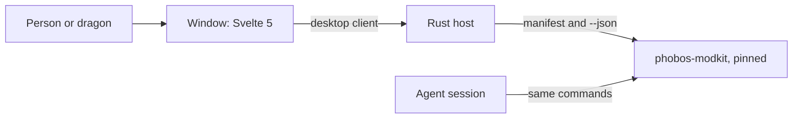

# D'thorga Companion: design record (9 Nov 2026)

**Steps 1 to 4 of this record are built: the window, its theme, its checks and the "where was I?" home page; so are the report
viewer's first stage, charts, the colony mood report and the atlas (10 Nov 2026). The owner approved the mock-up on 9 Nov 2026 ("I like the
purple vibe"); nothing built has been judged on screen yet.** The research behind it, with sources, is phobos-rimworld's
[research record](https://github.com/phobos-dthorga/phobos-rimworld/blob/main/docs/development/tools-desktop-research.md). The
home page mock-up the owner is judging is private to the owner; this record describes what it shows.

## Read this first

**D'thorga Companion is one desktop program for every game the owner mods.** It asks what you want to know and answers on
screen. Agent sessions keep the command line. Both run the same tools, so both get the same answers.

**Owner's decisions (9 Nov 2026):**

1. A program over every use of the tools, now and in the future, for humans and dragons first.
2. Primarily Rust, with SQLite if a database is needed.
3. Republic Observatory's layout and feel, with a House D'thorga identity.
4. A new sibling repository; phobos-modkit stays the engine.
5. One program for every game, so moving between games does not lose the thread.
6. The name: D'thorga Companion, plain so players can find it.
7. The order: this record and a mock-up, the two kit changes, this repository; then the home page, the report viewer, saves
   and logs, and the planet globe.

**Agent choices, for the owner to revise:** Tauri 2 with Svelte 5 over a Rust host; the Python tools run as processes; the
colours below; the first version only reads.

## What each behaviour does to the person

| Behaviour | What it lets them do | What it stops them doing | How it changes the way they work |
| --- | --- | --- | --- |
| The window (built) | See that the program and the tools are working, or be told plainly what is wrong and what to do | Nothing | Nothing yet: it is the frame everything else goes in |
| "Where was I?" home page (built) | Come back to a game after months and see when they last worked on it, what they did, what was left uncommitted, what isn't released and what's still open | Nothing; it only reads | Changing games stops costing the thread |
| Report viewer (step 5) | Read any tool's report, chosen from a list, with no typing | Run anything the manifest marks as writing, running or owner-only | Long quoted commands are no longer needed |
| Newest save and log (step 6) | See them appear by themselves as they play | Nothing | The page stays current without asking |
| Atlas (step 7, built 10 Nov 2026) | See the whole world as the game draws it, in six views with pollution over any of them, find any place and read any tile | Nothing; it only reads | "Why is that place polluted?" and "where should we settle?" become a glance |

## How it is built

**The window presents, the host decides.** Svelte components show what they are given. Only `desktopClient.ts` files may
talk to the host. The host owns running tools, and later the watcher, the databases and the refusals.

**One boundary to the tools.** The host runs `python -m phobos_modkit <command> --json` and reads one shape, the envelope
(phobos-modkit `docs/manifest.md`). A process per question is cheap: 0.16 s to start on the owner's PC, against 0.2 to 2.7 s
for the query itself (measured 9 Nov 2026, best case for other PCs).

**The manifest decides what the program may run.** Each report says what it does: `reads`, `reads-online`, `writes`, `runs`
or `owner-only`. The first version runs only the first two, and `owner-only` never.

**The core never names a game**, the rule phobos-modkit keeps too. A game's name reaches the core only through the
manifest's `game` field and the owner's own list of games.

## The window

Five bands, from Republic Observatory's `docs/dashboard-and-interface.md`:

| Band | Holds |
| --- | --- |
| Command bar | The crest and name, the pages |
| Observation bar | What you are looking at, and whether anything can change |
| Navigator | Your games |
| Canvas | The answer first, then the detail |
| Inspector | Where it came from, and how the tools are |

A status bar closes the window.

**For unreliable fine motor control:** controls are at least 44 px, nothing needs a drag, nothing appears only on hover, and
every control is reachable from the keyboard. **For reading:** the answer comes first, body text is 16 px and the floor is
12 px, and text scales with the operating system.

**When something fails, say four things in order:** what happened, what stayed safe, what to do, then the technical detail
folded away (Observatory's `docs/accessibility-guidance-and-notifications.md`).

**Fonts are the system's** (Georgia for headings, Segoe UI for text), as Observatory's are, so nothing is downloaded or
bundled. The mock-up uses web fonts that look much the same.

## The House D'thorga theme (agent's proposal, owner to judge)

The owner's Dragonself is the palette, in `themes/house-dthorga.json`:

| Role | Colour | From | Means |
| --- | --- | --- | --- |
| `accent` | Amber `#F2A93B` | The eyes | The brand, focus, what needs attention |
| `comparison` | Purple `#B79CFF` | The crest | Worked out from what was read |
| `observed` | Teal `#4FD1C5` | The tail | Read from a file or a save |
| `risk` | Red `#FF8A7A` | The body | Something went wrong |
| `success` | Green `#8BD17C` | The crest's streaks | It worked |
| `canvas` | Near-black `#0E0B10` | | The ground |

A test holds every colour to Observatory's contrast rules: 4.5:1 for text, 1.5:1 for dividers. **Colour never carries a
meaning alone.**

## "Where was I?" (built 9 Nov 2026)

**Each game is a list of repositories** in `.local/games.json`, never committed because it holds paths. `config/games.example.json`
shows the shape; `PHOBOS_COMPANION_GAMES` names another file. Nothing about any game is built in: the list is the only place a game
is named.

| On the page | Where it comes from |
| --- | --- |
| Games, most recently worked on first | The newest commit across the game's repositories |
| The opening sentence and the last thing done | That newest commit |
| Left unfinished | `git status`: files changed but not committed, only when there are some |
| The latest work | The newest eight commits, across the game's repositories |
| Not released yet | Each changelog, the repository's own and one per mod in `mods/`: entries under Unreleased, and the newest version marked Draft |
| Open work | `docs/development/outstanding-work.md`, where a repository has one: tables with Item and Status columns, counting statuses that begin open, in progress, waits, waiting, blocked, proposed or done except |
| Couldn't be read | Any repository that is missing or has no history; the rest of the page still shows |

**Git is read without changing anything:** `--no-optional-locks` takes no index lock, and `core.fsmonitor=false` starts no background
watcher, which is what leaked daemons on the owner's PC in November 2026. A test proves a read leaves the index unchanged.

**Why a JSON file and not SQLite** (agent choice, owner to revise): the list is short, is written by hand or by an agent, and in
`.local/` it is backed up with the repository. SQLite still arrives with the first thing that needs it, such as pins and history.

**Dates:** teal for a date read from a repository, purple for "how long ago", which is worked out from it, as the legend says.

**Left out of the mock-up:** Reports in the command bar, and Copy as command, until the report viewer gives them something to do.

## The report viewer, first stage (built 9 Nov 2026)

**The Reports page lists, for the chosen game, every report the kit marks `reads`, gives a plain question and needs nothing typed:
19 for RimWorld when built, 20 with the mood report.** The questions live with the tools, in each adapter's manifest, so the program still names no game. A game appears
here when its list `id` matches the manifest's `game`.

**The host decides.** The window asks to run a report by name. The host reads the manifest again, refuses anything it wouldn't offer,
and builds the arguments itself, so nothing typed or sent from the window reaches a command line.

**Tables:** numbers sort as numbers, through the `values` the kit adds beside each table (1.1.0). A column that isn't all numbers in
one unit sorts as words. Columns take the width their words need and the table scrolls sideways, after a real pawn list showed words
broken mid-letter. **Show more** asks the tool for five times as many rows, up to 5,000.

| Behaviour | What it lets them do | What it stops them doing | How it changes the way they work |
| --- | --- | --- | --- |
| Reports by question | Ask 19 questions of their game with a click | Run anything that writes, goes online or needs typing | No more long quoted commands for these |
| Sorting and Show more | Reorder a table and see all of it | Nothing | "Raise --top" and scanning for the biggest number are gone |
| Copy as command | Hand a session exactly what they're looking at | Nothing | Sessions and the program stay in step |

**The real path was checked with a report from the owner's own game**, through Rust and through the page, in a throwaway check that left
nothing behind. Clicking through the packaged window is the owner's.

## Charts (built 10 Nov 2026)

**Owner's request (10 Nov 2026): "pretty graphs and the like", learning from our other repositories.** Republic Observatory and
OnAir WyrmGrid both draw with Apache ECharts 6.1.0 behind one component fed a small declarative spec (Observatory's ADR-0003,
WyrmGrid's ADR-0004). Companion does the same, so the three programs share one way of drawing.

**The tools decide what to draw; the window decides how.** A chart is a block in a kit report (phobos-modkit 1.5.0,
`docs/manifest.md`): bars or a line, series and reference lines, each with a role (`risk`, `success` and so on) and never a colour.
`chartOptions.ts` turns it into ECharts options as plain data, tested without a browser; `CompanionChart.svelte` is the only
component that draws, and `echartsCore.ts` the only module that imports ECharts.

**What we changed from the sibling programs** (agent choices, owner to revise):

| Theirs | Ours | Why |
| --- | --- | --- |
| Tooltips on hover only (WyrmGrid has no other path) | Each bar's value written at its end, and **Show the numbers** for a sortable table | Nothing may need hover or a steady hand |
| Legend and line labels drawn by ECharts | A key in the page's own text under the chart, dashed swatches for lines | ECharts measured our font wrongly and the labels overlapped; page text is read aloud too |
| Axis text at 10 px | 13 px | The window's floor is 12 px |
| WyrmGrid ignores reduced motion | Motion stops when Windows asks for less | Observatory's rule, adopted |
| Canvas, loaded with the page | SVG, loaded only when a report has a chart; a failed load shows the numbers instead | Crisp at any display scale; a report without charts costs nothing |

**Does ECharts earn its place?** (the five tests in AGENTS.md, after WyrmGrid's ADR-0004): a real need now (four charts in the mood
report); less upkeep than our own, since two sibling programs already maintain the same code; one place to replace it from
(`echartsCore.ts`); tests on the option builder and in the browser; and when it fails the table shows. It costs one file of 562 kB
(192 kB compressed), read from this PC only when needed.

| Behaviour | What it lets them do | What it stops them doing | How it changes the way they work |
| --- | --- | --- | --- |
| Charts | See the shape of an answer at a glance: who is lowest, what costs most | Nothing | Long tables stop being the first thing to read |
| Show the numbers | Read and sort every figure behind a chart | Nothing | A chart never hides a number |

## Colony mood (built 10 Nov 2026)

**Owner's request (10 Nov 2026), from a play session showing "Extreme break risk x29":** "That might be actually worthwhile
integrating into our Companion, to see where you are lacking mood-wise." They handle mood mostly "with extreme amounts of drugs and
their addictions". The proposal came as a handoff from a phobos-rimworld session ([handoff-2026-11-10-mood-report.md](handoff-2026-11-10-mood-report.md));
this section is what was built from it.

**Gotcha: a save holds only half of a colonist's mood.** The game saves remembered events (a death, a meal off the floor, a party)
and works out situational thoughts (bedrooms, pain, cold, beliefs, a drug's high) while it runs. So the report counts remembered
events exactly, by the game's own rules, and gives the rest as one figure: mood minus the remembered events.

**Built: the save route, in phobos-modkit** (`rimworld-save mood`, 1.5.0). It needs no mod running and reads any save.

| Section | What it shows |
| --- | --- |
| Opening lines | How many are below each break threshold; what remembered events cost in all and the costliest; what everything else costs |
| Who is closest to breaking | A chart of every pawn's mood coloured by risk, against the thresholds; a table with each pawn's own threshold (traits move it), remembered events, everything else and lowest need |
| What hurts the most, what helps the most | Remembered events by what they cost or add everyone together, with charts |
| Needs running low | Each need's average, lowest first, with a chart and a line at 30% (our choice) |
| Addictions and drug needs | Each addiction, how many have it, how many are low and how many are empty |
| What this report cannot see | Said plainly in every report |

**Found while building, and fixed:** the game leaves a need's level out of the save when it is 0. Read as unknown, five colonists at
0% mood showed as fine; they were the worst off.

| Behaviour | What it lets them do | What it stops them doing | How it changes the way they play |
| --- | --- | --- | --- |
| Colony mood | See in one place which few problems cost the colony the most mood, instead of opening forty Needs tabs | Nothing: it only reads | Fixing the top two or three causes before reaching for drugs (the owner's own words prompted it) |

**The owner's answers (10 Nov 2026), all yes, built the same day:**

- **The snapshot route.** D'thorga Framework 0.64.0 writes the colony mood file at each save (phobos-rimworld's
  [design record](https://github.com/phobos-dthorga/phobos-rimworld/blob/main/docs/development/mood-snapshot.md)); phobos-modkit
  1.6.0 reads it when its tick count and world seed match the save, so every thought is named as the game counted it, bedrooms,
  cold and beliefs included, with each pawn's own thresholds. Without a matching file the report works from the save as before and
  says so. Not yet tested in game.
- **Suggested fixes, labelled as advice.** "Where to start" comes first: the costliest causes the player can act on, each with a
  suggestion; low needs and one pawn's thoughts carry advice too. The suggestions are written by us (agent-authored, held for the
  owner's review) in the kit's `mood-advice.json`, keyed by Def name, and every one says it is advice. A cause only time removes,
  such as a death, stays out of "Where to start".
- **Colonists, slaves and prisoners** together, each labelled; the tool's `--who` narrows it, and the window will offer that once
  reports take inputs.

## The atlas (built 10 Nov 2026)

**The owner chose a hex globe drawn with three.js over MapLibre (10 Nov 2026)**, once the owner's world turned out to have
590,492 tiles: MapLibre could only have drawn the land as a flat picture, soft up close and missing at the poles. WyrmGrid
uses three.js too, for its weather. **The owner asked for every layer in the first version**: biomes, settlements and tile
details; pollution; climate and terrain views; roads and rivers.

**The planet sits as the game's does.** The game builds its world from the same icosahedron our kit rebuilds and never rotates
it (read from the 1.7 code, 10 Nov 2026), so the in-game reading step 7 was waiting for is not needed; on the owner's world ice
sheet averages 75.5 degrees from the equator and rainforest 4.4. Reading the game's code for this also found that the kit kept
each tile's neighbours in its own order, not the game's, so roads and rivers would have been put on the wrong neighbours.
phobos-modkit 1.7.0 fixes it: the owner's 17,900 river pieces now join into 233 river systems.

| Part | How |
| --- | --- |
| Data | `rimworld-save atlas` (kit 1.7.0): one globe block of tile positions, each tile's neighbours in order, one value per tile per layer, places, lines, tags and region labels; about 45 MB of JSON and 1.1 s for the owner's world once the save is indexed |
| Drawing | Every tile a flat-coloured fan of triangles; one texture holds every tile's colour, another the overlay, so a new view rewrites a texture, never the geometry. It draws only when something changes. 423 ms from data to picture in a software renderer |
| Picking | The point under the pointer on the sphere, then a walk from a nearby tile to whichever neighbour is nearer until none is; on tiles made this way that always ends at the nearest |
| Colours | Biomes and hills bring the kit's own colours (agent-authored, `atlas-palette.json`). Temperature and elevation are two hues meeting at a light grey at 0 °C and sea level; rainfall and swampiness one hue, light to dark; pollution the game's four bands. Water shows as having no value where a layer leaves it out. The same ramps serve light and dark: the globe is a filled object, not marks on the page |
| Labels | Your own colonies always; every place once a tile spans 5 pixels; region names at the size the game gives them. More important first, none on top of another |
| Moving | Buttons for north, south, east, west, closer, further, the whole planet and the tile in the middle; the arrow keys, + and - and Enter do the same. Drag and the wheel are shortcuts. Flights are instant when motion is reduced |

**Agent choices, owner to revise:** the ramps and their stops; line colours (river blue, road tan); the purple glow from the theme's
comparison colour; amber for the picked tile; the label thresholds.

## What comes next

**Step 5, the rest of the report viewer.** Forms built from the manifest for the 19 reports that need an input, then the kit's
progress stream and the 7 that read online. Three tools get extra paths from phobos-rimworld's wrapper scripts (`query-code`,
`query-defs patched`, `mod-settings`) and need those paths in the game list first. The reports' opening lines are written for agents
("Index of PG4.rws, built now from a frozen copy...") and want moving out of the way of the answer.

**Step 6, saves and logs.** Rust watches the folders, with file events as hints, a full check every 15 seconds and a 1.5 second
wait until a file stops changing (Observatory's `recorder_service.rs`). Needs the kit's progress stream.

**Next on the atlas:** stepping through saves with buttons, to watch pollution spread; links from other reports' places and
tiles to the atlas (the owner's cross-links idea, 10 Nov 2026).

**SQLite arrives with the first thing to keep**: two files under the user's local application data, never a synced folder.
One holds what can be rebuilt, the other the owner's own pins and history, with an export because Synology does not back up
that folder.

## Limits

- The packaged program finds the kit by the path it was built from, or `PHOBOS_COMPANION_KIT`. It cannot be handed to anyone else
  yet.
- It needs Python on the PATH, or `PHOBOS_COMPANION_PYTHON`.
- `node_modules` sits inside this repository, in a synced folder if the clone is in one, as Observatory's does.

## Who chose what

**Owner (9 Nov 2026):** the seven decisions above. **Owner (10 Nov 2026):** charts; the colony mood report, its snapshot route,
advice labelled as such, and colonists, slaves and prisoners together; the atlas now, as a three.js hex globe, with every layer.

**Agent, with the owner's go-ahead on the order of work:** the stack, the boundary to the tools, the five-band layout as
borrowed, read-only first, the kit changes (phobos-modkit 1.0.0).

**Agent defaults, owner to revise:** the palette and what each colour means; system fonts; the empty window's wording.

## Open questions for the owner

| Question | Agent lean |
| --- | --- |
| Do the colours and the crest feel like House D'thorga? | Keep them until the owner says otherwise |
| Should older mods' pages link to Companion once it is public? | Not until it can be handed to someone else |
| In what order do other games get their saves and logs read? | Whichever game the owner is on when step 6 is done |
| Does the mood advice read right for your colony? It is agent-authored | Keep it until the owner edits or asks for changes |
| Do the atlas's biome colours and ramps read right? They are agent-authored | Keep them until the owner asks for changes |
