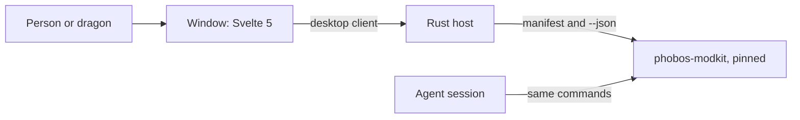

# D'thorga Companion: design record (9 Nov 2026)

**Steps 1 to 4 of this record are built: the window, its theme, its checks and the "where was I?" home page; so are the report
viewer's first stage, charts, the colony mood report and the atlas (10 Nov 2026). The owner approved the mock-up on 9 Nov 2026 ("I like the
purple vibe"); nothing built has been judged on screen yet.** The research behind it, with sources, is phobos-rimworld's
[research record](https://github.com/phobos-dthorga/phobos-rimworld/blob/main/docs/development/tools-desktop-research.md). The
home page mock-up the owner is judging is private to the owner; this record describes what it shows.

## Read this first

**D'thorga Companion is one desktop program for every game the owner mods.** It asks what you want to know and answers on
screen. Agent sessions keep the command line. Both run the same tools, so both get the same answers.

**Owner's decisions (9 Nov 2026):**

1. A program over every use of the tools, now and in the future, for humans and dragons first.
2. Primarily Rust, with SQLite if a database is needed.
3. Republic Observatory's layout and feel, with a House D'thorga identity.
4. A new sibling repository; phobos-modkit stays the engine.
5. One program for every game, so moving between games does not lose the thread.
6. The name: D'thorga Companion, plain so players can find it.
7. The order: this record and a mock-up, the two kit changes, this repository; then the home page, the report viewer, saves
   and logs, and the planet globe.

**Agent choices, for the owner to revise:** Tauri 2 with Svelte 5 over a Rust host; the Python tools run as processes; the
colours below; the first version only reads.

## What each behaviour does to the person

| Behaviour | What it lets them do | What it stops them doing | How it changes the way they work |
| --- | --- | --- | --- |
| The window (built) | See that the program and the tools are working, or be told plainly what is wrong and what to do | Nothing | Nothing yet: it is the frame everything else goes in |
| "Where was I?" home page (built) | Come back to a game after months and see when they last worked on it, what they did, what was left uncommitted, what isn't released and what's still open | Nothing; it only reads | Changing games stops costing the thread |
| Report viewer (step 5) | Read any tool's report, chosen from a list, with no typing | Run anything the manifest marks as writing, running or owner-only | Long quoted commands are no longer needed |
| Newest save and log (step 6) | See them appear by themselves as they play | Nothing | The page stays current without asking |
| Tests page (built 17 Nov 2026) | See which in-game tests the game has seen working, and pass or fail each with one press, in the moment | Mistake a note for a pass: only their own verdict passes a row | Passes seen in play reach the test list instead of being forgotten |
| Installer (built 17 Nov 2026) | Open the program from the Start menu or the desktop, like any other | Nothing | No more hunting for the exe in a build folder |
| Atlas (step 7, built 10 Nov 2026) | See the whole world as the game draws it, in six views with pollution over any of them, find any place and read any tile | Nothing; it only reads | "Why is that place polluted?" and "where should we settle?" become a glance |

## How it is built

**The window presents, the host decides.** Svelte components show what they are given. Only `desktopClient.ts` files may
talk to the host. The host owns running tools, and later the watcher, the databases and the refusals.

**One boundary to the tools.** The host runs `python -m phobos_modkit <command> --json` and reads one shape, the envelope
(phobos-modkit `docs/manifest.md`). A process per question is cheap: 0.16 s to start on the owner's PC, against 0.2 to 2.7 s
for the query itself (measured 9 Nov 2026, best case for other PCs).

**The manifest decides what the program may run.** Each report says what it does: `reads`, `reads-online`, `writes`, `runs`
or `owner-only`. The first version runs only the first two, and `owner-only` never.

**The core never names a game**, the rule phobos-modkit keeps too. A game's name reaches the core only through the
manifest's `game` field and the owner's own list of games.

## The window

Five bands, from Republic Observatory's `docs/dashboard-and-interface.md`:

| Band | Holds |
| --- | --- |
| Command bar | The crest and name, the pages |
| Observation bar | What you are looking at, and whether anything can change |
| Navigator | Your games |
| Canvas | The answer first, then the detail |
| Inspector | Where it came from, and how the tools are |

A status bar closes the window.

**For unreliable fine motor control:** controls are at least 44 px, nothing needs a drag, nothing appears only on hover, and
every control is reachable from the keyboard. **For reading:** the answer comes first, body text is 16 px and the floor is
12 px, and text scales with the operating system.

**When something fails, say four things in order:** what happened, what stayed safe, what to do, then the technical detail
folded away (Observatory's `docs/accessibility-guidance-and-notifications.md`).

**Fonts are the system's** (Georgia for headings, Segoe UI for text), as Observatory's are, so nothing is downloaded or
bundled. The mock-up uses web fonts that look much the same.

## The House D'thorga theme (agent's proposal, owner to judge)

The owner's Dragonself is the palette, in `themes/house-dthorga.json`:

| Role | Colour | From | Means |
| --- | --- | --- | --- |
| `accent` | Amber `#F2A93B` | The eyes | The brand, focus, what needs attention |
| `comparison` | Purple `#B79CFF` | The crest | Worked out from what was read |
| `observed` | Teal `#4FD1C5` | The tail | Read from a file or a save |
| `risk` | Red `#FF8A7A` | The body | Something went wrong |
| `success` | Green `#8BD17C` | The crest's streaks | It worked |
| `canvas` | Near-black `#0E0B10` | | The ground |

A test holds every colour to Observatory's contrast rules: 4.5:1 for text, 1.5:1 for dividers. **Colour never carries a
meaning alone.**

## "Where was I?" (built 9 Nov 2026)

**Each game is a list of repositories** in `.local/games.json`, never committed because it holds paths. `config/games.example.json`
shows the shape; `PHOBOS_COMPANION_GAMES` names another file. Nothing about any game is built in: the list is the only place a game
is named.

| On the page | Where it comes from |
| --- | --- |
| Games, most recently worked on first | The newest commit across the game's repositories |
| The opening sentence and the last thing done | That newest commit |
| Left unfinished | `git status`: files changed but not committed, only when there are some |
| The latest work | The newest eight commits, across the game's repositories |
| Not released yet | Each changelog, the repository's own and one per mod in `mods/`: entries under Unreleased, and the newest version marked Draft |
| Open work | `docs/development/outstanding-work.md`, where a repository has one: tables with Item and Status columns, counting statuses that begin open, in progress, waits, waiting, blocked, proposed or done except |
| Couldn't be read | Any repository that is missing or has no history; the rest of the page still shows |

**Git is read without changing anything:** `--no-optional-locks` takes no index lock, and `core.fsmonitor=false` starts no background
watcher, which is what leaked daemons on the owner's PC in November 2026. A test proves a read leaves the index unchanged.

**Why a JSON file and not SQLite** (agent choice, owner to revise): the list is short, is written by hand or by an agent, and in
`.local/` it is backed up with the repository. SQLite still arrives with the first thing that needs it, such as pins and history.

**Dates:** teal for a date read from a repository, purple for "how long ago", which is worked out from it, as the legend says.

**Left out of the mock-up:** Reports in the command bar, and Copy as command, until the report viewer gives them something to do.

## The report viewer, first stage (built 9 Nov 2026)

**The Reports page lists, for the chosen game, every report the kit marks `reads`, gives a plain question and needs nothing typed:
19 for RimWorld when built, 20 with the mood report.** The questions live with the tools, in each adapter's manifest, so the program still names no game. A game appears
here when its list `id` matches the manifest's `game`.

**The host decides.** The window asks to run a report by name. The host reads the manifest again, refuses anything it wouldn't offer,
and builds the arguments itself, so nothing typed or sent from the window reaches a command line.

**Tables:** numbers sort as numbers, through the `values` the kit adds beside each table (1.1.0). A column that isn't all numbers in
one unit sorts as words. Columns take the width their words need and the table scrolls sideways, after a real pawn list showed words
broken mid-letter. **Show more** asks the tool for five times as many rows, up to 5,000.

| Behaviour | What it lets them do | What it stops them doing | How it changes the way they work |
| --- | --- | --- | --- |
| Reports by question | Ask 19 questions of their game with a click | Run anything that writes, goes online or needs typing | No more long quoted commands for these |
| Sorting and Show more | Reorder a table and see all of it | Nothing | "Raise --top" and scanning for the biggest number are gone |
| Copy as command | Hand a session exactly what they're looking at | Nothing | Sessions and the program stay in step |

**The real path was checked with a report from the owner's own game**, through Rust and through the page, in a throwaway check that left
nothing behind. Clicking through the packaged window is the owner's.

## Charts (built 10 Nov 2026)

**Owner's request (10 Nov 2026): "pretty graphs and the like", learning from our other repositories.** Republic Observatory and
OnAir WyrmGrid both draw with Apache ECharts 6.1.0 behind one component fed a small declarative spec (Observatory's ADR-0003,
WyrmGrid's ADR-0004). Companion does the same, so the three programs share one way of drawing.

**The tools decide what to draw; the window decides how.** A chart is a block in a kit report (phobos-modkit 1.5.0,
`docs/manifest.md`): bars or a line, series and reference lines, each with a role (`risk`, `success` and so on) and never a colour.
`chartOptions.ts` turns it into ECharts options as plain data, tested without a browser; `CompanionChart.svelte` is the only
component that draws, and `echartsCore.ts` the only module that imports ECharts.

**What we changed from the sibling programs** (agent choices, owner to revise):

| Theirs | Ours | Why |
| --- | --- | --- |
| Tooltips on hover only (WyrmGrid has no other path) | Each bar's value written at its end, and **Show the numbers** for a sortable table | Nothing may need hover or a steady hand |
| Legend and line labels drawn by ECharts | A key in the page's own text under the chart, dashed swatches for lines | ECharts measured our font wrongly and the labels overlapped; page text is read aloud too |
| Axis text at 10 px | 13 px | The window's floor is 12 px |
| WyrmGrid ignores reduced motion | Motion stops when Windows asks for less | Observatory's rule, adopted |
| Canvas, loaded with the page | SVG, loaded only when a report has a chart; a failed load shows the numbers instead | Crisp at any display scale; a report without charts costs nothing |

**Does ECharts earn its place?** (the five tests in AGENTS.md, after WyrmGrid's ADR-0004): a real need now (four charts in the mood
report); less upkeep than our own, since two sibling programs already maintain the same code; one place to replace it from
(`echartsCore.ts`); tests on the option builder and in the browser; and when it fails the table shows. It costs one file of 562 kB
(192 kB compressed), read from this PC only when needed.

| Behaviour | What it lets them do | What it stops them doing | How it changes the way they work |
| --- | --- | --- | --- |
| Charts | See the shape of an answer at a glance: who is lowest, what costs most | Nothing | Long tables stop being the first thing to read |
| Show the numbers | Read and sort every figure behind a chart | Nothing | A chart never hides a number |

## Colony mood (built 10 Nov 2026)

**Owner's request (10 Nov 2026), from a play session showing "Extreme break risk x29":** "That might be actually worthwhile
integrating into our Companion, to see where you are lacking mood-wise." They handle mood mostly "with extreme amounts of drugs and
their addictions". The proposal came as a handoff from a phobos-rimworld session ([handoff-2026-11-10-mood-report.md](handoff-2026-11-10-mood-report.md));
this section is what was built from it.

**Gotcha: a save holds only half of a colonist's mood.** The game saves remembered events (a death, a meal off the floor, a party)
and works out situational thoughts (bedrooms, pain, cold, beliefs, a drug's high) while it runs. So the report counts remembered
events exactly, by the game's own rules, and gives the rest as one figure: mood minus the remembered events.

**Built: the save route, in phobos-modkit** (`rimworld-save mood`, 1.5.0). It needs no mod running and reads any save.

| Section | What it shows |
| --- | --- |
| Opening lines | How many are below each break threshold; what remembered events cost in all and the costliest; what everything else costs |
| Who is closest to breaking | A chart of every pawn's mood coloured by risk, against the thresholds; a table with each pawn's own threshold (traits move it), remembered events, everything else and lowest need |
| What hurts the most, what helps the most | Remembered events by what they cost or add everyone together, with charts |
| Needs running low | Each need's average, lowest first, with a chart and a line at 30% (our choice) |
| Addictions and drug needs | Each addiction, how many have it, how many are low and how many are empty |
| What this report cannot see | Said plainly in every report |

**Found while building, and fixed:** the game leaves a need's level out of the save when it is 0. Read as unknown, five colonists at
0% mood showed as fine; they were the worst off.

| Behaviour | What it lets them do | What it stops them doing | How it changes the way they play |
| --- | --- | --- | --- |
| Colony mood | See in one place which few problems cost the colony the most mood, instead of opening forty Needs tabs | Nothing: it only reads | Fixing the top two or three causes before reaching for drugs (the owner's own words prompted it) |

**The owner's answers (10 Nov 2026), all yes, built the same day:**

- **The snapshot route.** D'thorga Framework 0.64.0 writes the colony mood file at each save (phobos-rimworld's
  [design record](https://github.com/phobos-dthorga/phobos-rimworld/blob/main/docs/development/mood-snapshot.md)); phobos-modkit
  1.6.0 reads it when its tick count and world seed match the save, so every thought is named as the game counted it, bedrooms,
  cold and beliefs included, with each pawn's own thresholds. Without a matching file the report works from the save as before and
  says so. Not yet tested in game.
- **Suggested fixes, labelled as advice.** "Where to start" comes first: the costliest causes the player can act on, each with a
  suggestion; low needs and one pawn's thoughts carry advice too. The suggestions are written by us (agent-authored, held for the
  owner's review) in the kit's `mood-advice.json`, keyed by Def name, and every one says it is advice. A cause only time removes,
  such as a death, stays out of "Where to start".
- **Colonists, slaves and prisoners** together, each labelled; the tool's `--who` narrows it, and the window will offer that once
  reports take inputs.

## The atlas (built 10 Nov 2026)

**The owner chose a hex globe drawn with three.js over MapLibre (10 Nov 2026)**, once the owner's world turned out to have
590,492 tiles: MapLibre could only have drawn the land as a flat picture, soft up close and missing at the poles. WyrmGrid
uses three.js too, for its weather. **The owner asked for every layer in the first version**: biomes, settlements and tile
details; pollution; climate and terrain views; roads and rivers.

**The planet sits as the game's does.** The game builds its world from the same icosahedron our kit rebuilds and never rotates
it (read from the 1.7 code, 10 Nov 2026), so the in-game reading step 7 was waiting for is not needed; on the owner's world ice
sheet averages 75.5 degrees from the equator and rainforest 4.4. Reading the game's code for this also found that the kit kept
each tile's neighbours in its own order, not the game's, so roads and rivers would have been put on the wrong neighbours.
phobos-modkit 1.7.0 fixes it: the owner's 17,900 river pieces now join into 233 river systems.

| Part | How |
| --- | --- |
| Data | `rimworld-save atlas` (kit 1.7.0): one globe block of tile positions, each tile's neighbours in order, one value per tile per layer, places, lines, tags and region labels; about 45 MB of JSON and 1.1 s for the owner's world once the save is indexed |
| Drawing | Every tile a flat-coloured fan of triangles; one texture holds every tile's colour, another the overlay, so a new view rewrites a texture, never the geometry. It draws only when something changes. 423 ms from data to picture in a software renderer |
| Picking | The point under the pointer on the sphere, then a walk from a nearby tile to whichever neighbour is nearer until none is; on tiles made this way that always ends at the nearest |
| Colours | Biomes and hills bring the kit's own colours (agent-authored, `atlas-palette.json`). Temperature and elevation are two hues meeting at a light grey at 0 °C and sea level; rainfall and swampiness one hue, light to dark; pollution the game's four bands. Water shows as having no value where a layer leaves it out. The same ramps serve light and dark: the globe is a filled object, not marks on the page |
| Labels | Your own colonies always; every place once a tile spans 5 pixels; region names at the size the game gives them. More important first, none on top of another |
| Moving | Buttons for north, south, east, west, closer, further, the whole planet and the tile in the middle; the arrow keys, + and - and Enter do the same. Drag and the wheel are shortcuts. Flights are instant when motion is reduced |

**Agent choices, owner to revise:** the ramps and their stops; line colours (river blue, road tan); the purple glow from the theme's
comparison colour; amber for the picked tile; the label thresholds.

## The Tests page (built 17 Nov 2026)

**The owner asked for it (17 Nov 2026):** passes they saw in play rarely reached the test list, and the checklist should live
here rather than in the game ("Companion only", over an in-game window or both). **The owner's rules:** a note from the game is
evidence, never a pass ("seen working, awaiting your word"), and the owner has the final say on every row.

| Part | How |
| --- | --- |
| Reading | `test-pass report --all --json` (phobos-modkit 1.9.0) for every repository of the game with `config/test-evidence.json`: the rows, the game's seen-in-play notes and the verdicts so far |
| Shelves | Seen working first (a note, no verdict), then waiting, your verdicts not yet in the list, and done; preset buttons with counts |
| Verdicts | Passed, Failed (with an optional note) and Take it back; one JSON line appended to `test-verdicts/<repository>.jsonl` in this program's local data folder, checked by the host first (a row number, a known verdict, a note under 300 characters, a repository with a test list) |
| Into the test list | Not by this program: `python scripts/test-pass.py apply --apply` in the repository, run by an agent session or the owner, writes verdicts in |

**The one write.** The first version only read. Recording a verdict is the first thing this program writes, and only in its own
data folder: never a game, a save or a repository. Pressing Passed or Failed is the confirmation; Take it back undoes it. Agent
choice, for the owner to revise: no extra "are you sure?" step, since it costs a precise second press and changes nothing outside
this program.

## The installer (built 17 Nov 2026)

The owner had trouble finding the program each time and asked for an NSIS setup (17 Nov 2026). Tauri builds one itself
(`bundle.targets: ["nsis"]`); `npm run installer` runs it with build output outside the repository, as every build here does.

| Choice | What it is | Who chose |
| --- | --- | --- |
| NSIS | Tauri's own Windows installer: Start menu and desktop shortcuts, an uninstaller, updates over the top | Owner |
| For the current user | Installs under the user's local application data, no administrator prompt | Agent |
| Curly apostrophe in `productName` | Tauri's NSIS script quotes the shortcut name with straight apostrophes, so "D'thorga" broke it (`IsShortcutTarget`, 17 Nov 2026). The window title keeps the straight one | Agent |
| Not in the gate | The gate still builds with `--no-bundle`; the installer is built on request | Agent |

The installed program still finds the kit and `.local/games.json` by the folder it was built from (see Limits), so it is for the
PC that built it. The data folder is named by the identifier, which is unchanged, so test verdicts carry over.

## The Mods page (built 18 Nov 2026)

**The owner asked for it (18 Nov 2026):** a part "dedicated to the updating, reversing changes, making backups, etc. all with regard
to our mods", starting with seeing the changelogs "track and update to what I'm either benefitting from or losing as certain changes
are made". The design behind it is phobos-rimworld's
[mod installs record](https://github.com/phobos-dthorga/phobos-rimworld/blob/main/docs/development/mod-installs.md); the tool is
phobos-modkit 1.20.0's `installs` (its `docs/installs.md`).

| Question | Answer |
| --- | --- |
| What does it let the owner do? | See, mod by mod, what installing from the repository or going back to any backup would give or take away, by changelog entry, with save notes first; then make that move with one confirmed press |
| What does it stop them doing? | Going back or installing while the game runs; making a move without being asked first; losing the install a move replaces |
| How does it change the way they work? | Updating no longer needs a session to run deploy; a bad update can be undone from here without knowing where backups live |

| Part | How |
| --- | --- |
| Reading | `installs status --json` for every repository of the game with `config/installs.json`; again when the window regains focus (after 15 s) or on Read again |
| Gains and losses | From the changelog each copy carries: an entry one has and the other lacks. Matched by text, so an Unreleased entry that later gets a version is neither |
| Moves | Install from the repository, Back up the installed copy, Go back to this. Each opens a confirmation in words on the card, with the keyboard moved to it; the host checks the repository, the move (against the kit's manifest) and the names, then the kit checks again |
| Safety | Going back and installing wait for the game to close (the button says so); nothing is deleted: the replaced install becomes a backup and the backup stays |

**Round two (built 18 Nov 2026, 0.11.0).** The owner asked, after seeing the page, for a way to compile as needed, a refresh
after it, before and after shown ahead of a compile, and to know whether textures need encoding before a launch ("it's always a wild
guess currently"). **Owner's picks:** check and fix textures (Workshop mods included); Build plus Install everything that changed; all
four before-and-after extras (files, settings, test rows, side by side); a Before you play strip.

| Part | How |
| --- | --- |
| Before you play | Built from both readings: needs a build, changes not installed, textures stale or never encoded, the game running; Ready to play when nothing is left. Each line carries the button that does it |
| Build | `installs build` (the repository's `deploy.py --build-only`); no question asked, since it writes only inside the repository; allowed while the game runs (agent choice) |
| Install everything that changed | Mods whose changelog, files or build differ, one `installs install` per repository with every mod named: one run, one restart |
| Side by side | Installed now (version, where it came from, entries lost) beside After installing (version, needs a build, entries gained, files, settings, rows to look out for); save notes above both |
| Textures | The kit command for this game whose status has the `textures` surface (`rimworld-textures` today), with the settings file a repository names; encode after a question, game closed |

**The second write, and the first outside this program's folder.** Agent choices, for the owner to revise: a confirmation step for every
move (unlike verdicts, these change the game's files); the backup button stays live while the game runs, since it only reads; lists
show eight entries before Show all.

## Who it is for, and what follows from that (owner, 19 Nov 2026)

**"A multi-game, multi-framework, viewer to primarily help me but maybe also others."** From this version on, every design,
change and removal starts from that sentence (the rule is in `AGENTS.md`):

| It means | So |
| --- | --- |
| Every game the owner mods, and every modding framework under them | A page reads what any repository has (a changelog, git, a file it opts in with). A game's own knowledge comes through the kit's manifest and adapters, never from the window or the host |
| Mainly the owner | Their questions lead: where was I, what changed, is it installed, is it ready to play |
| Maybe others | Nothing personal is built in; words say "your mods", not one game's terms; and what stands between this and another person is written down, below |

**Where each page stands (19 Nov 2026):**

| Page | Any game today? | What a game needs |
| --- | --- | --- |
| Home ("where was I?") | Yes | A repository on the list |
| Changes and the code viewer | Yes | A `CHANGELOG.md` in the repository |
| Tests | Yes, where a repository keeps a test list | `config/test-evidence.json` |
| Mods (install, back up, go back) | Where the kit has an install adapter: RimWorld today | `config/installs.json`, and `games/<game>/installs.py` in the kit |
| Mods (textures) | RimWorld only | A kit command with the `textures` surface; most games have no such step |
| Reports, Atlas | RimWorld only | Kit commands for that game's saves and logs |
| Mods (0.26.2), Atlas, Logs, Memory, Game files, for a set of tools (0.24.0) | Never: a set of tools has none of what they read | Nothing: the page says so in words; Mods points to About |

**What stands between this and another person** (not built; listed so later work does not add to it): the program finds the kit
and the games list by the folder it was built in; it needs Python; and each repository's install is that repository's own script.

## Progress (built 19 Nov 2026)

**The owner asked for "progress bars along with some associated status updates, wherever the two would be appropriate".**

| Question | Answer |
| --- | --- |
| What does it let the person do? | See that work is going on, what it is doing right now, and how far along it is where that can be counted |
| What does it stop them doing? | Guessing whether the program has hung, and pressing a button twice |
| How does it change the way they work? | A build or an install can be left to run and glanced at |

| Part | How |
| --- | --- |
| The tools | phobos-modkit 1.24.0 writes progress lines to standard error when asked: a label, a step and a count where it can count, and a line of the work's own output. A repository's own build or install speaks the same lines |
| The host | `kit::run_hearing` reads them as they come and sends each through the channel the window gave with its request |
| The window | `ProgressBar.svelte`: filled by the count, or moving when there is none; words always; the latest output line beneath. With reduced motion the moving band stands still |

A step being worked on counts as not yet done, so step 3 of 23 shows two done (agent choice). Where a tool says nothing, the bar
moves under the page's own words.

## The Changes page and the code viewer (built 19 Nov 2026)

**The owner asked for "a code-viewer that helps show off all the new and shiny code associated with any particular CHANGELOG
item", with "a decent syntax highlighter", for the Mods page "and for any future modding I do as well".**

| Question | Answer |
| --- | --- |
| What does it let the person do? | Read what changed in any game's mods, and open the code behind any entry: which files, which lines, coloured by language |
| What does it stop them doing? | Mistaking a whole commit for one entry's work: when a commit wrote several entries, the viewer says so and names them |
| How does it change the way they work? | A changelog becomes a way in to the code, without a terminal or a git client |

| Part | How |
| --- | --- |
| Finding the code | phobos-modkit `changes entry`: the oldest commit in which the entry's opening appears in its changelog (`git log -S`), then that commit's diff. Nothing extra is written in a changelog |
| Order | Code, then data and definitions, then words, then other files; the viewer opens the code file with the most new lines, and the code before its tests |
| Colours | highlight.js, one grammar at a time, through `highlightCore.ts`; each side of a change is coloured whole so a comment or string over several lines reads right; token colours are the theme's roles |
| Two views | What changed (both line numbers, a plus or minus mark) and The code as it now stands (removed lines left out) |

**What it means for how changes are written** (the owner asked to be told): nothing new is written in a changelog. The view is
as sharp as the commit is small, so one commit that wrote eight entries shows the same 21 files for each of them. Of three choices
(leave commits as they are; commit separate changes separately where they are separate anyway; one commit for every entry), **the
owner chose the second (19 Nov 2026)**. It is a rule for every repository now, in phobos-modkit's `rules/every-session.md`: one
change is finished and committed before an unrelated one is started, and nothing is untangled afterwards.

## Tidying, and telling a rebuild from a change (built 19 Nov 2026, 0.13.0)

The owner, on 0.12.0: "I absolutely love how the code is tracked to every particular item", asked for the busiest areas tidied, and
saw "changes in DLLs, across the board, where there might not be any".

| Found | Done |
| --- | --- |
| A button under every entry, all opening the same commit | One button per run of entries one commit wrote (phobos-modkit gives every entry its commit, from `git blame` by version); a version from one commit has one button beside its heading |
| Bold marks inside an entry shown as asterisks | `RichText.svelte` shows `**bold**` and `` `code` `` as such, never as markup |
| Unchanged code read as changed | .NET stamped the git commit into every assembly; phobos-rimworld turned it off, and the kit marks an assembly whose own sources are unchanged as only rebuilt, and names the sources when they did change |
| "Up to date" beside files that differ | Two states: Only rebuilt, and Files differ (with the sources) |
| A tall, empty Installed now column | Columns sit at the top; the after column is wider |

## The Timeline page and the Settings page (built 19 Nov 2026, 0.14.0)

**The owner asked for "a timeline (with suitable graph(ic)s) that records/shows how updates were applied, changed, removed, etc.
over time with a suitably recorded history and its facts", because "I like coming back and reading the CHANGELOGs from a particular
update-in-moment but I can't because it is now lost to time"**, and, once the history log needed a home, "a central settings page
where everything or at least, most, of these sorts of things are managed".

| Question | Timeline | Settings |
| --- | --- | --- |
| What does it let the person do? | See what happened to every mod over time at a glance, read any day's facts, and read any changelog exactly as it stood then | See every path the tools read and where each value comes from, and change one for every repository at once |
| What does it stop them doing? | Losing a version's words once a later version rewords or removes them; mistaking today's changelog for what was installed then | Hunting through repositories' ignored files and environment variables to learn why a tool looks where it does |
| How does it change the way they work? | A changelog becomes a history to walk back through, not only today's page | Settings that hold everywhere live in one place, the Companion's own folder |

| Part | How |
| --- | --- |
| Facts from git | phobos-modkit `history timeline` reads every commit that touched a changelog, back to the first, once, and keeps the facts in its cache (about 4 s the first time for phobos-rimworld, under a second after) |
| Facts from this PC | The history log, one JSON line a fact, one file a game, in this program's own folder by default (owner's choice); the kit's installs, deploy and texture encoding write it as they work. Recorded from 19 Nov 2026; earlier installs were not recovered (owner's choice) |
| The overview (owner's choice: both views) | One lane a product, one column a day anything happened; quiet days are left out so a long gap takes no room. Each cell is a 44 px button with the strongest mark of the day and a count; its colour comes from the theme by role and never carries the meaning alone (each mark has words, in its label and in the key) |
| Day by day | Newest first, ten days at a time; each fact names its product, version and time, gives its version's summary, lists its entries under their sections (up to eight, with how many more), and offers Read it as it stood and Show the code at the end of its line. Mods installed, backed up or taken back together (one repository, one minute) are one row of buttons, one a mod (0.15.1, at the owner's request to streamline it). The repository is named only for a game with several |
| As it stood | `history at`: the changelog at the fact's commit, or, for a fact from this PC, at its moment; each entry marked kept, reworded (with its words now) or taken out since, with the commit that wrote it then, so Show the code works as on the Changes page (0.15.0, after the owner found it missing) |
| Settings | `settings list` names every repository on the owner's list, so a repository's own settings show; `settings set` writes only the central file, after a press of Save or Use the default |

**The history's ideas are a design to edit** (owner's choice): phobos-modkit's `rules/first-class.md` names what makes a thing a
first-class citizen (an identity that outlives its label, an address, a history of facts, the same shape in every game), and the
timeline is built on the first five: Change, Version, Product, Install and Event. Nothing there is a rule until the owner says so.

## How code connects (built 19 Nov 2026, 0.17.0)

**The owner asked for "flow-charts and the such which show relationships between functions, classes, etc. of the code I'm viewing,
wherever it might be. Such as when I'm viewing a code-slice that I was sent towards from a CHANGELOG"**, pointing at the style of
their Relationships and Factions screens: one thing in the middle, its connections grouped around it by kind, filters with counts,
and a press to put anything in the middle.

| Question | Answer |
| --- | --- |
| What does it let the person do? | See how any piece of code fits in (what calls it, what it calls, what it belongs to, builds on, overrides, patches and uses) and walk from one piece to the next, from a changelog entry or a search |
| What does it stop them doing? | Reading a change as if it stood alone: what a changed method affects, and what affects it, is on screen |
| How does it change the way they work? | A changelog entry leads to its code and from there to the code around it, in any game, without an editor or a terminal |

| Part | How |
| --- | --- |
| The facts (owner's choice: exact C#) | phobos-modkit 1.33.0's `connections`: C# exact from the built assemblies through the kit's assembly reader (calls, fields, inheritance, overrides, Harmony patches), placed in the source by its scanner; XML Defs, Lua and Python by their own rules; every connection marked exact or by name |
| The layouts (owner's choice: both) | Around it (hubs by kind, up to 14 members fanned beyond each, the rest on a "more" node that opens the list), a flow of calls (columns from callers to callees, two steps each way), and a list for the keyboard and for long groups |
| Where (owner's choice: both) | The code viewer's third view, starting from the things the commit changed, and the Code map page, starting from a search |
| Drawing | SVG, from `layout.ts` (tested without a screen). Each kind of connection has a theme colour and always its words and count; dashed lines are by name, dashed circles outside the repository, rings mark what the commit changed. Every node is a button with its words; zoom has buttons; drag and scroll are shortcuts |

**Agent choices, owner to revise:** which connections show at first (all but "holds", which lists a type's every member), 14 members
fanned per hub, two steps each way in the flow, and .NET's own library left out of the connections.

## Keyboard shortcuts (built 19 Nov 2026, 0.18.0)

**The owner asked for "some common-sense keyboard shortcuts as a default setting, and the ability for the end-user to configure
those further to their needs within the Settings Dialog somewhere, perhaps as its own modal deeper within".**

| Question | Answer |
| --- | --- |
| What does it let the person do? | Move between pages, games, views and pictures with one key, and choose those keys |
| What does it stop them doing? | Reaching for the mouse for every move; and, since nothing acts in a text box and each key can be turned off, a stray key doing something unasked |
| How does it change the way they work? | The common moves are a key away, and the full list is one more (?) |

| Part | How |
| --- | --- |
| The keys (agent's defaults, owner to change) | One key each, never two held at once, so no move needs a chord. Numbers for pages in the bar's order, brackets for games, letters for views, + - 0 for zoom |
| When a key acts | `registry.ts`: a view offers its moves while it is on screen; a press goes to the newest view offering it; never in a text box or in a part that takes keys itself (the globe), never when something else handled the press, and outside a dialog only while no dialog is open |
| Changing them | The Settings page's "Change keyboard shortcuts" dialog (owner's idea: a modal deeper within Settings). A key another action has is refused in words; Tab, Enter, Space and Escape are kept |
| Keeping them | `shortcuts.json` in the program's own folder, holding only what differs from the defaults, so new defaults still arrive; the host checks its shape before writing |

## Cross-links (built 19 Nov 2026, 0.19.0)

**The owner asked for the whole proposed order of [cross-links](cross-links.md) to be built overnight: "Proceed with your entire
proposed order, step-wise if necessary".** Each item answers the three questions here; what differs from its proposal is in that
record's "As built".

| Item | What does it let the person do? | What does it stop them doing? | How does it change the way they work? |
| --- | --- | --- | --- |
| N1 Back and Forward | Follow any link and return exactly where they were, dialogs included | Losing their place when a link jumps pages | Wandering is safe, so links can be followed freely |
| N2 Go to anything | Reach a method, entry, row, setting or report by name from any page | Hunting through pages for where a thing lives | One search box first, pages second |
| N3 Addresses | Keep or share a pointer to any place, and paste it back in | Describing a place in words to find it again | A place can be noted in a file and reopened later, which suits re-reading |
| L4 What was I running then? | See every mod's installed version at the end of any day | Guessing which versions a fault or a memory belongs to | A fault report starts from the versions that were in play |
| L1 The log chain | Go from an error in the game's log to the code it happened in, the change that touched that code, and the backup from before that change | Reading a log of hundreds of thousands of lines, and searching the code, history and backups by hand | "What broke it, and how do I undo it?" is a walk of links rather than a terminal session |
| L3 Test rows joined | Go from a test row to the code that notes it, from a method to the rows that watch it, and from a version to the rows still waiting on it | Searching code for a note's key, or the test list for a version, by hand | "What needs testing" and "what it is" sit one press apart, both ways |
| L5 Patch badges | See, on the method itself, how many other mods patch the same method and whether the last update changed it | Running the patches and upstream tools by hand before trusting a patch | Risk shows where it sits, before an update bites |
| S2 Tool kit pins | See which repositories lag the tool kit, and what moving each pin would bring | Remembering or guessing which kit each repository uses | Moving a pin becomes a choice made with the gains in view |
| S3 Merges on the Timeline | Follow a mod that ended into the mod that took it in, and back | Guessing where a merged mod's story continues | The Timeline reads across a merge as one story |
| S4 Home items as links | Start from "where was I?" and open the commit or the changelog in one press | Hunting for the same commit or changelog on another page | Home becomes a starting point, not only a summary |
| L2 A thing's history | See every commit that changed a method, class, Def or function, with the changelog entries each wrote, and open any of them | Reading git's history by hand to learn why code is as it is | From any node in a picture, "why is it like this?" is one button away |

**Shared code, on the owner's word.** The [shared code audit](shared-code-audit.md) (19 Nov 2026) found code written 3 to 17
times across the host and the window, and proposes a `companion-core` library crate for the host and a grown `src/lib/shell/` for
the window. Nothing is moved until the owner says.

**Step 5, the rest of the report viewer.** Forms built from the manifest for the 19 reports that need an input, then the kit's
progress stream and the 7 that read online. Three tools get extra paths from phobos-rimworld's wrapper scripts (`query-code`,
`query-defs patched`, `mod-settings`) and need those paths in the game list first. The reports' opening lines are written for agents
("Index of PG4.rws, built now from a frozen copy...") and want moving out of the way of the answer.

**Step 6, saves and logs.** Rust watches the folders, with file events as hints, a full check every 15 seconds and a 1.5 second
wait until a file stops changing (Observatory's `recorder_service.rs`). Needs the kit's progress stream.

**Next on the atlas:** stepping through saves with buttons, to watch pollution spread; links from other reports' places and
tiles to the atlas (the owner's cross-links idea, 10 Nov 2026).

**SQLite arrives with the first thing to keep**: two files under the user's local application data, never a synced folder.
One holds what can be rebuilt, the other the owner's own pins and history, with an export because Synology does not back up
that folder.

## Make-up (built 19 Nov 2026, 0.20.0)

**The owner asked to show "how the contents of our mods, code, etc. is consisted of in a graphical manner"**, and chose all six
views, lines as the first measure, and "a mix of new page and inside code map, as appropriate".

| Question | Answer |
| --- | --- |
| What does it let the person do? | See at a glance what each mod is made of, how it grew, where the work goes, how much is tested in game and what players get |
| What does it stop them doing? | Guessing sizes and balance from a file browser, or counting Defs and test rows by hand |
| How does it change the way they work? | Where effort and risk sit is visible: a big, busy, untested part stands out before it bites |

| Part | How |
| --- | --- |
| The facts | phobos-modkit 1.39.0's `makeup` (now, growth, churn, census): committed files only, products from changelog folders and each C# project's `<ModFolder>`, kinds by extension and folder |
| The pictures | ECharts treemap, stacked bars and stacked area through `OptionChart.svelte`, now the one component that talks to ECharts (the report chart draws through it). Colours: one fixed colour a kind, the reference categorical order validated on the theme's chart surface (worst adjacent CVD ΔE 8.4, normal vision 19.3, every colour 3:1); heat is one blue ramp |
| Where | A new page, Make-up (key M, agent's choice), for the content views; the Code map's busiest code for where the work goes |

**Agent choices, owner to revise:** the 30-day window for changes, the key M, the page at the end of the bar (it now holds eleven;
grouping it is still open), and "Size as installed" left out (it needs each game's install records).

## Screen notes (built 19 Nov 2026, 0.22.0)

**The owner said yes to a "something's off" key** (19 Nov 2026), the first of four tools proposed for working with agent sessions.

| Question | Answer |
| --- | --- |
| What does it let the person do? | Flag a page that looks wrong in one key press, with the picture and the page's address kept for them, and a few words if they like |
| What does it stop them doing? | Describing in a conversation where on which page something looked off, and losing the moment when no session is open |
| How does it change the way they work? | Oddities get noted as they are seen, and every session starts by reading them; Home shows what was done about each |

| Part | How |
| --- | --- |
| Taking it | The picture is drawn before the dialog opens (the same drawing as Save a picture), so it shows the page, not the dialog |
| Keeping it | The host writes `screen-notes/<id>/picture.png` and `note.json` whole, into a folder made beside its place and then moved; the id is the owner's local time (`20261119-101500`), the time inside is UTC, and the version is the host's own |
| Reading it | Agent sessions: phobos-modkit 1.41.0's `screen-notes list`, and `resolve` writes `resolved.json` beside the note. Home: open notes, and the newest five dealt with |

**Agent choices, owner to revise:** the ! key (Shift+1); the button's words "Something's off"; five dealt-with notes on Home; the
folder fixed in the Companion's own folder, not a setting, because the Companion and the kit must agree on it.

## Records backup (built 19 Nov 2026, 0.22.0)

**The owner said yes to backing up the Companion's own records** (19 Nov 2026): Synology does not back up the local application data
where they live.

| Question | Answer |
| --- | --- |
| What does it let the person do? | Keep a copy of every verdict, mark, note and history line somewhere their NAS keeps, in one press |
| What does it stop them doing? | Losing weeks of test verdicts and history to a disk failure or a reinstall |
| How does it change the way they work? | Home says when the copy is old, so backing up is a nudge, never a chore to remember |

| Part | How |
| --- | --- |
| What is copied | phobos-modkit 1.43.0's `records`: everything in this program's folder but WebView2's browser cache (`EBWebView`, about 79 MB of the owner's 80), so a new kind of record is included without a change; any record a setting keeps elsewhere too |
| Where | A new folder named for the local time, inside `recordsBackupPath`, written whole with a `backup.json`; a folder inside the records is refused |
| Settings page | Back up your records: when last copied, what a copy holds, where it goes, Back up now (waits until a folder is chosen), and a button to the setting |
| Home | A note when there is no copy, or the newest is at least seven days old |

**Agent choices, owner to revise:** seven days before Home speaks up; never deleting old copies (the owner prunes by hand); saves
left out (a separate, larger question, in `later.md`).

## Claims board (built 19 Nov 2026, 0.22.0)

**The owner said yes to a claims board** (19 Nov 2026), after an evening of sessions messaging each other to ask which version
number was free.

| Question | Answer |
| --- | --- |
| What does it let the person do? | See which agent session is working on what, and spot one that ended holding something |
| What does it stop them doing? | Relaying "is 0.174.0 yours?" between sessions, and two sessions shipping the same version number |
| How does it change the way they work? | Sessions sort out shared numbers among themselves; the owner reads the board instead of asking |

| Part | How |
| --- | --- |
| The board | phobos-modkit 1.44.0's `claims`: one file in this program's folder (`claimsPath`), changed under a lock file and written whole; a thing is its words, ignoring case and spacing |
| The rule | `rules/every-session.md` in the kit: take before using, release once committed, ask a holder rather than pick around them |
| Home | Who is working on what: each claim, its session, how long, its note, and old ones marked. Only read |

**Agent choices, owner to revise:** a day before a claim is called old; nothing expires by itself.

## Decisions page and the grouped bar (built 19 Nov 2026, 0.22.0)

**The owner said yes to a Decisions page** (19 Nov 2026), the "Decisions waiting for you" idea of 10 Nov grown into a page, with the
page bar grouped in the same change.

| Question | Answer |
| --- | --- |
| What does it let the person do? | Answer every open choice in one place, with the options and the agent's reasoning beside it, in one press when the lean is right |
| What does it stop them doing? | Hunting through design records for "agent choice, owner to revise" lines, and choices going unrevised because nobody asked |
| How does it change the way they work? | Agents leave questions on a page instead of in prose; sessions start by acting on the answers |

| Part | How |
| --- | --- |
| The questions | Each repository's `config/decisions.json`, read by phobos-modkit 1.45.0's `decisions list` over every repository on the list and this program's own |
| The answers | `decisions answer` appends a line to `decisions/<repository>.jsonl` in this program's folder; the last line decides, so an answer can be changed until an agent acts on it and removes the question |
| The page | One card a question: plain radio buttons (the lean marked and chosen first), Something else with words, Decide. Answered ones wait below with Change my answer |
| Home | How many decisions wait, with a button to the page |
| The bar | Three labelled groups, Play, Code and Tools, built from one list; every page keeps its key |

**Agent choices, owner to revise:** the lean chosen to begin with (one press to agree, at the cost of agreeing too easily); the D
key; the groups' names and order; keys left as they were until the owner answers `page-keys` on the page itself.

## Game files (built 19 Nov 2026, 0.22.0)

**The owner asked what the games themselves write that the Companion could show**, made general so a new game needs little setting
up (19 Nov 2026), and said yes to the views proposed.

| Question | Answer |
| --- | --- |
| What does it let the person do? | See before playing what updated since last time, find a save or a screenshot, and see where a game's space goes, for any Steam game |
| What does it stop them doing? | Digging through AppData and Steam's folders, or guessing which mods updated overnight |
| How does it change the way they work? | A start-of-session look tells them what to expect; a new game shows something before it is set up at all |

| Part | How |
| --- | --- |
| The facts | phobos-modkit 1.46.0's `game-files report`: Steam's app manifest and Workshop records, the game's saves and screenshots folders and Steam's, sizes by folder |
| Places | Guessed by the game's name; the games list may name `data`, `saves` and `screenshots`, and `steam_app_id` (`companion-core`'s `games::places_of`) |
| The page | Under Play (key W): what changed (since the last launch, a day or a week), saves (ten a page), screenshots (the newest twelve), space as bars. A part it cannot fill says what to set |
| Showing a file | Only one inside a folder the last report named, at most two levels down (a group of saves) |

**Checked on three games:** RimWorld (everything), Farming Simulator 25 (Steam's records; its data folder was not guessed) and
Project Zomboid (saves and space with its data folder named; not installed through Steam now). **Agent choices, owner to revise:**
the W key; twelve screenshots and ten saves a page; space as plain bars rather than a chart; a list of screenshots, not pictures,
until the gallery is built (`later.md`).

## Memory (built 19 Nov 2026, 0.23.0)

**The owner decided (19 Nov 2026) that memory profiling is done from the Companion**, not by asking agent sessions to run watches.
The tool kit already had the watch (phobos-modkit 1.42.0, fixed in 1.45.1); 1.47.0 added what a program needs to follow and steer it.

| Question | Answer |
| --- | --- |
| What does it let the person do? | Watch the game's memory for a few minutes at a press, see it as it goes, mark what they do ("reloading now") at the moment they do it, stop early, and read any kept watch's report |
| What does it stop them doing? | Starting a watch by accident or without a warning: a watch that attaches to the game asks first, every time. Reading figures before knowing what happened: the report opens with the saves the log shows loaded, the marks, and a bold line when a marked reload never reached the log |
| How does it change the way they work? | No agent session and no console: the owner runs short watches between restarts themselves, and the marks put their intentions beside the figures |

| Part | How |
| --- | --- |
| Finding the watch | The manifest's `memory-watch` surface (phobos-modkit 1.47.0) on `watch`, `watch-report`, `watch-status`, `watch-stop` and `watch-mark`; the host names no game, and a game without it is told so in words (`src-tauri/src/memory_page.rs`) |
| What may run | Reading only reads. **Starting runs only on a press and a confirmation**, never by itself, and only while the manifest calls it `runs`; stopping and marking write only into the watch's own folder in the kit's cache, while the manifest calls them `writes`. The host checks the length is one offered, the label and a mark are one line of a sane length, a watch's name has the kit's shape, and a mark's words come after `--`, so no text becomes an option |
| Following it | The window reads `watch-status` (about 0.2 s) every 5 seconds while a watch runs. The request that started it lasts as long as the watch and carries its progress; it is kept outside the page (`watching.svelte.ts`), so changing page loses nothing. A watch started elsewhere, or before the window was reopened, is followed the same way, its bar counted from its own clock |
| Marks | B puts the keyboard in the mark box and takes the moment then, not when Enter is pressed. Five quick marks mark at once. The kit stores them beside the samples (`watch-mark`), and the report names them beside the jumps |
| Kept watches | The twenty newest, with their length, state and what they read; choosing one shows its whole report (the kit's `watch-report`, drawn by `ReportView`). They also join Go to anything |

**Checked on:** RimWorld, the one game whose tools have a memory watch; for every other game the page says so in words (the host's
test covers a game without one). The kit's `watch-status` was read against the owner's two kept watches of 19 Nov 2026; **no watch
has been started from the window yet, and nothing here is tested on screen.**

**Agent choices, owner to revise:** the lengths offered (5, 10, 15, 20, 30 and 60 minutes, 15 first, from the owner's word that 60 was
"a bit generous" and 15 to 20 workable); .NET's figures on by default; the keys U (page), T (start), B (mark) and X (stop); the five
quick marks' words; stopping without a confirmation, since nothing is lost; the page under Play, after Logs. Four questions are on the
Decisions page: marking from inside the game, starting a watch by itself when the game starts, the first length, and the keys.

**Not built:** marking without switching from the game (a global key; on the Decisions page), carrying a watch across a game
restart or starting one when the game starts (on the Decisions page), editing or removing a mark, and the heap snapshot and its
comparison (`heap`, which pauses the game 20 to 30 seconds and holds only part of a large heap; a page for it waits for the kit's
reader of what holds what).

## Tools beside the games, loading pages, the atlas's top (built 19 Nov 2026, 0.24.0)

**The owner asked (19 Nov 2026) for the Companion "as its own game"**, knowing it would need exceptions, and chose one entry
holding all three tools (the Companion, phobos-modkit and phobos-log), with the pages that cannot serve it saying so. In the same
request: pages that showed only a progress bar and empty space (all Save a picture caught while one loaded), and a tidier atlas.

| Question | Answer |
| --- | --- |
| What does it let the person do? | Follow the tools' own work where they follow a game's: where was I, what changed, the timeline, the make-up, the decisions waiting. Take a picture of a page that is still loading and get the page, not its bar |
| What does it stop them doing? | Opening a game-only page for the tools and meeting a failed reading or a blank: the page says why there is nothing. Sharing a picture of a loading bar by accident |
| How does it change the way they work? | No switching to a terminal or GitHub to see what the tools did; P can be pressed as soon as a page is opened |

| Part | How |
| --- | --- |
| Kind | An entry on the list may carry `"kind": "tools"`; without it an entry is a game (`GameKind` in `companion-core`'s `games.rs`, carried to the window on Home's answer). Pages about a game being played (`GAME_ONLY_PAGES` in `src/lib/home/kinds.ts`: Atlas, Logs, Memory, Game files; Mods from 0.26.2, on the owner's yes, since its words are a game's and a tool's installed version is About's) show `NotForTools` for a tools entry instead of asking the host anything, and their buttons have a dashed edge. Tests and Reports stay: each already says when a repository has nothing for it, and a tool may one day have a test list |
| Loading | Every `ProgressBar` and `Placeholder` carries `data-picture-wait`, and so does the globe while it draws. Save a picture waits while any is on the page, looking every 250 ms, and takes the picture after two looks in a row find none, so a page that reads in stages is not caught between two. Take it now skips the wait; changing page lets it go. The Memory page's bar for a running watch passes `holdsPicture={false}`: it stays up for minutes while the page is there to see |
| Placeholders | Under each page's first reading: rows for the Code map, Reports, Settings and Tests; a new `globe` shape (a disc in a panel the globe's height) for the Atlas |
| Facts | phobos-modkit 1.48.0 gives a report `facts` (label and value). `ReportView` draws them as a strip of small cards above the opening lines, for every report. Save reports give Save, Read and, when built just now, Index; the atlas adds World seed and Surface tiles |
| The atlas's top | The page's own header holds the title and Read again on one line, and the globe's description as the lead (`globeCaption={false}`, so the globe block does not repeat it). The views and the show choices share one panel. The globe block is a container: at 960 px wide or more the tile panel and the key stand in a column beside the globe, with Go to your colony above them; narrower, they stack beneath it as before |

**Checked on:** RimWorld (a game) and the owner's tools entry, by the host's and the window's tests and a browser build; **nothing
here is tested on screen.**

**Agent choices, owner to revise:** the entry's name (D'thorga Tools) and id (`tools`); which pages count as game-only; the dashed
edge; half a second of staying loaded before the picture; the side column's width (300 to 380 px) and the 960 px point where it
appears. Two questions are on the Decisions page: Code map readers for TypeScript, Svelte and Rust, and how much of decompiling to
take on.

## About (built 19 Nov 2026, 0.25.0)

**The owner asked (19 Nov 2026) for "a proper, About, page"**: they kept forgetting which version was installed and could find no
version number anywhere.

| Question | Answer |
| --- | --- |
| What does it let the person do? | See at a glance which version is running, and from any page; learn whether a newer one is waiting and where its installer is; read what this version brought |
| What does it stop them doing? | Guessing whether the last install took, or running an old version without knowing |
| How does it change the way they work? | No asking an agent session or digging through folders for a version: it is in the status bar, and About answers the rest |

| Part | How |
| --- | --- |
| The version in sight | The status bar's version button, from package.json at build time (`__COMPANION_VERSION__` in `vite.config.ts`; a test keeps package.json and the host's version equal). It opens About |
| Build facts | `src-tauri/build.rs` records the commit, the moment and the build output folder (`CARGO_TARGET_DIR`), and runs again whenever the repository moves to another commit |
| The page | `src-tauri/src/about_page.rs` reads the running version, the repository's `package.json` version, its changelog (each version's number, date and opening paragraph), commits since the build (`git rev-list --count`, through `companion_core::git::text`, without locks or a watcher), the remote as a web address, the installer for the repository's version (found by its name's ending in the bundle folder, so no product name is written in code) and the notices' "In the program" table. Whatever cannot be read is left out, never a failure. It only reads |
| Where it stands | Newer version waiting (with the installer's path, or a word that it is not built yet), up to date with commits not yet in a version, or up to date (`src/lib/about/presentation.ts`) |

**Checked on:** this repository, by the host's and the window's tests and a browser build; **nothing here is tested on screen.**
It serves every game the same: it is about the program, not a game.

**Agent choices, owner to revise:** the I key; the page under Tools, last; the version in the status bar's right end; at most ten
newer versions listed; no Show in folder buttons (the paths are plain text to copy).

## Their code and updates (built 19 Nov 2026, 0.26.0)

**The owner chose "Read and compare, on your press" (19 Nov 2026)** for how much of decompiling the Companion takes on, and was
delighted by the idea of reading third-party code: "I like that we can delve even deeper into code now".

| Question | Answer |
| --- | --- |
| What does it let the person do? | Follow a patch of ours into the method it patches and read it; read any outside thing on the map; see what a mod's or the game's update changed, down to one method's diff |
| What does it stop them doing? | Guessing what a method we patch does, or asking an agent session to decompile and read it out. Decompiling a file the tools did not name |
| How does it change the way they work? | When an update breaks something, the trail is Code map → the patch → See what changed → Their code, all in the window |

| Part | How |
| --- | --- |
| Finding the tools | `kit::offered` in `companion-core` (new): the command whose report carries a surface, its effect checked, and `allowed_by_manifest` for one that runs. The first page to use it; the Memory page and patch targets still have their own finders, to move when next touched |
| Their code | phobos-modkit 1.49.0 `rimworld-code show` (public clones first, then `.local/decompiled`, then the kit's own decompiles; IL notes left out, each line's own number kept), `holder` (the assembly and mod, from metadata) and `decompile` (on a press, into the kit's cache). The panel stands above the Code map's results, under the focus key `their` |
| Updates | `rimworld-archive list` (now with data) and `compare`, optionally `--show` one declaration. The panel stands under Busiest code while nothing is chosen, under `update`, `owner` and `member` |
| Code colours | Moved from the code viewer into `app.css` as `.code-colours`, used by the viewer and the new `CodeLines` |
| Safety | The host remembers every assembly `holder` named in this run and refuses to decompile any other path. Names reach the kit after `--` |

**Checked on:** RimWorld, against the owner's real clones, decompiles and archive (VF's `TurretRotation` from its public source in
0.5 s once indexed; the game's `WorldPawns.PassToWorld` from a decompile; `holder` in about 5 s; Fortified Features Framework's
last update compared). Every other game has no `other-code` or `updates` surface, and the Code map says so in words. **Nothing here
is tested on screen.**

**Agent choices, owner to revise:** Decompile asks no second question (it writes only into the tools' cache, like Build); the
panels' places on the Code map; files kept only once are left out of the updates list; the first lines shown (400).

## Clean up, and the settings list at once (built 20 Nov 2026, 0.27.0)

**The owner asked (20 Nov 2026)** for the Mods page's settings list not to sit on its bar after a start, for the tools' cache to
move off Windows' Temp folder to K:, and for "some kind of ongoing cleanup process", with their yes before anything goes.

| Question | Answer |
| --- | --- |
| What does it let the person do? | See what the tools, builds and tests left behind, by group, and clear the groups they choose; see their settings list the moment the page opens |
| What does it stop them doing? | Deleting a way back by accident (install backups start unchosen), or deleting anything without a confirmation; waiting on a bar that looks stuck |
| How does it change the way they work? | Room is reclaimed from the window when Home says it is worth it, with no command line |

| Part | How |
| --- | --- |
| Listing | phobos-modkit 1.50.0 `cleanup` for every repository with `config/cleanup.json` (else the first on the list, for the kit's own leftovers), items merged by path, groups summed, largest first (`src-tauri/src/cleanup_page.rs`) |
| Deleting | `cleanup --group … --apply` per repository, after the press and an in-panel confirmation, checked by `allowed_by_manifest` (which now names a command's one unnamed report by an empty name) |
| Home | `CleanupNote` from 5 GB, from the latest listing shared with the panel (`latest.svelte.ts`), read at most every half hour |
| Settings list at once | The last list read for a game is kept in the window's own storage (`ledgerMemory.ts`) and shown at once while the read checks it; storage missing or refused means waiting, as before |
| Sizes | `formatSize` gives GB from 1 GB |

**Why the list looked stuck (found 20 Nov 2026):** the read itself takes about 4 s with its cache warm and logged as finished; just
after the program starts, Home's git reads and the Mods page's three Python reads start together, beside the game, and the bar
compared against the warm 4 s. With an empty cache the history takes about 3 minutes and speaks no progress; the cache now lives on
K: (`modkitCachePath`), where Windows' clean-ups do not reach.

**Checked on:** the owner's real listing (33.7 GB) through the kit, and the panel, the note and the list in the browser checks;
**nothing here is tested on screen.**

**Agent choices, owner to revise (both on the Decisions page):** Home's 5 GB threshold; install backups starting unchosen. Also:
the half-hour between Home's looks; the panel's place under Back up your records.

## Since you last played (built 20 Nov 2026, 0.28.0)

**The owner chose it as the next build (20 Nov 2026)**, from three offered: the question they have before launching, answered by
joining parts that already existed (Game files, the patch targets' updates, the archive, the code compare).

| Question | Answer |
| --- | --- |
| What does it let the person do? | See before playing what updated since the session before, and whether any update changed a method our mods patch, going straight to the change |
| What does it stop them doing? | Launching into a broken patch unawares; trusting "nothing changed" when the new build was never compared (it says so, and offers to keep it) |
| How does it change the way they work? | No agent session or script before a launch to ask what an update did |

| Part | How |
| --- | --- |
| What updated | Game files' report (phobos-modkit 1.51.0), with `--since previous` while the game runs: Steam keeps only the latest launch, so the kit remembers each launch it sees (`game-files/launches-<id>.json` in its cache) |
| Which are ours to check | The archive's kept files (`rimworld-archive list`), matched by name to the updated items: the mods our code ties into, and the game's own file when the game updated |
| What changed in what we patch | `rimworld-patches targets --updates`, each change with `newestKept`; counted only when kept since the moment compared with and from an update since (`src/lib/mods/sinceLastPlayed.ts`) |
| Not kept yet | A tied update whose newest kept build is older than that moment; Keep the new builds runs `rimworld-archive snapshot` on the owner's press, then checks again |
| See what changed | The Code map's update view for that file (0.26.0) |

**Checked on:** RimWorld, with the owner's real data (Vanilla Furniture Expanded - Factory's update of 19 Nov 2026 changed
`Building_Conveyor.Tick` and `PeriodicCacheCheck`, which D'thorga Factory Additions patches), and the browser checks. **Nothing here
is tested on screen.**

**Agent choices, owner to revise:** matching updated items to kept files by name (a mod renamed between builds would be missed);
the line's place in Before you play; Keep the new builds without a second question (it writes only into the tools' archive).

## Kept for later

Everything proposed and agreed but not yet built (screen notes, a records backup, a claims board, a Decisions page, the
game-files views, and the open questions behind them) is in [later.md](later.md), with each item's status.

## Limits

- The packaged program finds the kit by the path it was built from, or `PHOBOS_COMPANION_KIT`. It cannot be handed to anyone else
  yet.
- It needs Python on the PATH, or `PHOBOS_COMPANION_PYTHON`.
- `node_modules` sits inside this repository, in a synced folder if the clone is in one, as Observatory's does.
- The Timeline finds a game's history log by the game's ID on the owner's list, which must match the name in each repository's
  `config/installs.json`. A game whose tools write no log shows only what its repositories did, and says so.

## Who chose what

**Owner (9 Nov 2026):** the seven decisions above. **Owner (10 Nov 2026):** charts; the colony mood report, its snapshot route,
advice labelled as such, and colonists, slaves and prisoners together; the atlas now, as a three.js hex globe, with every layer.

**Agent, with the owner's go-ahead on the order of work:** the stack, the boundary to the tools, the five-band layout as
borrowed, read-only first, the kit changes (phobos-modkit 1.0.0).

**Owner (17 Nov 2026):** the Tests page here rather than in the game; a note never passes a row; an NSIS installer.

**Owner (18 Nov 2026):** the Mods page, for updating, going back and backups, led by what the changelogs say each move gains or loses.

**Owner (19 Nov 2026):** the Timeline page with both views (the lanes and the day-by-day list); the history log in this program's
own folder, with a central settings page to change it; installs recorded from now on, not recovered from backups; the first-class
citizens written up as a design to edit. **Agent choices:** the marks and their order of strength, ten days at a time, quiet days
left out of the overview, and paths only on the Settings page for now.

**Owner (19 Nov 2026):** keyboard shortcuts with defaults, changed in a dialog deeper within Settings. **Agent choices:** the
default keys, one key each.

**Owner (19 Nov 2026):** how code connects, with both layouts, exact C# from built code, C#, XML Defs, Lua and Python, in the code
viewer and on a Code map page.

**Agent defaults, owner to revise:** the palette and what each colour means; system fonts; the empty window's wording.

## Open questions for the owner

| Question | Agent lean |
| --- | --- |
| Do the colours and the crest feel like House D'thorga? | Keep them until the owner says otherwise |
| Should older mods' pages link to Companion once it is public? | Not until it can be handed to someone else |
| In what order do other games get their saves and logs read? | Whichever game the owner is on when step 6 is done |
| Does the mood advice read right for your colony? It is agent-authored | Keep it until the owner edits or asks for changes |
| Do the atlas's biome colours and ramps read right? They are agent-authored | Keep them until the owner asks for changes |
