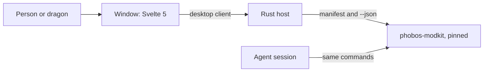

# D'thorga Companion: design record (9 Nov 2026)

**Steps 1 to 3 of this record are built: the window, its theme and its checks. Nothing has been opened and judged on
screen by the owner yet.** The research behind it, with sources, is phobos-rimworld's
[research record](https://github.com/phobos-dthorga/phobos-rimworld/blob/main/docs/development/tools-desktop-research.md). The
home page mock-up the owner is judging is private to the owner; this record describes what it shows.

## Read this first

**D'thorga Companion is one desktop program for every game the owner mods.** It asks what you want to know and answers on
screen. Agent sessions keep the command line. Both run the same tools, so both get the same answers.

**Owner's decisions (9 Nov 2026):**

1. A program over every use of the tools, now and in the future, for humans and dragons first.
2. Primarily Rust, with SQLite if a database is needed.
3. Republic Observatory's layout and feel, with a House D'thorga identity.
4. A new sibling repository; phobos-modkit stays the engine.
5. One program for every game, so moving between games does not lose the thread.
6. The name: D'thorga Companion, plain so players can find it.
7. The order: this record and a mock-up, the two kit changes, this repository; then the home page, the report viewer, saves
   and logs, and the planet globe.

**Agent choices, for the owner to revise:** Tauri 2 with Svelte 5 over a Rust host; the Python tools run as processes; the
colours below; the first version only reads.

## What each behaviour does to the person

| Behaviour | What it lets them do | What it stops them doing | How it changes the way they work |
| --- | --- | --- | --- |
| The window (built) | See that the program and the tools are working, or be told plainly what is wrong and what to do | Nothing | Nothing yet: it is the frame everything else goes in |
| "Where was I?" home page (step 4) | Come back to a game after months and see when they last worked on it and what they did | Nothing; it only reads | Changing games stops costing the thread |
| Report viewer (step 5) | Read any tool's report, chosen from a list, with no typing | Run anything the manifest marks as writing, running or owner-only | Long quoted commands are no longer needed |
| Newest save and log (step 6) | See them appear by themselves as they play | Nothing | The page stays current without asking |
| Planet globe (step 7) | See world-map pollution and every settlement at a glance, stepping through saves with buttons | Nothing | "Why is that place polluted?" becomes a glance |

## How it is built

**The window presents, the host decides.** Svelte components show what they are given. Only `desktopClient.ts` files may
talk to the host. The host owns running tools, and later the watcher, the databases and the refusals.

**One boundary to the tools.** The host runs `python -m phobos_modkit <command> --json` and reads one shape, the envelope
(phobos-modkit `docs/manifest.md`). A process per question is cheap: 0.16 s to start on the owner's PC, against 0.2 to 2.7 s
for the query itself (measured 9 Nov 2026, best case for other PCs).

**The manifest decides what the program may run.** Each report says what it does: `reads`, `reads-online`, `writes`, `runs`
or `owner-only`. The first version runs only the first two, and `owner-only` never.

**The core never names a game**, the rule phobos-modkit keeps too. A game's name reaches the core only through the
manifest's `game` field and the owner's own list of games.

## The window

Five bands, from Republic Observatory's `docs/dashboard-and-interface.md`:

| Band | Holds |
| --- | --- |
| Command bar | The crest and name, the pages |
| Observation bar | What you are looking at, and whether anything can change |
| Navigator | Your games |
| Canvas | The answer first, then the detail |
| Inspector | Where it came from, and how the tools are |

A status bar closes the window.

**For unreliable fine motor control:** controls are at least 44 px, nothing needs a drag, nothing appears only on hover, and
every control is reachable from the keyboard. **For reading:** the answer comes first, body text is 16 px and the floor is
12 px, and text scales with the operating system.

**When something fails, say four things in order:** what happened, what stayed safe, what to do, then the technical detail
folded away (Observatory's `docs/accessibility-guidance-and-notifications.md`).

**Fonts are the system's** (Georgia for headings, Segoe UI for text), as Observatory's are, so nothing is downloaded or
bundled. The mock-up uses web fonts that look much the same.

## The House D'thorga theme (agent's proposal, owner to judge)

The owner's Dragonself is the palette, in `themes/house-dthorga.json`:

| Role | Colour | From | Means |
| --- | --- | --- | --- |
| `accent` | Amber `#F2A93B` | The eyes | The brand, focus, what needs attention |
| `comparison` | Purple `#B79CFF` | The crest | Worked out from what was read |
| `observed` | Teal `#4FD1C5` | The tail | Read from a file or a save |
| `risk` | Red `#FF8A7A` | The body | Something went wrong |
| `success` | Green `#8BD17C` | The crest's streaks | It worked |
| `canvas` | Near-black `#0E0B10` | | The ground |

A test holds every colour to Observatory's contrast rules: 4.5:1 for text, 1.5:1 for dividers. **Colour never carries a
meaning alone.**

## What comes next

**Step 4, "Where was I?"** Each game is a list of repositories, kept on the owner's PC because it holds paths. For each game:
when it was last worked on, the last few commits, unreleased changelog entries, and open work where a repository records it.

**Step 5, the report viewer.** Forms built from the manifest; every report drawn from the envelope's report. Needs typed table
cells in the kit so numbers sort.

**Step 6, saves and logs.** Rust watches the folders, with file events as hints, a full check every 15 seconds and a 1.5 second
wait until a file stops changing (Observatory's `recorder_service.rs`). Needs the kit's progress stream.

**Step 7, the planet.** MapLibre GL JS in globe projection with an empty style and our own tiles, as WyrmGrid's Atlas draws
its map, starting with a drawing test on the owner's save. A flat map is the fallback. **Waits for one in-game reading** to
confirm our rebuilt planet sits the same way up as the game's.

**SQLite arrives with the first thing to keep**: two files under the user's local application data, never a synced folder.
One holds what can be rebuilt, the other the owner's own pins and history, with an export because Synology does not back up
that folder.

## Limits

- The packaged program finds the kit by the path it was built from, or `PHOBOS_COMPANION_KIT`. It cannot be handed to anyone else
  yet.
- It needs Python on the PATH, or `PHOBOS_COMPANION_PYTHON`.
- `node_modules` sits inside this repository, in a synced folder if the clone is in one, as Observatory's does.

## Who chose what

**Owner (9 Nov 2026):** the seven decisions above.

**Agent, with the owner's go-ahead on the order of work:** the stack, the boundary to the tools, the five-band layout as
borrowed, read-only first, the kit changes (phobos-modkit 1.0.0).

**Agent defaults, owner to revise:** the palette and what each colour means; system fonts; the empty window's wording.

## Open questions for the owner

| Question | Agent lean |
| --- | --- |
| Do the colours and the crest feel like House D'thorga? | Keep them until the owner says otherwise |
| Should older mods' pages link to Companion once it is public? | Not until it can be handed to someone else |
| In what order do other games get their saves and logs read? | Whichever game the owner is on when step 6 is done |
