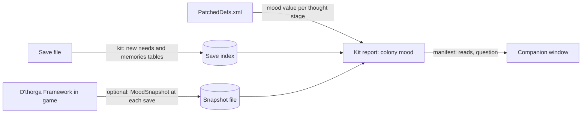

# Handoff: a colony mood report for D'thorga Companion (10 Nov 2026)

**Delivered the same day: the save route is built** (phobos-modkit 1.5.0, `rimworld-save mood`; D'thorga Companion 0.4.0). What was
built, what changed from this proposal and the questions still open are in the
[design record](design-record.md#colony-mood-built-10-nov-2026). This handoff is kept as it was written.

From the phobos-rimworld session (phobos-rimworld-b2), for the next Companion session. **Owner's request (10 Nov 2026):** "That might
be actually worthwhile integrating into our Companion, to see where you are lacking mood-wise." It came from a play session where
the owner's colony showed "Extreme break risk x29"; they said they handle mood mostly "with extreme amounts of drugs and their
addictions". **Nothing below is built.** Everything marked *proposal* is the agent's, for the owner to judge.

## Read this first (gotchas)

- **A save holds only half of a colonist's mood.** Read from the game's code (`query-code.py show ThoughtHandler.ExposeData`):
  `Need_Mood` saves `thoughts` and `recentMemory`, and `ThoughtHandler` saves only `memories`. **Situational thoughts are never
  saved**: bedroom, dining room and rec room impressiveness, hunger, exhaustion, pain, cold, darkness, ideology precepts, traits,
  "ate without a table" while it lasts, and most of what makes a colony miserable. They are recomputed live.
- **So a save-only report cannot answer "where am I lacking?" in full.** It can give each colonist's current mood level, every
  remembered event with its age, and the need levels (food, rest, recreation, comfort, beauty, outdoors), which imply some
  situational thoughts (starving, exhausted). It cannot see rooms.
- **A memory's mood value is not in the save.** It comes from the ThoughtDef's stages (`baseMoodEffect`, times `moodPowerFactor`,
  at `stageIndex` where one is saved). That needs the Defs as patched: phobos-rimworld's `query-defs.py patched` has them, from
  the `PatchedDefs.xml` D'thorga Framework writes on request.
- **Companion never runs a game, a mod or a write.** Everything here is a `reads` report run through the pinned kit, per
  Companion's AGENTS.md.

## What the owner's save holds (PG5, measured 10 Nov 2026)

`python scripts/query-save.py sql ...` in phobos-rimworld, over `element_path`:

| Path under a map pawn (`savegame/game/maps/li/things/thing/needs/needs/li/`) | Count |
| --- | --- |
| `def`, `curLevel` (every need, mood included) | 1,312 and 1,173 |
| `thoughts/memories/memories/li/def`, `age`, `otherPawn`, `sourcePrecept`, `durationTicksOverride` | 3,135 memories, on 61 pawns |
| `.../moodPowerFactor` | 1,668 |
| `.../opinionOffset` (social memories) | 2,530 |
| `.../stageIndex` | 84 |
| `tolerances/vals`, `bored/vals` (recreation types worn out) | 51 pawns |

**The save index has no table for needs or thoughts today**; they exist only as element paths. World pawns have the same layout
under `savegame/game/world/worldPawns/pawnsAlive/li/needs/`.

## Two routes, best done together (proposal)

1. **Save route, in phobos-modkit** (the kit's rules; then move Companion's pin). Index each pawn's needs and memories into new
   tables of `rimworld-save`; add a report, for example `rimworld-save mood`, whose manifest entry is `reads` with a plain
   `question` such as "Where is my colony's mood suffering?". It answers: colonists by mood level against their break thresholds;
   the memories hurting the most colonists, with their summed mood cost; needs that are low colony-wide (food, rest, recreation,
   beauty, comfort, outdoors); and recreation kinds most colonists are bored of. It says plainly what it cannot see (rooms,
   temperature, precepts).
2. **Snapshot route, in phobos-rimworld's D'thorga Framework** (a new behaviour there, so it needs a design record answering the
   three questions first). At each save, or on a dev action, write one small file beside `PatchedDefs.xml` listing every
   colonist's whole thought list as the game computes it: thought, label, mood offset, situational or memory, and source
   (precept, room, other pawn). About 40-60 colonists, once per save: cheap. The report reads it when it is newer than the save
   and falls back to the save route otherwise. This is the only way to see bedrooms, cold and precepts exactly.

**Why both:** the save route works on any save and with Framework off; the snapshot gives the full picture for players who run
it. Each source is labelled in the report, so a reader knows which they are looking at.

## What it does for the player (draft for the design record)

| | |
| --- | --- |
| **Lets them** | See in one place which few problems cost the colony the most mood, instead of opening forty Needs tabs |
| **Stops them** | Nothing: it only reads |
| **Changes how they play** | Fixing the top two or three causes before reaching for drugs (the owner's own words prompted it) |

## Open questions for the owner

1. Save route only first, or both routes together?
2. Should the report suggest fixes (for example "12 colonists eat paste: a stove and a cook would lift each by about 4"), or only
   name the causes? Suggestions need authored rules per thought, and must label themselves as advice.
3. Colonists only, or slaves and prisoners too? (The owner's screenshot showed a prisoner in severe pain.)

## Where things are

- Save tool: phobos-modkit `rimworld-save` (called through phobos-rimworld's `scripts/query-save.py`).
- Defs as patched: phobos-rimworld `scripts/query-defs.py patched <defName>`.
- Game code: phobos-rimworld `scripts/query-code.py show Type.Member` (decompile in its `.local/decompiled`).
- Companion's report rules: `AGENTS.md` here ("What the program may do") and `src-tauri/src/reports.rs`.
