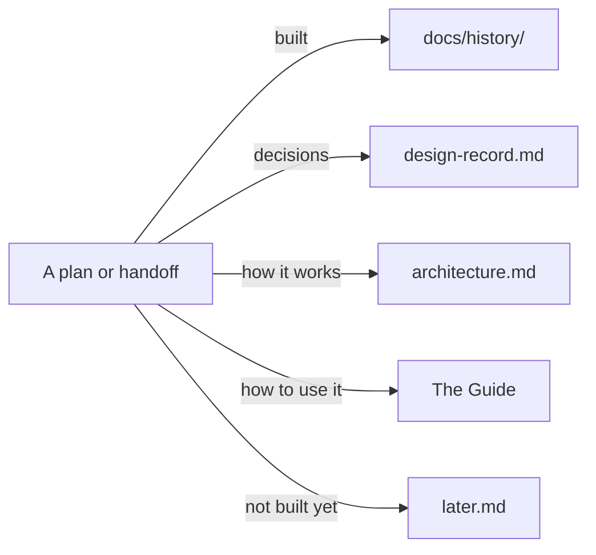

# History: finished plans and handoffs

**This folder keeps documents whose work is done**, so the live docs say only what is true now. Nothing here is a rule or a
plan still to follow: read it to learn why something is as it is, or how it was first proposed. Started on 24 Nov 2026, in the
owner's docs rewrite (step 7).

- **What is true now** lives in the live docs: the rules in [`AGENTS.md`](../../AGENTS.md), how the code works in
  [architecture.md](../architecture.md), the decisions in [design-record.md](../design-record.md), how to use it in the Guide
  (F1 in the program), and what is still to build in [later.md](../later.md).
- **A document moves here when its work is built**, whole and unchanged (`git mv`), or, for a live doc that also holds reference
  or unbuilt plans, as the sections that are now history. Links to it are repointed in the same commit.
- **Never edit a document here to match the program as it is now.** Correct the live doc instead.

| Document | What it was | Moved |
| --- | --- | --- |
| [handoff-2026-11-10-mood-report.md](handoff-2026-11-10-mood-report.md) | A phobos-rimworld session's handoff proposing the colony mood report, built in 0.4.0 and 0.5.0 | 24 Nov 2026, whole |
| [shared-code-audit.md](shared-code-audit.md) | The audit of code written more than once, and its plan; built in 0.16.0 as `companion-core` and `src/lib/shell/` | 24 Nov 2026, whole |
| [cross-links-proposal.md](cross-links-proposal.md) | The cross-links proposal (N1 to N3, L1 to L5, S1 to S5), its order and where each build differed; built in 0.19.0 | 24 Nov 2026, from `cross-links.md` |
| [debugging-layer-1.md](debugging-layer-1.md) | The heap probe on RimWorld 1.7 and the plan for layer 1, Look inside; built in 0.41.0 | 24 Nov 2026, from `debugging.md` |
| [publishing-plan.md](publishing-plan.md) | The Publish page's planned layout, the rule changes, the build order and the planned-against-built table; built in 0.69.0 | 24 Nov 2026, from `publishing.md` |
