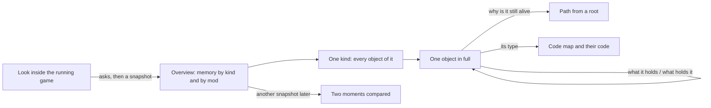

# Debugging: the probe and layer 1's plan (20 to 21 Nov 2026)

**History** (moved here from `docs/debugging.md` on 24 Nov 2026, the owner's docs rewrite, step 7). Layer 1, "Look inside",
is built: the Explorer page (Companion 0.41.0) on phobos-modkit 1.65.0's heap reader. Its decisions are in the design record's
[Explorer](../design-record.md#explorer-look-inside-the-running-game-built-21-nov-2026-0410) and how it works in
[architecture.md](../architecture.md). Layers 2 and 3 are still designed in outline in [debugging.md](../debugging.md).

## The probe (20 Nov 2026, agent-run, the owner's yes)

A 120-line C# program (`HeapProbe`, kept outside every repository at `K:\phobos-modkit\spikes\heapprobe-2026-11-20`, with its
output) using **ClrMD** (Microsoft.Diagnostics.Runtime 4.2.751201, MIT, Microsoft's library for reading .NET memory). It takes a
Windows process snapshot (`PssCaptureSnapshot`), loads the game's own memory-reading library, walks the heap and opens one object.

| What | Result |
| --- | --- |
| Self-test on a stand-in program (stock .NET 10.0.15) | 6 ms pause; 11,157 objects in 0.1 s; a test object's string, int and float read exactly |
| First attach to RimWorld | Snapshot in 449 ms; **refused**: ClrMD checks Microsoft's signature on the memory-reading library, and Waylith's has none |
| Second attach, the check switched off for the game's own file only | Snapshot in **431 ms**; library loaded in 8 ms; **28,350,237 objects in 12.0 s, every one with its type**; 34,812 types, 510 modules, 60 threads |
| One `Verse.Pawn` opened | All 121 fields: numbers, true/false, links to other objects (its kind, faction, name, every tracker, its 25 comps) |

**What this settles:** layer 1 works on RimWorld 1.7, with no cap on the number of objects (dotnet-gcdump stops near ten million on
the owner's game; see the Memory page). **What it does not settle:** structs (a position, a rotation) were shown only as "(Struct)"
by the probe and need reading field by field; generic lists and dictionaries need opening by their inner arrays; how much memory a
held snapshot costs over minutes; whether Waylith's injected fields (its `FieldInjection` setting) read correctly on every type.

### What the first look showed (leads, not conclusions)

These are the probe's top kinds by memory, on the owner's colony. Each is a question the finished page would answer with **what
holds it**; none was chased.

| Kind | Memory | Lead |
| --- | --- | --- |
| Free space between objects | 714.8 MB | The heap's gaps; matches the kit's memory watch, which already subtracts them |
| XML: elements, text, attribute lists, names | **at least 380 MB** (8.8 million objects) | **Answered 21 Nov 2026 with the finished reader: 453 MB, live.** Every mod's patch list, which the game clears after loading, read back by Vanilla Expanded Framework's settings code, so the game loads all 10,499 patch files again and keeps them (phobos-rimworld `docs/development/patch-xml-kept-alive-2026-11-21.md`) |
| `MouseoverSounds+MouseoverRegionCall[]` | 128 MB in two arrays | Unusually large for two arrays |
| Character Editor's preset sets, a `KTrie` search tree | 34 MB and 63 MB | Two mods' caches |
| Vanilla Expanded Framework's `PipeSystem.CachedIngredient` | 22 MB, 722,371 objects | Many small objects |

## Layer 1: what the page shows

| Part | What it shows |
| --- | --- |
| **Look inside the running game** | A button, with the pause and "save first" in its question; a bar while the heap is read (12 s on the owner's game) |
| **Overview** | Memory by kind and **by mod** (a type's assembly file names its mod's folder), free space, object counts; the biggest first |
| **One kind** | Its objects, paged; a search by a value (a pawn's name, a thing's kind) |
| **One object in full** | Every field and its value, structs opened, lists and dictionaries opened a page at a time, each link a press away. **The same view the Save explorer's "one thing in full" uses**, so a save and the running game look alike |
| **What holds it** and **why is it still alive** | The objects that point to it, and one path from a root (a static field, a thread, a handle) down to it: the answer to a memory leak |
| **Its type** | A press to the Code map and to "Read their code" (`rimworld-code show`), with patch badges |
| **Two moments compared** | Counts and memory by kind and by mod between two snapshots, beside the Memory page's watch |

What a game's tools add, RimWorld first: friendly groups (Maps, Pawns by name, Things by kind, the game's and mods' components),
a thing's label from its kind, and the mod behind each kind, all through the kit's game adapter.

## Layer 1: how it is built

| Part | How |
| --- | --- |
| The reader | Built in phobos-modkit (the heap reader, kit 1.65.0, served by `look-serve`): how it reads a snapshot, what one costs, what it holds and its limits are in the kit's `docs/heap-reader.md`, the one home for them. The page holds one snapshot at a time and lets it go on Let it go, on leaving the page, when the program closes, or after ten minutes |
| The host | `AGENTS.md`'s "What the program may do" gains a line in the change that builds it: an attach only on a press and a confirmation, only to the process the game adapter names, only reading |
| Moving | Every press goes through the trail; focus keys `snapshot`, `kind` and `object`, listed in `cross-links.md` when built |
| The Guide | A page entry, "Find out what is using my game's memory" and "Find why something is still in memory", in the same change |
