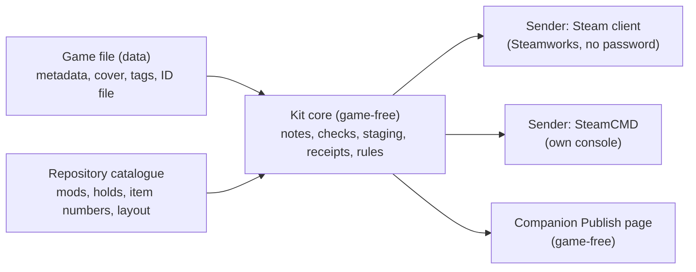

# Publishing to the Steam Workshop

**Answer first.** A **Publish** page in D'thorga Companion takes any game's mods to the Steam Workshop: each mod's state on
Steam, its Workshop page edited with a live preview, the change note built from its changelog, and buttons to prepare, upload
privately, make public and read Steam back. It sits on phobos-modkit's `steam-publish`, which came from phobos-ostranauts'
scripts on 8 November 2026. **Designed and built 23 November 2026 (Companion 0.69.0, kit 1.97.0 to 1.102.0).** Not yet tested
on screen, and **nothing has been sent to Steam from it yet**: the first real upload is the owner's press. **The owner's
checklist for the first uploads** (a private and a public Ostranauts update as proof, then a RimWorld mod's first) is
[first-upload.md](first-upload.md).

## The owner's request and choices

**Request** (23 Nov 2026): "I had an excellent set of scripts for Ostranauts that allowed for easy publishing of mods to the Steam
Workshop including things like the CHANGELOGs and so on. I wish to bring that over to the Companion now, especially in a visual way
for the user to modify and upload their mods easily." And, while it was being designed: "The Steam Workshop uploader should be
genericized as far as is possible."

**Owner's choices (question cards, 23 Nov 2026):**

| Question | Choice |
| --- | --- |
| How the Upload button reaches Steam | **Both, chosen per upload**: the running Steam client by default, SteamCMD beside it |
| Which repository first | **Both together**: phobos-ostranauts (10 real items) and phobos-rimworld, which adopts the tool now with every mod held. This lifts phobos-rimworld's "not before the first public beta gate" rule |
| Editing the Workshop page | **In the Companion**, with a live preview and a byte counter; Save writes the file in the repository |
| Other games this round | **Project Zomboid, Kenshi and Workers & Resources** |
| How generic | **As far as is possible** |

## Read this first (gotchas)

- **Only the owner's press uploads.** Agents, tests and CI never send anything to Steam; tests use a stand-in host and a stand-in
  Steam library. The first real upload from this page is the owner's.
- **No password, ever, on the Steam client route.** It speaks to the Steam client already running and signed in, as the Subscribe
  button does (kit 1.77.0). While it uploads, Steam shows the owner as playing that game. The SteamCMD route opens SteamCMD in its
  own console window; the owner types the login there, and the Companion never sees it.
- **New items are always created Private.** Making one public is a second, separate press with a stronger yes, and only from
  committed work.
- **Never create twice.** If Steam gives back no item number, the page says to look on Steam first and settle the receipt; it
  refuses a second create until then (the kit's rule, carried over).
- **Not tested against Steam from the kit yet.** The logic matched phobos-ostranauts' records byte for byte (444 release notes, the
  same 5 of 10 items due), but the kit's uploader has only run against a stand-in. Ostranauts' 10 items went up through its
  PowerShell uploader.

## The four questions

| Question | Answer |
| --- | --- |
| What does it let the person do? | See every mod's Workshop state in one place, for any game: the version on Steam against the repository's, the versions waiting, what blocks an upload. Edit the Workshop page with a live preview. Read the exact change note Steam will get. Prepare, upload privately, make public and read Steam back, from buttons. Set tags and Required items without visiting Steam (Steam client route) |
| What does it stop them doing? | Uploading uncommitted work wider than Private; creating an item twice; a page or change note over Steam's limits; sending a version already on the item; going public without the second yes; uploading a held mod except privately with the hold acknowledged; a mod and its ID file disagreeing |
| How does it change the way they work? | The scripts' sequence becomes one card per mod showing the next step; no console or password on the default route; a changelog entry turns Released after Steam is read back, not by hand |
| What outside it notices? | Steam: the item, its change notes, and every subscriber's next download. The repository: the catalogue, the game's ID file, the changelog's Released date. The Timeline (history log) records each upload. Home notes "versions waiting" |

**Risk (agent's grade, owner to confirm): moderate.** What can be lost: a broken or unfinished version reaching players, or text
published that should not be. Once public, subscribers download it at once; a fix is a new upload, not an undo. It is never sudden:
Private first, then a second press, and every check runs before each. By the shared design rule, a moderate risk has its own setting
that **starts on**: **Workshop uploads** on the Settings page, which hides the upload buttons when off (reading and preparing stay).

## Generic first: the game is data

The owner's word, and the shared rule "build for every game from the start". **Nothing in the core names a game.** The core is
everything Steam's Workshop does the same for every game; a game is a small data file saying where its mods keep what Steam needs.

| Layer | Holds | Where |
| --- | --- | --- |
| **Core** | Changelog to BBCode, page checks, Steam's limits (title 128 bytes, text 8,000 bytes, our 7,500 budget), staging with hashes, receipts, the publishing rules, reading Steam back, change-note worksheets | phobos-modkit `steam/publish/` |
| **Senders** | Two ways to hand a staged item to Steam, behind one interface: the same candidate, receipt and records either way | phobos-modkit `steam/` |
| **Game file** | One JSON file per game: app number, how a mod folder is recognised, where its title and version are read, the cover, the folder uploaded, tags, the ID file the game keeps, reminders | phobos-modkit `games/<game>/workshop.json` |
| **Code hook** | Only where a game's format cannot be said as data (a binary header, say): one small function the game file names | phobos-modkit `games/<game>/publish.py`, only if needed |
| **Repository policy** | Which mods, holds, item numbers, the layout of its folders, what a package must hold (a payload hook) | each repository's `config/workshop-publishing.json` and wrapper |
| **The page** | One page for every game; it reads the kit's JSON and knows no game | Companion |

**The game file says, as data** (agent's design):

- `appId`; `metadata`: the file that marks a mod folder, its format (`xml`, `json`, `ini`, `keyvalue` lines) and the fields giving
  the title and version.
- `preview`: the cover's path, its expected size if the game has one, and the formats allowed.
- `content`: the folder uploaded, as a pattern (for a game whose Workshop item wraps the mod, such as `Contents/mods/{mod}`).
- `tags`: fixed tags, and tags read from a metadata field through a map (RimWorld's supported versions become `1.6`, `1.7`).
- `idFile`: where the game writes the item number and in what format, so the kit can keep it in step and refuse a disagreement.
- `reminders`: what the owner must still do on Steam for this game.

RimWorld's and Ostranauts' Python adapters become game files first, and must give byte-for-byte the same results as now (the
Ostranauts check of 8 November is run again). A game a person adds that nobody has written a file for gets a **plain-folder** game:
the folder uploaded as it is, title and version typed on the page.

### The two senders

| | Steam client (default) | SteamCMD (beside it) |
| --- | --- | --- |
| Login | The running, signed-in client; nothing asked | The owner types it in SteamCMD's own console window |
| Library | That game's own `steam_api64.dll`, found from its install, as Subscribe does | Valve's SteamCMD, installed by the owner |
| Tags | Set (`SetItemTags`) | Not settable: a reminder |
| Required items | Set (`AddDependency` for each) | Not settable: a reminder lists them |
| Progress | A bar (`GetItemUpdateProgress`) | SteamCMD's own window |
| Agreement | Says when Steam needs the Workshop legal agreement accepted, and opens it | SteamCMD says so in its output |
| Proof | Steam's result code and the item number from the call's own result | SteamCMD's log; still "unverified" |

**The Steam client route reads two of Steam's result structures** (`CreateItemResult_t`, `SubmitItemUpdateResult_t`), which the
Subscribe code avoided. Their layout comes from Valve's headers (8-byte packing on 64-bit Windows); a test holds it, and the first
real run confirms it. **Both routes still end "unverified"** until Steam is read back.

## The Publish page (agent's layout, owner to revise)

- **Top:** the game and repository, as elsewhere; the Workshop uploads setting's state; the sender chosen (Steam client or SteamCMD).
- **A card per mod, dependencies first:** cover with its size; item number or "not on Steam yet"; the version on Steam against the
  repository's; a **versions waiting** count; visibility; blockers in words (held, cover missing, page too long, ID file disagrees);
  and **one next step** as the card's main button.
- **The mod's own view, in tabs:**
  - **Page:** the BBCode on the left, the live preview on the right (Steam's look, in the chosen theme), a byte counter against
    7,500, problems listed as they are found. **Save** writes `page.bbcode` through the kit, which checks it first.
  - **Change note:** exactly what Steam will get: every version since the last upload, newest first, and what was cut if it is long.
  - **Steam:** tags and Required items as Steam will be told, visibility, the last receipt, and **Read Steam back**.
  - **History:** each upload's receipt, from the repository's records.
- **Buttons, in order:** Prepare (offline, writes only to the kit's staging folder) → **Upload privately** (one yes) → the owner's
  subscription test (the page says what to check) → **Make public** (a second yes naming the item, the version and "everyone") →
  **Read Steam back** (marks the changelog Released, writes the date). **Update all waiting** does every due item, dependencies
  first, and stops at the first failure.
- Every action has a key; nothing needs the mouse.

## What changes in the rules (owner's word given by the cards above)

- **phobos-modkit `AGENTS.md`, "Steam, read-only and slow":** the uploader's exception grows from "only the owner runs it, in their
  own console" to that **or the owner's press in D'thorga Companion**, through the signed-in Steam client or SteamCMD in its own
  console; still never a password held, and never an agent, test or CI.
- **The kit's manifest gains `owner-press`:** a program may run it only on the person's press and yes, in a window they see; agents
  never. `upload` and `update` move from `owner-only` to it. `owner-only` stays for what a program must never run.
- **The Companion's `AGENTS.md`:** the Publish page is a third place, beside the Mods and Mod list pages, where the program changes
  something outside itself, on press and confirmation only, while the manifest calls it `owner-press`.
- **phobos-rimworld `mods/AGENTS.md`:** the publishing tooling is adopted now, not at the first public beta gate; every mod's
  catalogue entry starts held.

## Build order

| Step | Where | What |
| --- | --- | --- |
| 1 | kit | Game files as data; RimWorld and Ostranauts moved to them with the same output; the plain-folder game |
| 2 | kit | The sender interface; the Steam client sender; SteamCMD in its own console; `owner-press`; the rule wording |
| 3 | kit | `steam-publish page` (read, check, write a page) and JSON for everything the page shows |
| 4 | Companion | The Publish page, the Workshop uploads setting, Home's note, the Timeline's upload marks |
| 5 | phobos-rimworld | Adopt: catalogue (all held), a Workshop page draft per mod (agent-written, held for the owner), the wrapper, the rule |
| 5 | phobos-ostranauts | Adopt: catalogue layout keys, its package checks as a payload hook, the wrapper; the PowerShell uploader kept until the kit's first real upload works |
| 6 | kit | Game files for Project Zomboid, Kenshi and Workers & Resources, each after reading its format (below) |

### The three new games: format facts to confirm before each file

Agent's current understanding, **not yet checked**; each is confirmed from the game's own files and public documentation before
its game file is written, and written in our own words.

| Game | App | Understanding to check |
| --- | --- | --- |
| Project Zomboid | 108600 | The Workshop item wraps mods: `workshop.txt`, `preview.png` (256 by 256) and `Contents/mods/<mod>/` with each `mod.info` (`name=`, `modversion=`). The game writes the item number into `workshop.txt` |
| Kenshi | 233860 | A mod folder holds `<name>.mod`, `<name>.img` (the cover) and `<name>.info`, which the game's tool writes with the item number, title and visibility. The version may live only in the `.mod` file's header, which may need a code hook |
| Workers & Resources | 784150 | A mod folder carries a `workshopconfig.ini` whose `$` keys hold the item number, name, visibility and preview |

Each repository of those games adopts the tool when the owner next works in it, not in a sweep.

## Who chose what

**Owner (23 Nov 2026):** the page itself; both senders, chosen per upload; Ostranauts and RimWorld together, with RimWorld's rule
lifted and every mod held; editing in the Companion; Project Zomboid, Kenshi and Workers & Resources; as generic as possible.

**Agent choices, owner to revise:** the game file as data with code only where needed, and the plain-folder game; `owner-press`; the
page's layout, tabs and buttons; the risk grade (moderate) and the Workshop uploads setting starting on; the build order.

## Answered (question cards, 23 Nov 2026)

| Question | The owner's answer |
| --- | --- |
| Retire Ostranauts' PowerShell uploader once the kit has made a real upload? | **Yes, after proof**: one private upload and one public update that work |
| Write a Workshop page draft for each RimWorld mod now, every mod held? | **Yes**: agent-written drafts, held for the owner's review |
| Workshop uploads setting: on or off at first? | **On** |
| When to build | **All six steps in one run** |

## As built (0.69.0)

| Planned | Built |
| --- | --- |
| A card per mod with cover size | The card names the item, versions, visibility, blockers and next step. **The cover's size is not shown**: the kit's answers carry the cover's path and blockers (missing, over budget, and from kit 1.100.0 a game's own size rules), not its size. A next step if wanted |
| The game and repository at the top | The game is the one chosen, as on every page; a repository choice shows when more than one of the game's repositories keeps a catalogue |
| Upload, Make public | **Upload privately** (a new item) or **Send the update** (an item with a newer version), one yes; **Make public** for an up-to-date private item, two: **Go on**, then **Make it public for everyone**, naming the item and version |
| Update all waiting | The kit's `update`, which builds each due item unless told not to, then prepares and sends it, dependencies first, stopping at the first failure |
| Read Steam back | The kit's `pull --visibility --changelog --write`, under a new going-online kind, **Workshop pages** (`api.steampowered.com`, small loss), on by default as every kind is |
| Timeline marks for uploads | **Not built.** Uploads are recorded in each repository's receipts (`.local/workshop-receipts/`) and the catalogue's commits, not in the history log the Timeline reads; the kit would first have to write a history fact per upload. Shown meanwhile on the mod's **Uploads** tab |
| Every action has a key | **Shift + W** the page; **J**/**K** mods; **E** Prepare; **Shift + U** Upload or Send the update (asks first); **Shift + M** Make public (asks twice); **B** Read Steam back; **Shift + A** Update all waiting (asks first); **O** Open in Steam (agent's defaults, changeable in Settings) |

**Checked**: the host's names, arguments and refusals (Rust tests: an upload is refused while the setting is off before the kit is
asked; public only with `--confirm-public` after the window's second yes; SteamCMD always in its own window); the BBCode preview's
parser (only the kit's tags become anything, a link is never followed, nothing is drawn as HTML); the cards' next steps; and the
page against a stand-in host in the browser, both widths, with the accessibility audit: an update asks first and nothing is asked
of the host until the yes, making public asks twice, and the editor shows the tools' problems and keeps Save off. The kit's
manifest at the pin was read to say `upload` and `update` are `owner-press`, `page`, `notes` and `pull` `writes`, `prepare` `runs`.

## Open questions for the owner

| Question | Agent lean |
| --- | --- |
| Show each cover's size on its card? The kit would first have to report it | Only if the blockers' words are not enough |
| Timeline marks for uploads? The kit would first have to write a history fact per upload | Yes, once uploads have run a few times |
| Do the page's keys suit you (Shift + W, E, Shift + U, Shift + M, B, Shift + A, O)? | Keep them until you change them in Settings |
