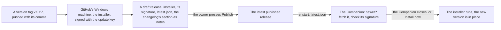

# Releases on GitHub, and the updater (O1, 25 Nov 2026)

**Status (25 Nov 2026):** designed and built in Companion 0.85.0; **waiting on the owner's one-time setup** (the update key,
below) before the first release can be built, and not tested on screen. The owner chose O1 from [later.md](later.md#going-online)
("Releases and updater"), the first step toward the Companion for others (the [release audit](release-audit.md)'s B6), and
answered five questions by card the same day. Agent choices are labelled so the owner can revise them.

## Read this first (gotchas)

- **Nothing goes public until the owner presses Publish on GitHub.** Each version tag builds a **draft** release; the updater reads
  only the latest *published* release, so a draft reaches no one.
- **The updater installs only what the owner's update key signed.** The key is made once, by the owner, and held as a GitHub
  secret with the owner's own copy; **agents never see, make or hold it**. If it is lost, installed copies cannot take updates
  and need one reinstall by hand with a new key.
- **The public half of the key is in `src-tauri/tauri.conf.json`** (`plugins.updater.pubkey`); it is not secret. Until the owner
  gives it, the updater says "not set up yet" and makes no call.
- **It installs when the Companion closes**, so it never restarts under the person: **Install now** does it at once and opens the
  new version again. Windows shows the installer's small progress window either way.
- **A local build is never signed.** `npm run installer` signs only when the key is in its environment, as on GitHub; the owner's
  own installers stay as they are.
- **Windows only for now.** Linux and macOS each need their own way to carry Python and the tool kit first (below).

## The owner's answers (25 Nov 2026, by card)

| Question | Answer |
| --- | --- |
| What happens with a version built on GitHub? | **A draft; the owner presses Publish** |
| How does the Companion learn of a newer version? | "**I think we should integrate an auto-updater**", then: **fetch it in the background, install it when the Companion closes**, with **Install now** to do it at once |
| Where is the key that signs update files kept? | **A GitHub secret, and a copy the owner keeps** |
| Which systems? | **Windows now, others later** |
| (O4's rule, 23 Nov) May it go online by itself? | On for the owner's listed repositories' kinds, **each with a switch**; this is one more kind, `updates` |

## The four questions, and the risk (`rules/designs.md`)

| Question | Answer |
| --- | --- |
| What does it let the person do? | Get each new version without building it or being told where an installer is: it arrives while they work and is in place the next time they open the Companion |
| What does it stop them doing? | Running an old version without knowing; hunting for an installer; asking an agent to build one |
| How does it change the way they work? | Versions are published, not handed over: the owner presses Publish on a draft, and every copy, theirs included, follows |
| What outside it notices? | GitHub (a draft release per version, built by GitHub's own Windows machine), About's Version tab and Home, Settings → Going online (a switch), the Guide |

**Risk grade: low** (agent's grading, for the owner to confirm): an update replaces the program, never the person's data, games,
saves or repositories; it is the owner's own published version, signed; and it installs only when they close the program or
press Install now. A bad version is undone by publishing a fixed one, or by installing an older installer by hand. **So it starts
on**, with the switch in Settings → Going online.

## How it works

| Part | How | Whose choice |
| --- | --- | --- |
| The build | `.github/workflows/release.yml`, on a tag `v*`: the same `npm run installer` as on the owner's PC (pinned Python, the kit, its compiled tools), with the key from the secrets, so the build also writes the installer's `.sig` | Agent |
| The release | A draft named after the version, holding the installer under a plain name (`DthorgaCompanion_X.Y.Z_x64-setup.exe`), its signature, and `latest.json` (`scripts/release-files.mjs`: version, the changelog's section as notes, the date, the installer's address, the signature) | Owner: a draft. Agent: the files and names |
| Which tags | An agent tags each Companion version after its commit (the kit already does), so every version builds a draft; the owner publishes the ones they want | Agent, under the owner's "draft; I press Publish" |
| Checking | Once, a few seconds after the Companion starts, when the `updates` kind is on and the key is set: `latest.json` from the latest published release (`github.com/phobos-dthorga/phobos-companion/releases/latest/download/latest.json`), compared with the running version (only newer) | Owner: auto-updater. Agent: once a start, a minute's timeout |
| Fetching | At once, in the background; the file is checked against the key before it is kept, and kept in memory | Owner |
| Installing | When the Companion closes (after a snapshot is released and an agent ended), the installer runs with its progress window and the program does not reopen; **Install now** runs it at once and opens the new version | Owner |
| Where it shows | About's Version tab: checking, up to date, fetching, ready (with its notes and Install now), failed (with why and Check again), off, or not set up; Home: one line while an update is ready | Owner: About and Home. Agent: the words |
| Its switch | Settings → Going online, `updates` ("github.com"), on by default | Owner (O4's rule) |

**Agent choices, owner to revise:** the plain asset name (GitHub would otherwise turn the curly apostrophe and spaces into
something else); once a start, no checking while it runs; the update kept in memory, not on disk, so an update not installed is
fetched again next time; the installer's progress window (`passive`); `requireSignedVersion` left off (it rejects releases
signed by an older Tauri command line; worth turning on once a release built with it has been checked).

## The owner's one-time setup

Agents never do these: the key is a credential.

1. **Make the key**, in a terminal in the phobos-companion folder: `npx tauri signer generate -w "%USERPROFILE%\.tauri\dthorga-companion.key"`.
   It asks for a password (it may be empty) and writes two files: the private key and `dthorga-companion.key.pub`.
2. **Put the private key on GitHub**: the repository's Settings → Secrets and variables → Actions → New repository secret,
   `TAURI_SIGNING_PRIVATE_KEY`, with the whole content of `dthorga-companion.key`; and, if you gave one, the password as
   `TAURI_SIGNING_PRIVATE_KEY_PASSWORD`.
3. **Keep a copy** of the private key and its password where you keep such things (a password manager). Don't put it in a
   repository or the safe copies.
4. **Give an agent the public key**: the content of `dthorga-companion.key.pub`. It is not secret; it goes into
   `tauri.conf.json` with the next version, and that version's tag builds the first draft.

## What it does not do yet

- **Linux and macOS**: each needs Python and the kit carried its own way (Linux: an AppImage with a portable Python; macOS: the
  same, and Apple's notarising, which needs a paid Apple account). The workflow takes one more job each, and `latest.json` one more
  platform line.
- **Signing the installer itself** (O6, SignPath Foundation): Windows still warns of an unrecognised program on a first install.
  An update installed by the updater is checked by its own signature instead.
- **Choosing a version to go back to**: install an older installer by hand from the releases page.
