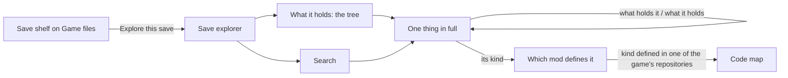

# Save explorer: design (20 Nov 2026)

**Status (20 Nov 2026):** designed, nothing built. The first slice (the explorer and one thing in full) waits for the owner's word
to build; the slices after it are listed at the end. When it is built, its design moves into `design-record.md` and `later.md`
keeps one line pointing there.

**The owner asked whether the Companion should let players "delve deep into their save-files and like the Coding tools ... see
relationships visually"** (20 Nov 2026). The agent's answer was yes, starting from what the tools already read. **Owner's choices
(20 Nov 2026):** the explorer and one thing in full come first; **written for players from the start**: plain words, no tool names
on the page, any save and any mod list.

## Read this first (gotchas)

- **It only reads.** A save is never written, and **save editing is not part of this design**: it is risky, and other tools do it.
- **Never the whole save as one picture.** The owner's RimWorld saves are about 300 MB. Every view starts from one thing, one
  part of the save or one search, the way the Code map starts from one piece of code.
- **A save holds what the game saved, not what it works out.** A kind's name, never its label; values before any mod's patches;
  half of a colonist's mood (the mood report's gotcha). Labels come from the installed mods, so a save made with other mods shows
  some names as saved.
- **Most of the facts exist already** in phobos-modkit's save index (`docs/rimworld-save.md`): things, pawns, health conditions,
  traits, skills, factions and how each stands with the others, maps, world objects, what mods saved, what holds what, and one
  thing's saved data in full. **The page's real gap is typed inputs**: the Reports page runs only reports that need nothing
  typed, and this page is the first that sends a search or an ID to a tool.
- **The indexer is general.** It counts every element path in any XML file and records where each element sits
  (`crates/xml-index`), so the tree and one element in full can work for any game whose saves are XML, not only RimWorld.

## The four questions

| Question | Answer |
| --- | --- |
| What does it let the person do? | Open any save, see what it holds by kind and by place, find anything in it by name, kind or ID, and open one thing to see everything it saved: its values, what holds it and what it holds, with a press from each to the next |
| What does it stop them doing? | Opening a 300 MB file in a text editor, or guessing where a thing went, what a removed mod left behind or why a save is large. It changes nothing |
| How does it change the way they work? | A question about their colony that needed a terminal command or an agent session becomes a few presses from the save shelf |
| What outside the program notices? | **Nothing, by choice**: it only reads. The game, the save and the repositories never see it |

## What the page shows

| Part | What it shows | For every game whose saves are XML | What a game's tools add (RimWorld first) |
| --- | --- | --- | --- |
| Which save | Its name, date and size, and when it was last read; another save from the shelf or a list | Yes | The game's version, the colony's age in days, its maps |
| What it holds | A tree, like the code viewer's list of files: each part of the save with how many there are, opened a level at a time | The save's own parts, from the indexer's count of element paths | Friendly groups above them: Maps, Things by kind, People and animals, The world, What mods saved |
| Search | Anything matching a name, kind or ID, with `*` and `?` | Parts of the save by name | Things, people and animals, world objects |
| One thing in full | Every value it saved, as a nested list that opens and closes; what holds it, out to the map or the world; what it holds, each a press away | One element of the save, by its place in the tree | Its kind with the label the installed mods give it, the mod that defines that kind, and a press to the Code map when that kind is defined in one of the game's repositories |

**A kind no installed mod defines is marked "not in your mods now"**, with its saved name. That alone answers, thing by thing,
what a removed mod left behind; the mod footprint slice (below) counts it for the whole save.

### Words for players (agent choices, owner to revise)

| The save says | The page says |
| --- | --- |
| `def` | kind |
| hediff | health condition |
| component | kept by the game or by a mod |
| `li[3]` | item 4 |
| thing ID | ID, shown with a copy button |
| world object | place on the world map |

The saved name is folded beneath each friendly one, and **Copy as command** carries the saved names, so an agent session sees
exactly what the person sees.

## How it is built

| Part | How |
| --- | --- |
| The facts | **phobos-modkit first, then the pin.** K1: `rimworld-save`'s `things`, `find` and `thing` give their answers as data as well as tables (nested values, what holds it, what it holds), to be checked against what they give today. K2: a general save tree for any XML save, from the indexer's count of element paths and the place each element sits, with one element read by its place; for a game whose save is a folder of XML files, a file at a time. K3: labels and the defining mod for each kind, from the kit's Def index. K4: the manifest marks these reports with a new `save` surface and declares each option. Each speaks progress lines |
| Typed inputs | The host reads each option from the manifest, checks the text against its kind and a shape (an ID: letters, digits, `_` and `-`; a place in the tree: names separated by `/`; a search: one line of a sane length) and passes it after `--` as one argument, so nothing typed reaches a command line any other way. `AGENTS.md`'s "What the program may do" gains a line in the change that builds it |
| Reading | The save is read once, from a copy, into the kit's index: about a second and a half for the owner's RimWorld saves, with a bar while it runs. Later presses take well under a second. One thing in full reads only that thing's bytes from the save, and **is refused when the game has saved over it since**: the page says so and offers **Read again** |
| Drawing | The tree and lists from the components already there; one nested-list view for saved values. No new library. The relationship pictures (a later slice) reuse the Code map's drawing in `src/lib/connections/` |
| Moving | Every press goes through the trail, with focus keys `save`, `place`, `thing` and `search`, listed in `cross-links.md` when built. Go to anything offers one entry, **Search this save for ...**, rather than searching the save live as you type |
| Where | Under Play, after Game files; key **V**; every save on the Game files shelf gets **Explore this save** |
| The Guide | A page entry, a How do I...? answer ("Find where something went in my save") and the words above, in the same change |

## Games

| Game | What it can show | Checked |
| --- | --- | --- |
| RimWorld | Everything above | When built |
| Farming Simulator 25 | Its saves are folders of XML files (agent's knowledge, to confirm when built): the tree and one element in full, a file at a time; no friendly groups until a game adapter adds them | When built |
| A game whose saves the tools cannot read (Project Zomboid's, for one) | The page says in words that this game's saves cannot be read yet | When built |

**Check it on two games before calling it done** (`AGENTS.md`): RimWorld and Farming Simulator 25.

## Limits

- **Pawn names and colony details are on screen**, and in any picture the page saves. The kit already shows the home folder as
  `~` in what it reports.
- An index lives in the kit's cache, outside every repository, and the kit's clean-up already lists stale ones.
- **Not tested on screen** until the owner says so, like the rest of the Companion.

## Agent choices, owner to revise

The key V; the page under Play; one Go to anything entry rather than a live search; the friendly group names and the words table
above. The key and the search are on the Decisions page.

## The slices after this one (not on the build list yet)

| Slice | What it lets the person do | What it needs |
| --- | --- | --- |
| **Relationship pictures** | See what holds what, how factions stand with each other, and family, lovers, rivals and bonded animals, one thing in the middle and its links around it, drawn with the Code map's drawing | What holds what and factions are indexed already; **the social web needs a new table in the kit's save schema** for relations between pawns |
| **What each mod has in this save** | See every thing, health condition, place on the world map and kept value grouped by the mod behind it, and **whether removing a mod from this colony is safe**, with real counts | The kit's Def index joined to the save index; the agent's top pick of all the slices, as it serves every player |
| **Save against save** | See what changed between two saves (things that came and went, people who arrived or left, conditions gained or healed) on the Timeline | The kit's `diff` already answers it; drawing it on the Timeline |
| **Why is this save so big** | See which parts of a save take the most space, often one mod's leftover data | The indexer counts elements today, not bytes; a byte count per part |
