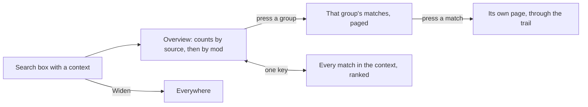

# Search: everything, overview first (design, 21 Nov 2026)

**Status (checked 24 Nov 2026):** designed, nothing built. Waits for the owner's word to build. When it is built, its design moves into
`design-record.md` and `later.md` keeps one line pointing there.

**The owner's request** (21 Nov 2026): "some sort of global, search functionality". They like the RimWorld mod Needle (ZIPender,
[Workshop](https://steamcommunity.com/sharedfiles/filedetails/?id=3834934844)), which searches inside every mod's settings and
lists every matching option, but miss a way to go "from element-based searching of literally everything with a letter or word in
it, to a more global-like search, or at least easily so". **Owner's choices (21 Nov 2026, by question card):**

- **Overview first, then drill in**: how many matches in each source and each mod, biggest first, then a group's elements.
- **In the Companion**, for every game, not as a mod in the game.
- **Every source in the first version**: everything Go to anything searches, mods' Defs as patched, the Explorer's snapshot, and logs
  and saves.
- **"The ability to switch contexts, so the player is not overloaded with literally everything"**: a search starts narrowed to a
  context, and widening it is one press.

## Read this first (gotchas)

- **Go to anything stays**, for jumping to one thing you can name (`/`). Search is for "where is this word, overall?". Go to
  anything gains one top row, **Everything about "…"**, which opens Search with the same words.
- **Overview first, never a wall of results.** A search shows counts by source and by mod before any single match; a group opens
  only when pressed.
- **Instant while typing**, so it reads indexes built ahead, as Needle reads settings once at load, never the raw files per key.
  Each index is rebuilt when what it was built from changes, and says how old it is.
- **Some sources belong to one game.** Defs, the save and the log come through the kit's game adapter (RimWorld first); a game whose
  tools lack one is told so in the source's row, in words.
- **The snapshot is searched only while one is held** (the Explorer, at most ten minutes), and by kind names and the descriptions
  already read, never by walking every object for every key pressed.
- **It only reads.**

## The four questions

| Question | Answer |
| --- | --- |
| What does it let the person do? | Type a word once and see where it lives across everything the Companion can read, grouped by source and by mod, then open one group, then one match, and jump to it on its own page |
| What does it stop them doing? | Searching page by page, and wading through every letter-match at once: a context keeps the first answer small, and the overview comes before the list |
| How does it change the way they work? | "Which mod adds this?", "where did that error come from?" and "what in my game mentions heat?" become one search instead of several pages and a terminal |
| What outside the program notices? | Nothing: it reads the kit's indexes. Building one reads files the tools already read |

## What the page shows

| Part | What it shows |
| --- | --- |
| **The box** | The words; **Whole words** or **Any letters** (a pressed toggle); filters borrowed from Needle where they fit: `mod:`, `kind:`, `in:` (a source), `id:` (a package ID), `def:` (a Def type) |
| **Context** | Chips: **This page**, **Play** (mods, Defs, saves, logs, the snapshot, settings), **Code** (code, changelogs, the Timeline, test rows), **Help** (the Guide, reports) and **Everywhere**. It starts on the part of the program you came from; **Widen to everywhere** is one press, and the overview says how many more matches lie outside the context |
| **Overview** | One row per source with its count, then within each source one row per mod or repository, biggest first; each row a button. Sources with nothing are listed as such, once, at the foot |
| **A group** | Its matches, best first (a name before a label before a description; whole words before parts of words), with the words shown in place, paged with the shared pager; each opens its own page |
| **Every match** | One key flips between the overview and one ranked list of every match in the context, for when the person knows it is in there somewhere |

### Sources

| Source | What is searched | From | Games |
| --- | --- | --- | --- |
| Go to anything's own | Pages, code, versions, changelog entries, test rows, timeline facts, settings, reports, the Guide, memory watches | What the window already reads | Every game |
| **Defs, as patched** | defName, label, description, the mod that defines or patches it | The kit's Def index and the patched-Defs file | RimWorld (the kit's `rimworld-defs`); others in words |
| **The save** | Things, pawns, factions, world objects by name and kind, in the newest save or the one chosen on Game files | The kit's save index | RimWorld; others in words |
| **The log** | Messages, grouped as triage groups them, with the mods it names | The kit's log index | RimWorld; others in words |
| **The snapshot** | Every kind's name (all of them, not only the 200 largest), and the descriptions already read this snapshot | The held Explorer snapshot: a new reader request listing every type that matches | Games whose tools can look inside (RimWorld) |
| Mod settings | Our mods' settings by label and description | The kit's `rimworld-settings` | RimWorld |

## How it is built

| Part | How |
| --- | --- |
| **The kit** | A game-free `search` command over named sources, answering counts by source and group, then a group's matches, in the kit's envelope. Each game adapter adds its sources (RimWorld: Defs, save, log, settings). One SQLite full-text index per source in the kit's cache (SQLite's FTS5, in Python's standard library), stamped with what it was built from and rebuilt when that changes, with progress lines while building |
| **The reader** | phobos-modkit's heap reader gains a request listing every type name that matches a word, for the snapshot source and for the Explorer's "find a kind by name" |
| **The host** | Checks the words (one line, a sane length), the context and the filters against fixed lists, and the chosen save against Game files' list, before the kit sees them; the snapshot source goes through the Explorer's held session |
| **The window** | A Search page, and the top row in Go to anything; the overview and lists with the shared pager; every press through the trail (focus keys `q`, `context`, `source`, `group`, listed in `cross-links.md` when built) |
| **Speed** | Asked a quarter of a second after the last key; the overview first, then the open group; a target of a fifth of a second per answer on the owner's mod list, to be measured |
| **The Guide** | The page, "Find everything about a word", and the words Context and Whole words, in the same change |

## Agent choices, owner to revise

**The owner's choices** (on the Decisions page): the page key is **S**, "for search", which became **Shift+S** once the page keys
were renumbered on 25 Nov 2026 and Settings took S (the owner's choice by card); a new search **starts in the part you came
from** (Play from the Mods or Logs page, Code from Changes), with everywhere one press away.

The name **Search**; Go to anything staying beside it; the context names and what each holds; starting in the context you came from;
ranking names before labels before descriptions; the page key (Decisions page); the flip key between overview and every match.

## Credit

The filters (`mod:`, `author:`, `id:`, `tab:`, `def:`) and building the index once ahead of time are Needle's ideas (ZIPender), as
its Workshop page describes them; no code of theirs is used or read.
